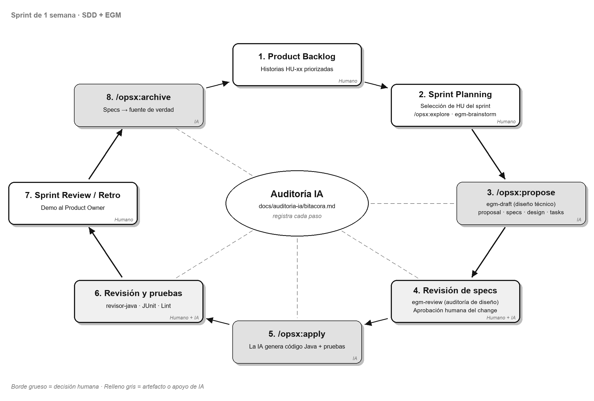
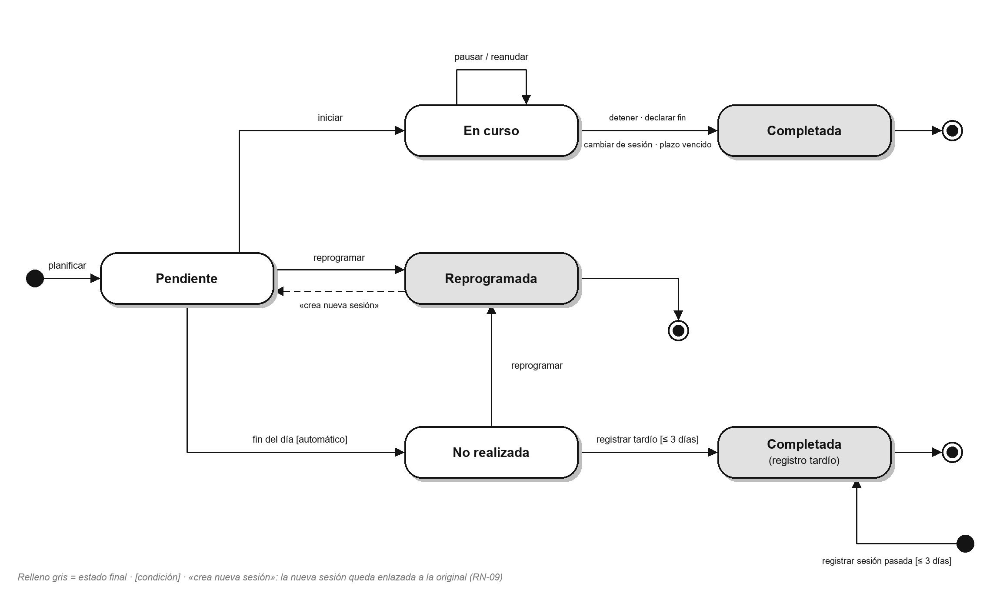

# Requisitos y Análisis del Sistema

## Metodología de Desarrollo Adoptada

Se adopta **Scrum** (Schwaber & Sutherland, 2020), adaptado a un equipo de un desarrollador asistido por IA, y combinado con **desarrollo guiado por especificaciones** mediante OpenSpec. Scrum aporta el marco de gestión (roles, eventos y artefactos); OpenSpec aporta la disciplina técnica que obliga a especificar y aprobar el comportamiento antes de que la IA genere código. Ambos son coherentes con los valores del Manifiesto Ágil (Beck et al., 2001).

### Roles

Tabla: Roles de Scrum adaptados al proyecto {#tabla3}

| Rol Scrum | Responsable | Responsabilidades en StudyPlan |
|---|---|---|
| Product Owner | Estudiante (con el docente como cliente académico) | Decide los requisitos y reglas de negocio, prioriza el Product Backlog y acepta o rechaza los incrementos |
| Scrum Master | Estudiante | Vela por el proceso, elimina impedimentos y mantiene la bitácora de IA |
| Developers | Estudiante + asistente de IA (Claude Code) | El estudiante decide, especifica y revisa; la IA pregunta, propone specs y genera código bajo supervisión |

### Eventos y artefactos

- **Sprints de una semana**, con *Sprint Planning* (selección de historias), revisión diaria del avance, *Sprint Review* (demostración del incremento) y *Retrospectiva*.
- **Product Backlog**: las historias de usuario HU-01 a HU-45 (sección 3.2.1), priorizadas con MoSCoW y estimadas en puntos de historia (serie de Fibonacci).
- **Sprint Backlog**: un *change* de OpenSpec por épica o grupo de historias, cuyo tasks.md contiene las tareas del sprint.
- **Incremento**: APK funcional que cumple la *Definition of Done*. El primer entregable funcional es la versión 0.1.0.

### Flujo Scrum + SDD

La @figura:figura1 muestra cómo se integra OpenSpec en cada sprint. La regla central es que **ningún código entra al repositorio sin una especificación aprobada por el humano**. Cada paso queda registrado en la bitácora de Auditoría IA.

{#figura1}

Nota: Los pasos con borde grueso son decisiones humanas y los rellenos en gris, pasos ejecutados por la IA. Elaboración propia.

### Definition of Done

Una historia de usuario se considera terminada cuando:

- Todos sus escenarios (criterios de aceptación) del spec de OpenSpec se cumplen y tienen una prueba asociada, y las reglas de negocio que cita (RN-xx) están probadas con JUnit.
- Compila sin errores (./gradlew assembleDebug), las pruebas pasan (./gradlew test) y Android Lint no reporta errores.
- Cumple los criterios de calidad (RNF) asignados a su épica y los transversales (sección 3.2.2).
- El código fue revisado por el estudiante (con apoyo del subagente revisor-java) y el estudiante puede explicarlo.
- La sesión de IA quedó registrada en la bitácora y el *change* fue archivado con openspec archive.

### Coherencia metodológica

Para evitar un error frecuente en proyectos académicos, la mezcla de métodos ágiles con métodos tradicionales, este proyecto usa **solo artefactos ágiles**. Los requisitos funcionales se expresan como historias de usuario con criterios de aceptación, **no** como casos de uso ni como especificación IEEE 830; las reglas de negocio se referencian desde los criterios de aceptación; y los no funcionales se expresan como criterios de calidad vinculados a la *Definition of Done*. Por coherencia, la sección 3.3.1 del índice del docente, que se titula *Casos de Uso*, se renombra **Historias de Usuario** en este documento.

## Requisitos

**Técnica de levantamiento.** Los requisitos se levantaron mediante una **entrevista estructurada** con el Product Owner (el estudiante), conducida por el asistente de IA en cinco rondas de preguntas cerradas con opción de respuesta libre. Las preguntas partieron del enunciado del docente, el mockup de referencia y la consigna *Modelado de requerimientos*. Una primera versión de los requisitos, redactada por la IA sin consultar, fue **rechazada** por el Product Owner (ver *Auditoría IA*). La @tabla:tabla4 resume las decisiones obtenidas.

Tabla: Decisiones del Product Owner obtenidas en la entrevista de levantamiento {#tabla4}

| Tema | Pregunta | Decisión del Product Owner | Requisitos derivados |
|---|---|---|---|
| Arquitectura | ¿Necesita servidor o internet? | Solo local y offline; copia de seguridad cifrada en Google; el usuario puede borrar su información | RNF-09, RNF-12, HU-35 a HU-38 |
| Usuarios | ¿Quiénes usan la app? | Es una app de autocontrol: solo el estudiante en la v0.1.0 | RN-01 |
| Metas | ¿Meta total o por materia? | Ambas, independientes entre sí | HU-25, HU-26, RN-14 |
| Alcance | ¿Qué funciones extra incluir? | Recordatorios, cronómetro, Pomodoro, No molestar, exportar, mensaje motivacional; todo en la v0.1.0 | HU-22 a HU-24, HU-28, HU-33, HU-34 |
| Respaldo | ¿Cómo respaldar? | Como WhatsApp: frecuencia Nunca, Diaria, Semanal, Mensual o Solo manual; contraseña opcional | HU-35, HU-36, RN-19, RN-20 |
| Sesiones | ¿Registrar fechas pasadas? | Sí, con límite de 3 días | HU-11, RN-06 |
| Sesiones | ¿Se permiten cruces de horario? | No, se bloquea | RN-05 |
| No molestar | ¿Cómo se activa? | Configuración global, que puede forzarse en cada sesión | HU-24, RN-18 |
| Borrado | ¿Qué se borra? | El usuario elige: teléfono, Drive o ambos | HU-38, RN-21 |
| Estados | ¿Qué pasa con una sesión vencida? | Pasa a No realizada; puede reprogramarse conservando el registro; máquina de estados donde cada estado solo conoce su acción y su siguiente estado; registro tardío como «Completada (registro tardío)» | RN-07 a RN-10, HU-13, HU-14 |
| Pomodoro | ¿Qué se configura? | Clásico configurable (25/5/15 cada 4) | HU-23, RN-17 |
| Calidad | ¿Qué exigencias de calidad? | Modo oscuro, bloqueo con huella/PIN, multiidioma, widget | HU-03 a HU-05, RNF-07, RNF-08 |
| Calendario | ¿Qué vistas? | Página clave según el docente: vistas de día, semana tipo horario y mes, estados, creación desde el calendario, resumen y filtro | HU-16 a HU-21 |
| Fin planificado | ¿Qué pasa si el cronómetro sigue después de la hora de fin? | Sigue y pregunta «¿Sigues estudiando?»; el resto es tiempo extra | HU-42, RN-25 |
| Duración | ¿Real distinta de la planificada? | Se registra lo real (39 min o 3 h 28 min), sin estados parciales | HU-22, RN-26 |
| Cruce real | ¿Si el tiempo extra invade otra sesión? | Avisar y decidir; poder seguir con la otra materia sin tocar el celular | HU-43, HU-44, RN-27, RN-28 |
| Pomodoro extra | ¿Y si quiero seguir tras el plan? | Ofrecer ciclos extra o tiempo extra libre | HU-23 |
| Eventos | ¿Qué pasa si salgo o cierro la app? | Registrar eventos con marcas de tiempo, sin un proceso contando; avisar para volver; al volver, el usuario decide hasta qué hora estudió (evento «estudio con la app cerrada») | HU-39 a HU-41, RN-22 a RN-24 |
| Métricas | ¿Qué medir con los eventos? | Concentración, puntualidad, respeto del tiempo, tiempo fuera de la app | HU-45, RN-30 |

Nota: Entrevista realizada el 4 de noviembre de 2026. El registro completo está en docs/auditoria-ia/bitacora.md.

Además de las respuestas cerradas, el Product Owner narró **escenarios reales de estudio**. Cada escenario se transformó en historias de usuario y en criterios de aceptación verificables (@tabla:tabla5). Esta técnica, partir de situaciones concretas del usuario, es la que mejor reveló las reglas del dominio que la IA no había previsto.

Tabla: Escenarios narrados por el Product Owner y requisitos derivados {#tabla5}

| Escenario narrado (resumen) | Historias y criterios derivados | Reglas |
|---|---|---|
| «Una sesión que no estudié no puede desaparecer: hay que dejar registro de que ese día no estudié, aunque la reprograme.» | HU-13 (No realizada automática), HU-14 (reprogramar conservando el registro) | RN-08, RN-09 |
| «Si registro tarde lo que estudié, que diga completada con registro tardío.» | HU-11, HU-13 (escenario Registro tardío) | RN-06, RN-10 |
| «Me inspiré: tenía 1 hora planificada y estudié 39 min, o 3 h 28 min.» | HU-22 (escenario Duración distinta), HU-42 (tiempo extra) | RN-25, RN-26 |
| «Inicié la sesión, me concentré tanto que olvidé el celular y seguí estudiando.» | HU-41 (declarar estudio con la app cerrada), HU-42 | RN-24, RN-29 |
| «Me llamaron a las 8:45, salí de la app, cerré la app por completo y volví a las 11:00, a las 17:00 o al día siguiente; estuve estudiando en grupo.» | HU-22 (escenario App cerrada por completo), HU-40 (aviso al salir), HU-41 (escenarios Volver más tarde y Al día siguiente) | RN-22, RN-23, RN-24, RN-29 |
| «Sabía que tenía 1 h de Matemáticas y 1 h de Inglés; terminé Matemáticas y seguí con Inglés sin tocar el celular.» | HU-43 (cambiar de sesión), HU-44 (repartir el tramo continuo) | RN-27, RN-28 |
| «Hay que medir qué tan concentrado estoy y qué tanto respeto el tiempo de estudio.» | HU-39 (eventos de estudio), HU-45 (métricas) | RN-30 |
| «El calendario de estudio es una página muy importante, la mencionó el docente.» | HU-16 a HU-21 (vistas de día, semana y mes, estados, creación, filtro y resumen) | RN-13 |

Nota: Las frases son paráfrasis fieles de los mensajes del Product Owner durante la sesión del 4 de noviembre de 2026.

El rol de usuario es único: el **estudiante**, persona que cursa materias y desea planificar y controlar sus horas de estudio. Los requisitos se organizan en diez épicas (@tabla:tabla6) y se mantienen en una fuente única (docs/build/requisitos.py) desde la cual se generan las especificaciones de OpenSpec y las tablas de este documento. Así el documento y el contrato que usa la IA no pueden contradecirse.

Tabla: Épicas del producto y su especificación en OpenSpec {#tabla6}

| Épica | Nombre | Historias | Especificación (OpenSpec) |
|---|---|---|---|
| E1 | Perfil, inicio y ajustes | HU-01, HU-02, HU-03, HU-04, HU-05 | specs/perfil-ajustes/spec.md |
| E2 | Gestión de materias | HU-06, HU-07, HU-08, HU-09 | specs/gestion-materias/spec.md |
| E3 | Sesiones de estudio | HU-10, HU-11, HU-12, HU-13, HU-14, HU-15 | specs/sesiones-estudio/spec.md |
| E4 | Calendario de estudio | HU-16, HU-17, HU-18, HU-19, HU-20, HU-21 | specs/calendario-estudio/spec.md |
| E5 | Técnicas y eventos de estudio | HU-22, HU-23, HU-24, HU-39, HU-40, HU-41, HU-42, HU-43, HU-44 | specs/tecnicas-estudio/spec.md |
| E6 | Metas semanales | HU-25, HU-26, HU-27, HU-28 | specs/metas-semanales/spec.md |
| E7 | Estadísticas | HU-29, HU-30, HU-31, HU-45 | specs/estadisticas/spec.md |
| E8 | Reportes | HU-32, HU-33 | specs/reportes/spec.md |
| E9 | Recordatorios | HU-34 | specs/recordatorios/spec.md |
| E10 | Respaldo y privacidad | HU-35, HU-36, HU-37, HU-38 | specs/respaldo-privacidad/spec.md |

Nota: Las rutas son relativas a openspec/changes/add-requisitos-base/.

### Requisitos Funcionales

Los requisitos funcionales se expresan como historias de usuario. La @tabla:tabla7 presenta el *Product Backlog* completo y las tablas siguientes detallan cada historia con sus criterios de aceptación; cada criterio corresponde a un *Scenario* verificable del spec de OpenSpec. Al final de esta sección se presentan las reglas de negocio (@tabla:tabla18) y la máquina de estados de la sesión de estudio (@figura:figura2 y @tabla:tabla19), que los criterios de aceptación referencian como RN-xx.

Tabla: Product Backlog de StudyPlan v0.1.0 {#tabla7}

| ID | Épica | Historia de usuario | Prioridad | Pts. |
|---|---|---|---|---|
| HU-01 | E1 | Configurar perfil inicial | Must | 2 |
| HU-02 | E1 | Ver resumen en la pantalla de inicio | Must | 5 |
| HU-03 | E1 | Configurar tema e idioma | Should | 3 |
| HU-04 | E1 | Bloquear la app con huella o PIN | Should | 3 |
| HU-05 | E1 | Ver progreso en un widget | Could | 5 |
| HU-06 | E2 | Registrar materia | Must | 3 |
| HU-07 | E2 | Editar materia | Must | 2 |
| HU-08 | E2 | Archivar o eliminar materia | Should | 3 |
| HU-09 | E2 | Listar materias con horas acumuladas | Must | 2 |
| HU-10 | E3 | Planificar sesión de estudio | Must | 5 |
| HU-11 | E3 | Registrar sesión pasada (registro tardío) | Must | 3 |
| HU-12 | E3 | Completar una sesión | Must | 3 |
| HU-13 | E3 | Marcar automáticamente sesiones no realizadas | Must | 3 |
| HU-14 | E3 | Reprogramar sesión conservando el registro | Must | 5 |
| HU-15 | E3 | Eliminar sesión planificada | Should | 2 |
| HU-16 | E4 | Ver calendario mensual | Must | 5 |
| HU-17 | E4 | Ver calendario semanal tipo horario | Must | 8 |
| HU-18 | E4 | Ver calendario diario | Must | 3 |
| HU-19 | E4 | Ver el estado de las sesiones en el calendario | Must | 3 |
| HU-20 | E4 | Crear sesión desde el calendario | Should | 3 |
| HU-21 | E4 | Filtrar y resumir el calendario | Should | 3 |
| HU-22 | E5 | Cronometrar sesión en curso | Must | 5 |
| HU-23 | E5 | Estudiar con técnica Pomodoro configurable | Must | 5 |
| HU-24 | E5 | Activar modo No molestar durante la sesión | Should | 3 |
| HU-39 | E5 | Registrar eventos de estudio | Must | 5 |
| HU-40 | E5 | Recibir aviso al salir de la app durante una sesión | Should | 3 |
| HU-41 | E5 | Declarar estudio con la app cerrada | Must | 5 |
| HU-42 | E5 | Continuar con tiempo extra al llegar al fin planificado | Must | 3 |
| HU-43 | E5 | Decidir al llegar la hora de otra sesión | Should | 3 |
| HU-44 | E5 | Repartir un tramo continuo entre sesiones | Should | 5 |
| HU-25 | E6 | Definir meta semanal total | Must | 3 |
| HU-26 | E6 | Definir meta semanal por materia | Must | 3 |
| HU-27 | E6 | Ver progreso de metas | Must | 3 |
| HU-28 | E6 | Recibir mensaje motivacional | Could | 2 |
| HU-29 | E7 | Ver total de horas y comparación semanal | Must | 3 |
| HU-30 | E7 | Ver distribución de horas por materia | Must | 5 |
| HU-31 | E7 | Ver tasa de cumplimiento | Should | 3 |
| HU-45 | E7 | Ver métricas de concentración y respeto del tiempo | Should | 5 |
| HU-32 | E8 | Generar reporte de un periodo | Should | 5 |
| HU-33 | E8 | Exportar y compartir reporte | Should | 5 |
| HU-34 | E9 | Recibir recordatorio de sesión | Must | 3 |
| HU-35 | E10 | Configurar copia de seguridad en Google Drive | Must | 8 |
| HU-36 | E10 | Cifrar el respaldo con contraseña opcional | Should | 5 |
| HU-37 | E10 | Restaurar copia de seguridad | Must | 5 |
| HU-38 | E10 | Borrar mi información | Must | 3 |

Nota: Prioridad MoSCoW: Must = imprescindible; Should = importante; Could = deseable. Estimación en puntos de historia (Fibonacci). Total: 45 historias, 172 puntos (111 puntos Must). Por decisión del Product Owner, todas forman parte de la versión 0.1.0; la prioridad ordena los sprints.

Tabla: Historias de usuario de la épica E1: Perfil, inicio y ajustes {#tabla8}

| HU-01 | Configurar perfil inicial |
|---|---|
| **Historia** | Como estudiante, quiero registrar mi nombre y mi meta semanal predeterminada la primera vez que abro la app para recibir una experiencia personalizada sin crear una cuenta. |
| **Prioridad / Est.** | Must · 2 puntos |
| **Criterios de aceptación** | 1. **Primer uso.** *Dado* que la aplicación se abre por primera vez, *cuando* el estudiante ingresa su nombre y una meta semanal válida y confirma, *entonces* el sistema guarda el perfil en el teléfono y muestra la pantalla de inicio con el saludo «¡Hola, <nombre>!». 2. **Nombre vacío.** *Dado* que el formulario de perfil está abierto, *cuando* el estudiante intenta confirmar sin nombre, *entonces* el sistema muestra «Ingresa tu nombre» y no guarda el perfil. |
| **HU-02** | **Ver resumen en la pantalla de inicio** |
| **Historia** | Como estudiante, quiero ver mi avance de la meta semanal, mi próxima sesión y las sesiones de hoy para saber en segundos qué me toca estudiar y cómo voy. |
| **Prioridad / Est.** | Must · 5 puntos |
| **Criterios de aceptación** | 1. **Resumen con datos.** *Dado* que existen una meta y sesiones planificadas, *cuando* el estudiante abre la pantalla de inicio, *entonces* el sistema muestra las horas realizadas sobre la meta con una barra de progreso, la próxima sesión Pendiente y las sesiones de hoy con su estado. 2. **Acceso rápido.** *Dado* que el estudiante está en la pantalla de inicio, *cuando* pulsa «Nueva sesión», *entonces* el sistema abre el registro de sesión con la fecha de hoy preseleccionada. |
| **HU-03** | **Configurar tema e idioma** |
| **Historia** | Como estudiante, quiero elegir tema claro, oscuro o del sistema e idioma español o inglés para usar la app con comodidad visual y en mi idioma. |
| **Prioridad / Est.** | Should · 3 puntos |
| **Criterios de aceptación** | 1. **Tema.** *Dado* que el estudiante está en Ajustes, *cuando* elige el tema oscuro, *entonces* toda la aplicación se muestra con el tema oscuro y la elección se conserva al reiniciar. 2. **Idioma.** *Dado* que el estudiante está en Ajustes, *cuando* elige inglés, *entonces* todos los textos de la aplicación se muestran en inglés. |
| **HU-04** | **Bloquear la app con huella o PIN** |
| **Historia** | Como estudiante, quiero proteger el acceso a la aplicación con mi huella o el PIN del teléfono para que nadie más vea mis datos de estudio. |
| **Prioridad / Est.** | Should · 3 puntos |
| **Criterios de aceptación** | 1. **Activar bloqueo.** *Dado* que el teléfono tiene huella o PIN configurado, *cuando* el estudiante activa el bloqueo en Ajustes, *entonces* cada vez que la app vuelve a primer plano solicita autenticarse antes de mostrar datos. 2. **Sin método de bloqueo.** *Dado* que el teléfono no tiene huella ni PIN, *cuando* el estudiante intenta activar el bloqueo, *entonces* el sistema explica que debe configurar un bloqueo de pantalla y no activa la opción. |
| **HU-05** | **Ver progreso en un widget** |
| **Historia** | Como estudiante, quiero agregar un widget en la pantalla de inicio del teléfono con mi progreso semanal y la próxima sesión para ver mi avance sin abrir la aplicación. |
| **Prioridad / Est.** | Could · 5 puntos |
| **Criterios de aceptación** | 1. **Widget.** *Dado* que el estudiante agregó el widget de StudyPlan, *cuando* completa una sesión, *entonces* el widget actualiza las horas realizadas sobre la meta. 2. **Abrir desde el widget.** *Dado* que el widget está visible, *cuando* el estudiante lo toca, *entonces* se abre la pantalla de inicio de la aplicación. |
| **Criterios de calidad** | RNF-01, RNF-07, RNF-08, RNF-12, RNF-09, RNF-16, RNF-17 (ver @tabla:tabla21) |
| **Spec OpenSpec** | openspec/changes/add-requisitos-base/specs/perfil-ajustes/spec.md |

Tabla: Historias de usuario de la épica E2: Gestión de materias {#tabla9}

| HU-06 | Registrar materia |
|---|---|
| **Historia** | Como estudiante, quiero registrar una materia con su nombre, un color y, opcionalmente, el docente para organizar mis sesiones de estudio por asignatura. |
| **Prioridad / Est.** | Must · 3 puntos |
| **Criterios de aceptación** | 1. **Registro válido.** *Dado* que el estudiante está en el formulario de nueva materia, *cuando* ingresa un nombre válido, elige un color y guarda, *entonces* el sistema crea la materia y la muestra en la lista. 2. **Nombre duplicado.** *Dado* que ya existe una materia activa «Matemáticas», *cuando* el estudiante registra «matemáticas», *entonces* el sistema rechaza el registro con «Ya existe una materia con ese nombre» (RN-02). |
| **HU-07** | **Editar materia** |
| **Historia** | Como estudiante, quiero modificar el nombre, el color o el docente de una materia para corregir errores o reflejar cambios del semestre. |
| **Prioridad / Est.** | Must · 2 puntos |
| **Criterios de aceptación** | 1. **Edición.** *Dado* que existe una materia con sesiones, *cuando* el estudiante cambia su nombre y color, *entonces* las sesiones siguen asociadas a la materia y el calendario muestra el nuevo color. |
| **HU-08** | **Archivar o eliminar materia** |
| **Historia** | Como estudiante, quiero archivar una materia terminada o eliminar una registrada por error para mantener limpia mi lista sin perder mi historial. |
| **Prioridad / Est.** | Should · 3 puntos |
| **Criterios de aceptación** | 1. **Archivar.** *Dado* que la materia tiene sesiones, *cuando* el estudiante elige «Archivar», *entonces* la materia deja de aparecer en las listas de selección y sus sesiones se conservan en reportes y estadísticas. 2. **Eliminar protegida.** *Dado* que la materia tiene sesiones, *cuando* el estudiante intenta eliminarla, *entonces* el sistema no lo permite y sugiere archivarla (RN-03). 3. **Eliminar sin historial.** *Dado* que la materia no tiene sesiones, *cuando* el estudiante la elimina y confirma, *entonces* el sistema la elimina definitivamente. |
| **HU-09** | **Listar materias con horas acumuladas** |
| **Historia** | Como estudiante, quiero ver mis materias activas con las horas estudiadas en cada una para detectar a qué asignaturas les dedico poco tiempo. |
| **Prioridad / Est.** | Must · 2 puntos |
| **Criterios de aceptación** | 1. **Lista.** *Dado* que existen materias activas, *cuando* el estudiante abre Materias, *entonces* el sistema muestra cada materia con su color, nombre y horas realizadas, en orden alfabético. 2. **Lista vacía.** *Dado* que no existen materias, *cuando* el estudiante abre Materias, *entonces* el sistema invita a registrar la primera materia. |
| **Criterios de calidad** | RNF-06, RNF-14, RNF-09, RNF-16, RNF-17 (ver @tabla:tabla21) |
| **Spec OpenSpec** | openspec/changes/add-requisitos-base/specs/gestion-materias/spec.md |

Tabla: Historias de usuario de la épica E3: Sesiones de estudio {#tabla10}

| HU-10 | Planificar sesión de estudio |
|---|---|
| **Historia** | Como estudiante, quiero registrar una sesión con materia, fecha, hora de inicio, hora de fin y notas opcionales para planificar cuándo voy a estudiar cada asignatura. |
| **Prioridad / Est.** | Must · 5 puntos |
| **Criterios de aceptación** | 1. **Registro válido.** *Dado* que existe una materia activa, *cuando* el estudiante registra una sesión de hoy o futura de 10:00 a 11:30, *entonces* el sistema la crea en estado Pendiente con 90 minutos planificados. 2. **Horario inválido.** *Dado* que el formulario está abierto, *cuando* la hora de fin es igual o anterior a la de inicio, *entonces* el sistema muestra «La hora de fin debe ser posterior a la de inicio» y no guarda (RN-04). 3. **Cruce bloqueado.** *Dado* que existe una sesión de 10:00 a 11:30 ese día, *cuando* el estudiante registra otra de 11:00 a 12:00 el mismo día, *entonces* el sistema bloquea el registro e indica con qué sesión se cruza (RN-05). |
| **HU-11** | **Registrar sesión pasada (registro tardío)** |
| **Historia** | Como estudiante, quiero registrar una sesión que ya estudié en los últimos 3 días para no perder horas reales si olvidé anotarlas. |
| **Prioridad / Est.** | Must · 3 puntos |
| **Criterios de aceptación** | 1. **Dentro del límite.** *Dado* que hoy es jueves, *cuando* el estudiante registra una sesión del lunes de la misma semana, *entonces* el sistema la guarda en estado «Completada (registro tardío)» y suma sus horas (RN-06). 2. **Fuera del límite.** *Dado* que hoy es jueves, *cuando* el estudiante intenta registrar una sesión de hace 4 días o más, *entonces* el sistema rechaza la fecha e informa el límite de 3 días. |
| **HU-12** | **Completar una sesión** |
| **Historia** | Como estudiante, quiero marcar como completada una sesión Pendiente del día para llevar el control real de lo que estudié. |
| **Prioridad / Est.** | Must · 3 puntos |
| **Criterios de aceptación** | 1. **Completar.** *Dado* que existe una sesión Pendiente de hoy, *cuando* el estudiante la marca como completada, *entonces* el sistema la pasa a Completada, registra la duración real (editable) y la suma al progreso semanal. 2. **Transición inválida.** *Dado* que una sesión está Reprogramada, *cuando* el estudiante intenta completarla, *entonces* el sistema no muestra esa acción, porque el estado no la permite (RN-07). |
| **HU-13** | **Marcar automáticamente sesiones no realizadas** |
| **Historia** | Como estudiante, quiero que las sesiones que no cumplí queden registradas como No realizadas para tener un historial honesto de mi cumplimiento. |
| **Prioridad / Est.** | Must · 3 puntos |
| **Criterios de aceptación** | 1. **Fin del día.** *Dado* que una sesión de hoy sigue Pendiente, *cuando* termina el día, *entonces* el sistema la pasa a «No realizada» sin intervención del usuario (RN-08). 2. **Registro tardío.** *Dado* que una sesión de hace 2 días está No realizada, *cuando* el estudiante elige «Registrar tardío» e indica la duración, *entonces* la sesión pasa a «Completada (registro tardío)» y suma horas (RN-10). 3. **Fuera de plazo.** *Dado* que una sesión de hace 5 días está No realizada, *cuando* el estudiante la consulta, *entonces* el sistema ya no ofrece el registro tardío, solo reprogramar. |
| **HU-14** | **Reprogramar sesión conservando el registro** |
| **Historia** | Como estudiante, quiero reprogramar una sesión Pendiente o No realizada a otra fecha y hora para recuperar el estudio perdido sin borrar el registro de que no estudié ese día. |
| **Prioridad / Est.** | Must · 5 puntos |
| **Criterios de aceptación** | 1. **Reprogramar.** *Dado* que existe una sesión No realizada del martes, *cuando* el estudiante la reprograma al jueves de 16:00 a 17:00, *entonces* la sesión del martes pasa a «Reprogramada» y se crea una nueva sesión Pendiente el jueves enlazada a la original (RN-09). 2. **Historial visible.** *Dado* que una sesión fue reprogramada, *cuando* el estudiante abre la sesión original, *entonces* el sistema muestra su estado Reprogramada y un enlace a la nueva sesión. 3. **Cruce.** *Dado* que el nuevo horario se cruza con otra sesión, *cuando* el estudiante confirma la reprogramación, *entonces* el sistema la bloquea (RN-05). |
| **HU-15** | **Eliminar sesión planificada** |
| **Historia** | Como estudiante, quiero eliminar una sesión Pendiente que ya no voy a hacer para mantener mi plan limpio. |
| **Prioridad / Est.** | Should · 2 puntos |
| **Criterios de aceptación** | 1. **Eliminar Pendiente.** *Dado* que existe una sesión Pendiente, *cuando* el estudiante la elimina y confirma, *entonces* el sistema la borra y recalcula los resúmenes. 2. **Historial protegido.** *Dado* que una sesión está Completada, No realizada o Reprogramada, *cuando* el estudiante busca la opción de eliminar, *entonces* el sistema no la ofrece (RN-12). |
| **Criterios de calidad** | RNF-02, RNF-04, RNF-14, RNF-15, RNF-09, RNF-16, RNF-17 (ver @tabla:tabla21) |
| **Spec OpenSpec** | openspec/changes/add-requisitos-base/specs/sesiones-estudio/spec.md |

Tabla: Historias de usuario de la épica E4: Calendario de estudio {#tabla11}

| HU-16 | Ver calendario mensual |
|---|---|
| **Historia** | Como estudiante, quiero ver un calendario del mes con los días que tienen sesiones para visualizar mi carga de estudio del mes. |
| **Prioridad / Est.** | Must · 5 puntos |
| **Criterios de aceptación** | 1. **Vista mensual.** *Dado* que hay sesiones en el mes, *cuando* el estudiante abre Calendario en vista Mes, *entonces* el sistema resalta hoy y marca cada día con sesiones usando el color de sus materias. 2. **Seleccionar día.** *Dado* que la vista Mes está abierta, *cuando* el estudiante toca un día, *entonces* el sistema lista debajo las sesiones de ese día con materia, horario y estado. 3. **Navegar.** *Dado* que la vista Mes está abierta, *cuando* el estudiante desliza o pulsa las flechas, *entonces* el sistema muestra el mes anterior o siguiente. |
| **HU-17** | **Ver calendario semanal tipo horario** |
| **Historia** | Como estudiante, quiero ver la semana de lunes a domingo como un horario por horas con bloques de sesiones para organizar mi estudio igual que mi horario de clases. |
| **Prioridad / Est.** | Must · 8 puntos |
| **Criterios de aceptación** | 1. **Vista semanal.** *Dado* que hay sesiones en la semana, *cuando* el estudiante elige la vista Semana, *entonces* el sistema muestra 7 columnas (L–D) con franjas horarias y cada sesión como un bloque del color de su materia, de alto proporcional a su duración. 2. **Navegar semanas.** *Dado* que la vista Semana está abierta, *cuando* el estudiante desliza a la izquierda, *entonces* el sistema muestra la semana siguiente. |
| **HU-18** | **Ver calendario diario** |
| **Historia** | Como estudiante, quiero ver un día con sus horas y las sesiones en línea de tiempo para enfocarme en lo que tengo que hacer hoy. |
| **Prioridad / Est.** | Must · 3 puntos |
| **Criterios de aceptación** | 1. **Vista día.** *Dado* que hoy hay sesiones, *cuando* el estudiante elige la vista Día, *entonces* el sistema muestra las horas del día y las sesiones como bloques con materia, horario y estado, y una línea en la hora actual. |
| **HU-19** | **Ver el estado de las sesiones en el calendario** |
| **Historia** | Como estudiante, quiero distinguir en el calendario las sesiones completadas, pendientes, no realizadas y reprogramadas para ver de un vistazo mi cumplimiento. |
| **Prioridad / Est.** | Must · 3 puntos |
| **Criterios de aceptación** | 1. **Indicadores.** *Dado* que hay sesiones en distintos estados, *cuando* el estudiante ve cualquier vista del calendario, *entonces* cada sesión muestra un ícono y una etiqueta propios de su estado, sin depender solo del color. 2. **Leyenda.** *Dado* que el estudiante no reconoce un ícono, *cuando* abre la leyenda del calendario, *entonces* el sistema explica cada ícono de estado. |
| **HU-20** | **Crear sesión desde el calendario** |
| **Historia** | Como estudiante, quiero tocar un día u hora libre del calendario para crear una sesión para planificar directamente sobre mi agenda. |
| **Prioridad / Est.** | Should · 3 puntos |
| **Criterios de aceptación** | 1. **Hora libre.** *Dado* que la vista Semana o Día está abierta, *cuando* el estudiante toca una franja libre a las 15:00 del viernes, *entonces* el sistema abre «Nueva sesión» con fecha viernes e inicio 15:00 precargados. 2. **Día en la vista Mes.** *Dado* que la vista Mes está abierta, *cuando* el estudiante mantiene pulsado un día, *entonces* el sistema abre «Nueva sesión» con esa fecha. |
| **HU-21** | **Filtrar y resumir el calendario** |
| **Historia** | Como estudiante, quiero filtrar el calendario por materia y ver el total de horas planificadas y realizadas para analizar mi dedicación a una materia en el tiempo. |
| **Prioridad / Est.** | Should · 3 puntos |
| **Criterios de aceptación** | 1. **Filtro.** *Dado* que hay sesiones de varias materias, *cuando* el estudiante filtra por «Matemáticas», *entonces* todas las vistas muestran solo las sesiones de esa materia hasta quitar el filtro. 2. **Resumen.** *Dado* que una vista está abierta, *cuando* el estudiante consulta la cabecera, *entonces* el sistema muestra las horas planificadas y realizadas del día, la semana o el mes visible. |
| **Criterios de calidad** | RNF-02, RNF-04, RNF-06, RNF-19, RNF-09, RNF-16, RNF-17 (ver @tabla:tabla21) |
| **Spec OpenSpec** | openspec/changes/add-requisitos-base/specs/calendario-estudio/spec.md |

Tabla: Historias de usuario de la épica E5: Técnicas y eventos de estudio {#tabla12}

| HU-22 | Cronometrar sesión en curso |
|---|---|
| **Historia** | Como estudiante, quiero iniciar, pausar y detener la sesión y ver el tiempo transcurrido mientras estoy en la app para registrar el tiempo real estudiado. |
| **Prioridad / Est.** | Must · 5 puntos |
| **Criterios de aceptación** | 1. **Cronometrar.** *Dado* que existe una sesión Pendiente de hoy, *cuando* el estudiante pulsa Iniciar y, tras 45 minutos efectivos, Detener, *entonces* la sesión pasa por En curso a Completada con 45 minutos reales. 2. **App cerrada por completo.** *Dado* que la sesión está En curso, *cuando* el estudiante cierra la app desde recientes y la abre 20 minutos después, *entonces* la sesión sigue En curso y el tiempo se calcula desde las marcas de tiempo guardadas (RN-22). 3. **Duración distinta a la planificada.** *Dado* que la sesión se planificó para 60 minutos, *cuando* el estudiante la detiene a los 39 minutos (o a las 3 h 28 min), *entonces* se registra la duración real y la diferencia se muestra en el reporte (RN-26). |
| **HU-23** | **Estudiar con técnica Pomodoro configurable** |
| **Historia** | Como estudiante, quiero ejecutar mi sesión en bloques Pomodoro con tiempos configurables para mantener la concentración con descansos programados. |
| **Prioridad / Est.** | Must · 5 puntos |
| **Criterios de aceptación** | 1. **Ciclo.** *Dado* que la configuración es 25/5/15 cada 4, *cuando* el estudiante inicia la sesión en modo Pomodoro, *entonces* el sistema alterna trabajo y descansos con aviso sonoro o vibración en cada cambio. 2. **Solo trabajo suma.** *Dado* que se completaron 4 pomodoros, *cuando* el estudiante detiene la sesión, *entonces* se registran 100 minutos reales, sin contar descansos (RN-11). 3. **Configurar.** *Dado* que el estudiante está en Ajustes > Pomodoro, *cuando* cambia el trabajo a 50 minutos, *entonces* las siguientes sesiones usan 50 minutos (RN-17). 4. **Seguir tras el plan.** *Dado* que se completaron los pomodoros que caben en el tiempo planificado, *cuando* el estudiante quiere seguir, *entonces* el sistema ofrece «+1 pomodoro» o «tiempo extra libre» y lo registra como tiempo extra (RN-25). |
| **HU-24** | **Activar modo No molestar durante la sesión** |
| **Historia** | Como estudiante, quiero que el teléfono silencie notificaciones mientras estudio para evitar distracciones. |
| **Prioridad / Est.** | Should · 3 puntos |
| **Criterios de aceptación** | 1. **Global.** *Dado* que No molestar está activado en Ajustes y la app tiene el permiso, *cuando* el estudiante inicia una sesión, *entonces* el sistema activa No molestar y lo restaura al pausar o terminar (RN-18). 2. **Forzar por sesión.** *Dado* que No molestar está desactivado globalmente, *cuando* el estudiante lo activa en la pantalla de la sesión antes de iniciar, *entonces* solo esa sesión usa No molestar. 3. **Sin permiso.** *Dado* que la app no tiene acceso a No molestar, *cuando* el estudiante activa la opción, *entonces* el sistema explica el permiso y abre la configuración del sistema para concederlo. |
| **HU-39** | **Registrar eventos de estudio** |
| **Historia** | Como estudiante, quiero que la app registre los eventos de mi sesión (inicio, pausas, salidas y regresos, tiempo extra, cambios, fin) para saber qué tan concentrado estuve y cuánto respeté mi tiempo de estudio. |
| **Prioridad / Est.** | Must · 5 puntos |
| **Criterios de aceptación** | 1. **Línea de tiempo.** *Dado* que una sesión terminó, *cuando* el estudiante abre su detalle, *entonces* el sistema muestra la línea de tiempo de eventos con su hora y tipo. 2. **Persistencia.** *Dado* que se registra un evento, *cuando* el sistema operativo termina la app justo después, *entonces* el evento permanece guardado (RN-22). |
| **HU-40** | **Recibir aviso al salir de la app durante una sesión** |
| **Historia** | Como estudiante, quiero recibir una notificación para volver cuando salgo de la app con una sesión en curso para no perder el hilo ni olvidar la sesión abierta. |
| **Prioridad / Est.** | Should · 3 puntos |
| **Criterios de aceptación** | 1. **Salida.** *Dado* que hay una sesión En curso, *cuando* el estudiante sale de la app para atender una llamada, *entonces* se registra el evento «salida», la sesión NO se pausa y aparece la notificación «Tu sesión sigue en curso — volver» (RN-23). 2. **Regreso.** *Dado* que el estudiante salió de la app, *cuando* toca la notificación o abre la app, *entonces* se registra el evento «regreso». |
| **HU-41** | **Declarar estudio con la app cerrada** |
| **Historia** | Como estudiante, quiero indicar al volver si seguí estudiando después de salir de la app y hasta qué hora para registrar mi estudio real aunque haya olvidado el celular o estudiado en grupo. |
| **Prioridad / Est.** | Must · 5 puntos |
| **Criterios de aceptación** | 1. **Volver más tarde.** *Dado* que salió de la app a las 8:45 con la sesión En curso y vuelve a las 17:00, *cuando* la app pregunta «Saliste a las 8:45, ¿seguiste estudiando?» y el estudiante indica «Sí, hasta las 11:00» con la nota «en grupo», *entonces* se registra el tramo 8:45–11:00 como «estudio con la app cerrada» y la sesión pasa a Completada (RN-24). 2. **No siguió.** *Dado* que aparece la pregunta al volver, *cuando* el estudiante responde «No, terminé al salir», *entonces* la sesión se completa con la hora de salida como fin. 3. **Sigue estudiando.** *Dado* que aparece la pregunta al volver, *cuando* el estudiante responde «Sigo estudiando», *entonces* el tramo fuera de la app se registra como estudio con la app cerrada y la sesión continúa En curso. 4. **Al día siguiente.** *Dado* que la sesión quedó En curso desde ayer, *cuando* el estudiante abre la app, *entonces* se hace la misma pregunta y la sesión no se marcó No realizada (RN-29). |
| **HU-42** | **Continuar con tiempo extra al llegar al fin planificado** |
| **Historia** | Como estudiante, quiero que al llegar la hora de fin la app me pregunte si sigo estudiando para aprovechar mi inspiración sin perder el registro. |
| **Prioridad / Est.** | Must · 3 puntos |
| **Criterios de aceptación** | 1. **Pregunta.** *Dado* que la sesión planificada termina a las 11:00 y sigue En curso, *cuando* llegan las 11:00, *entonces* aparece la notificación «¿Sigues estudiando?» con [Sigo] y [Terminé] (RN-25). 2. **Sin respuesta.** *Dado* que el estudiante no responde, *cuando* pasa el tiempo, *entonces* la sesión sigue En curso y el tiempo posterior se marca como tiempo extra. |
| **HU-43** | **Decidir al llegar la hora de otra sesión** |
| **Historia** | Como estudiante, quiero que, si sigo estudiando cuando empieza mi siguiente sesión, la app me avise y me deje seguir o cambiar para pasar de una materia a otra sin cortar mi concentración. |
| **Prioridad / Est.** | Should · 3 puntos |
| **Criterios de aceptación** | 1. **Cambiar.** *Dado* que Matemáticas está En curso y a las 12:00 empieza Inglés, *cuando* el estudiante elige «Cambiar a Inglés», *entonces* Matemáticas pasa a Completada a las 12:00 e Inglés pasa a En curso sin detener el tiempo (RN-27). 2. **Seguir.** *Dado* que aparece el aviso, *cuando* el estudiante elige «Seguir con Matemáticas», *entonces* Inglés queda Pendiente y sigue su ciclo normal. |
| **HU-44** | **Repartir un tramo continuo entre sesiones** |
| **Historia** | Como estudiante, quiero repartir al detener el tiempo estudiado entre la sesión actual y las siguientes del día para reflejar que terminé una materia y seguí con otra sin tocar el celular. |
| **Prioridad / Est.** | Should · 5 puntos |
| **Criterios de aceptación** | 1. **Repartir.** *Dado* que Matemáticas (10:00–11:00) estuvo En curso hasta las 12:10 e Inglés estaba planificada de 11:00 a 12:00, *cuando* el estudiante detiene y elige «Repartir»: Matemáticas hasta las 11:05 e Inglés el resto, *entonces* Matemáticas queda Completada con 65 min e Inglés Completada con 65 min (RN-28). 2. **Sin sesiones siguientes.** *Dado* que no hay sesiones Pendientes consecutivas, *cuando* el estudiante detiene, *entonces* no se ofrece repartir. |
| **Criterios de calidad** | RNF-03, RNF-10, RNF-18, RNF-09, RNF-16, RNF-17 (ver @tabla:tabla21) |
| **Spec OpenSpec** | openspec/changes/add-requisitos-base/specs/tecnicas-estudio/spec.md |

Tabla: Historias de usuario de la épica E6: Metas semanales {#tabla13}

| HU-25 | Definir meta semanal total |
|---|---|
| **Historia** | Como estudiante, quiero fijar cuántas horas en total quiero estudiar en la semana para tener un objetivo concreto y medible. |
| **Prioridad / Est.** | Must · 3 puntos |
| **Criterios de aceptación** | 1. **Meta válida.** *Dado* que es una semana nueva, *cuando* el estudiante define 20 horas, *entonces* el sistema guarda la meta para esa semana. 2. **Por defecto.** *Dado* que no definió meta para la semana, *cuando* se abre la pantalla de inicio, *entonces* se aplica la meta predeterminada del perfil (RN-15). 3. **Inválida.** *Dado* que el formulario está abierto, *cuando* ingresa 0 o más de 168 horas, *entonces* el sistema muestra un error y no guarda (RN-14). |
| **HU-26** | **Definir meta semanal por materia** |
| **Historia** | Como estudiante, quiero fijar una meta de horas semanales para cada materia que elija para equilibrar mi estudio entre asignaturas. |
| **Prioridad / Est.** | Must · 3 puntos |
| **Criterios de aceptación** | 1. **Meta por materia.** *Dado* que existe la materia «Historia», *cuando* el estudiante le asigna 4 horas semanales, *entonces* el sistema guarda la meta y la muestra en la lista de materias. 2. **Independencia.** *Dado* que la meta total es 10 h y las metas por materia suman 12 h, *cuando* el estudiante guarda, *entonces* el sistema lo acepta, porque las metas son independientes (RN-14). |
| **HU-27** | **Ver progreso de metas** |
| **Historia** | Como estudiante, quiero ver cuántas horas llevo frente a la meta total y a cada meta por materia para ajustar mi ritmo antes de que termine la semana. |
| **Prioridad / Est.** | Must · 3 puntos |
| **Criterios de aceptación** | 1. **Cálculo.** *Dado* que la meta total es 20 h y hay 12 h realizadas, *cuando* el estudiante consulta su progreso, *entonces* el sistema muestra «12 / 20 h» y una barra al 60 %. 2. **Solo realizadas.** *Dado* que hay sesiones Pendientes y No realizadas, *cuando* se calcula el progreso, *entonces* solo suman las Completadas y Completadas (registro tardío) (RN-11). |
| **HU-28** | **Recibir mensaje motivacional** |
| **Historia** | Como estudiante, quiero recibir una felicitación al alcanzar una meta para mantener la constancia. |
| **Prioridad / Est.** | Could · 2 puntos |
| **Criterios de aceptación** | 1. **Meta alcanzada.** *Dado* que el progreso es menor que la meta, *cuando* una sesión completada hace que la alcance, *entonces* el sistema muestra «¡Sigue así!» con el botón «Volver al inicio». 2. **Una vez.** *Dado* que ya se mostró la felicitación de esa meta esta semana, *cuando* se completa otra sesión, *entonces* no se vuelve a mostrar (RN-16). |
| **Criterios de calidad** | RNF-05, RNF-15, RNF-09, RNF-16, RNF-17 (ver @tabla:tabla21) |
| **Spec OpenSpec** | openspec/changes/add-requisitos-base/specs/metas-semanales/spec.md |

Tabla: Historias de usuario de la épica E7: Estadísticas {#tabla14}

| HU-29 | Ver total de horas y comparación semanal |
|---|---|
| **Historia** | Como estudiante, quiero ver el total de horas de la semana y su variación respecto a la anterior para saber si estoy mejorando. |
| **Prioridad / Est.** | Must · 3 puntos |
| **Criterios de aceptación** | 1. **Variación.** *Dado* que esta semana hay 15 h y la anterior 12 h, *cuando* el estudiante abre Estadísticas, *entonces* el sistema muestra «15 h» y «↑ 25 % vs. semana anterior». 2. **Sin datos previos.** *Dado* que no hay datos de la semana anterior, *cuando* abre Estadísticas, *entonces* se muestra el total sin comparación. |
| **HU-30** | **Ver distribución de horas por materia** |
| **Historia** | Como estudiante, quiero ver un gráfico de anillo con el porcentaje de horas por materia para identificar mis áreas de mejora. |
| **Prioridad / Est.** | Must · 5 puntos |
| **Criterios de aceptación** | 1. **Gráfico.** *Dado* que hay horas de varias materias en el periodo, *cuando* el estudiante abre Estadísticas, *entonces* el sistema muestra un gráfico de anillo con el color de cada materia y su porcentaje. 2. **Periodo.** *Dado* que el gráfico está visible, *cuando* el estudiante cambia entre Semana y Mes, *entonces* el gráfico se recalcula. |
| **HU-31** | **Ver tasa de cumplimiento** |
| **Historia** | Como estudiante, quiero ver cuántas sesiones cumplí, no realicé o reprogramé en el periodo para medir mi constancia y no solo mis horas. |
| **Prioridad / Est.** | Should · 3 puntos |
| **Criterios de aceptación** | 1. **Cumplimiento.** *Dado* que en la semana hubo 8 completadas, 1 tardía, 2 no realizadas y 1 reprogramada, *cuando* el estudiante abre Estadísticas, *entonces* el sistema muestra el conteo por estado y una tasa de cumplimiento del 75 % (9 de 12). |
| **HU-45** | **Ver métricas de concentración y respeto del tiempo** |
| **Historia** | Como estudiante, quiero ver mi índice de concentración, interrupciones, puntualidad, respeto del tiempo y tiempo fuera de la app para mejorar la calidad de mi estudio y no solo la cantidad. |
| **Prioridad / Est.** | Should · 5 puntos |
| **Criterios de aceptación** | 1. **Métricas.** *Dado* que en la semana hubo sesiones con eventos, *cuando* el estudiante abre Estadísticas > Concentración, *entonces* el sistema muestra concentración (%), interrupciones por hora, puntualidad promedio, respeto del tiempo (%) y tiempo fuera de la app (RN-30). 2. **Autodeclarado separado.** *Dado* que hubo tramos de estudio con la app cerrada, *cuando* se calculan las métricas, *entonces* esos tramos suman horas reales pero se muestran aparte y no entran en el índice de concentración. |
| **Criterios de calidad** | RNF-02, RNF-06, RNF-09, RNF-16, RNF-17 (ver @tabla:tabla21) |
| **Spec OpenSpec** | openspec/changes/add-requisitos-base/specs/estadisticas/spec.md |

Tabla: Historias de usuario de la épica E8: Reportes {#tabla15}

| HU-32 | Generar reporte de un periodo |
|---|---|
| **Historia** | Como estudiante, quiero generar un reporte semanal o mensual con horas planificadas, reales y cumplimiento por materia para evaluar mi desempeño con objetividad. |
| **Prioridad / Est.** | Should · 5 puntos |
| **Criterios de aceptación** | 1. **Reporte.** *Dado* que existen sesiones en el periodo, *cuando* el estudiante genera el reporte semanal, *entonces* el sistema muestra por materia: horas planificadas, reales, cumplimiento (reales / planificadas × 100) y sesiones no realizadas, más los totales. 2. **Sin datos.** *Dado* que no hay sesiones en el periodo, *cuando* genera el reporte, *entonces* el sistema informa que no hay datos. |
| **HU-33** | **Exportar y compartir reporte** |
| **Historia** | Como estudiante, quiero exportar el reporte en PDF o CSV y compartirlo para guardarlo o mostrarlo a un tutor. |
| **Prioridad / Est.** | Should · 5 puntos |
| **Criterios de aceptación** | 1. **PDF.** *Dado* que hay un reporte generado, *cuando* el estudiante elige Compartir > PDF, *entonces* el sistema crea el PDF y abre el selector para compartir de Android. 2. **CSV.** *Dado* que hay un reporte generado, *cuando* elige Compartir > CSV, *entonces* el sistema genera un CSV en UTF-8 con una fila por materia. |
| **Criterios de calidad** | RNF-11, RNF-15, RNF-09, RNF-16, RNF-17 (ver @tabla:tabla21) |
| **Spec OpenSpec** | openspec/changes/add-requisitos-base/specs/reportes/spec.md |

Tabla: Historias de usuario de la épica E9: Recordatorios {#tabla16}

| HU-34 | Recibir recordatorio de sesión |
|---|---|
| **Historia** | Como estudiante, quiero recibir una notificación configurable (5, 15 o 30 minutos) antes de cada sesión para no olvidar mis sesiones planificadas. |
| **Prioridad / Est.** | Must · 3 puntos |
| **Criterios de aceptación** | 1. **Notificación.** *Dado* que existe una sesión Pendiente a las 10:00 con aviso de 15 minutos, *cuando* el reloj marca las 09:45, *entonces* el sistema muestra una notificación con la materia y el horario, con acceso directo para iniciarla. 2. **Permiso.** *Dado* que el teléfono usa Android 13 o superior y no se concedió el permiso de notificaciones, *cuando* el estudiante activa un recordatorio, *entonces* el sistema explica para qué sirve y solicita el permiso. 3. **Cancelación.** *Dado* que la sesión se reprogramó, eliminó o completó antes, *cuando* llega la hora del aviso original, *entonces* no se muestra la notificación. |
| **Criterios de calidad** | RNF-03, RNF-18, RNF-09, RNF-16, RNF-17 (ver @tabla:tabla21) |
| **Spec OpenSpec** | openspec/changes/add-requisitos-base/specs/recordatorios/spec.md |

Tabla: Historias de usuario de la épica E10: Respaldo y privacidad {#tabla17}

| HU-35 | Configurar copia de seguridad en Google Drive |
|---|---|
| **Historia** | Como estudiante, quiero respaldar mis datos en mi Google Drive con frecuencia Nunca, Diaria, Semanal, Mensual o Solo manual para no perder mi historial si cambio o pierdo el teléfono. |
| **Prioridad / Est.** | Must · 8 puntos |
| **Criterios de aceptación** | 1. **Configurar.** *Dado* que el estudiante está en Ajustes > Copia de seguridad, *cuando* inicia sesión con su cuenta Google y elige frecuencia Semanal, *entonces* el sistema programa el respaldo semanal y muestra la fecha y el tamaño del último respaldo (RN-19). 2. **Manual.** *Dado* que hay una cuenta Google vinculada, *cuando* el estudiante pulsa «Respaldar ahora», *entonces* el sistema sube el respaldo y muestra el resultado. 3. **Sin conexión.** *Dado* que no hay internet a la hora programada, *cuando* llega el momento del respaldo, *entonces* el sistema lo reintenta cuando haya conexión y la app sigue funcionando sin cambios. |
| **HU-36** | **Cifrar el respaldo con contraseña opcional** |
| **Historia** | Como estudiante, quiero proteger mi respaldo con una contraseña opcional para que nadie, ni siquiera Google, pueda leer mis datos. |
| **Prioridad / Est.** | Should · 5 puntos |
| **Criterios de aceptación** | 1. **Con contraseña.** *Dado* que el estudiante define una contraseña de respaldo, *cuando* se ejecuta un respaldo, *entonces* el archivo se cifra en el teléfono antes de subirse (RN-20). 2. **Advertencia.** *Dado* que el estudiante va a definir la contraseña, *cuando* confirma la contraseña, *entonces* el sistema advierte que, si la olvida, el respaldo no podrá recuperarse. |
| **HU-37** | **Restaurar copia de seguridad** |
| **Historia** | Como estudiante, quiero restaurar mis datos desde Drive al instalar la app en un teléfono para continuar con mi historial. |
| **Prioridad / Est.** | Must · 5 puntos |
| **Criterios de aceptación** | 1. **Restaurar.** *Dado* que existe un respaldo en la cuenta Google, *cuando* el estudiante instala la app, inicia sesión y elige «Restaurar», *entonces* el sistema recupera materias, sesiones, metas y ajustes. 2. **Contraseña.** *Dado* que el respaldo está cifrado, *cuando* el estudiante ingresa una contraseña incorrecta, *entonces* el sistema no restaura y permite reintentar. |
| **HU-38** | **Borrar mi información** |
| **Historia** | Como estudiante, quiero borrar mis datos eligiendo si se borran del teléfono, de Drive o de ambos para tener control total sobre mi información. |
| **Prioridad / Est.** | Must · 3 puntos |
| **Criterios de aceptación** | 1. **Elegir alcance.** *Dado* que el estudiante está en Ajustes > Privacidad, *cuando* elige «Borrar del teléfono y de Drive» y confirma dos veces, *entonces* el sistema elimina los datos locales y el respaldo, y vuelve a la pantalla de primer uso (RN-21). 2. **Cancelar.** *Dado* que aparece la segunda confirmación, *cuando* el estudiante cancela, *entonces* no se borra nada. |
| **Criterios de calidad** | RNF-10, RNF-11, RNF-12, RNF-13, RNF-09, RNF-16, RNF-17 (ver @tabla:tabla21) |
| **Spec OpenSpec** | openspec/changes/add-requisitos-base/specs/respaldo-privacidad/spec.md |

#### Reglas de negocio y máquina de estados de la sesión

Las reglas de negocio expresan restricciones del dominio que deben cumplirse en toda la aplicación, independientemente de la pantalla. La columna *Origen* indica si la regla la dictó el Product Owner en la entrevista, si la propuso la IA y fue aceptada, o si se derivó de otra regla y queda pendiente de confirmación.

Tabla: Reglas de negocio del dominio {#tabla18}

| ID | Regla | Origen |
|---|---|---|
| RN-01 | Existe un único usuario por dispositivo: el estudiante. No hay cuentas ni roles adicionales en la v0.1.0. | Entrevista |
| RN-02 | El nombre de una materia activa es único (sin distinguir mayúsculas) y tiene de 1 a 50 caracteres. | Propuesta IA, aceptada |
| RN-03 | Una materia con sesiones registradas no se elimina: solo se archiva, para conservar el historial. | Propuesta IA, aceptada |
| RN-04 | La hora de fin de una sesión debe ser posterior a su hora de inicio. | Propuesta IA, aceptada |
| RN-05 | Dos sesiones no pueden cruzarse en el mismo horario: el sistema bloquea el registro. | Entrevista |
| RN-06 | Solo se pueden registrar sesiones pasadas hasta 3 días atrás; quedan en estado «Completada (registro tardío)». | Entrevista |
| RN-07 | El estado de una sesión cambia solo por las transiciones de la máquina de estados (Tabla de transiciones); cada estado conoce únicamente sus acciones y su estado siguiente. | Entrevista |
| RN-08 | Al terminar el día, toda sesión Pendiente de ese día pasa automáticamente a «No realizada». | Entrevista |
| RN-09 | Reprogramar no borra ni modifica el horario original: la sesión original pasa a «Reprogramada» y se crea una sesión nueva Pendiente enlazada a ella. Así queda registro del día no estudiado. | Entrevista |
| RN-10 | Una sesión «No realizada» puede pasar a «Completada (registro tardío)» solo si su fecha está dentro de los últimos 3 días. | Entrevista |
| RN-11 | Solo las sesiones Completadas y Completadas (registro tardío) suman horas reales; con Pomodoro solo suman los bloques de trabajo, no los descansos. | Entrevista |
| RN-12 | Solo se pueden eliminar sesiones Pendientes; las demás forman parte del historial. | Derivada de RN-09, confirmada por el Product Owner |
| RN-13 | La semana de estudio va de lunes a domingo. | Mockup (calendario L–D) |
| RN-14 | La meta semanal total y las metas por materia son independientes entre sí; cada una debe ser mayor que 0 y menor o igual a 168 horas. | Entrevista |
| RN-15 | Si no se define una meta total para la semana, se aplica la meta predeterminada del perfil. | Propuesta IA, aceptada |
| RN-16 | La felicitación por cumplir una meta se muestra una sola vez por meta y semana. | Propuesta IA, aceptada |
| RN-17 | Pomodoro por defecto: 25 min de trabajo, 5 min de descanso corto y 15 min de descanso largo cada 4 pomodoros; todos los valores son configurables. | Entrevista |
| RN-18 | El modo No molestar se configura de forma global; al iniciar una sesión el estudiante puede forzar activarlo o desactivarlo solo para esa sesión, y el estado anterior del teléfono se restaura al terminar. | Entrevista |
| RN-19 | La frecuencia del respaldo puede ser Nunca, Diaria, Semanal, Mensual o Solo manual. | Entrevista |
| RN-20 | La contraseña del respaldo es opcional; si se define, el archivo se cifra en el teléfono antes de subirlo y, si se olvida, el respaldo no se puede recuperar. | Entrevista |
| RN-21 | Al borrar información, el estudiante elige: solo datos del teléfono, solo el respaldo en Drive o ambos; la acción requiere doble confirmación y es irreversible. | Entrevista |
| RN-22 | El tiempo de una sesión se calcula a partir de eventos con marca de tiempo guardados en la BD, no de un proceso que cuente segundos; cerrar o terminar la app no detiene la sesión y el cronómetro solo se dibuja cuando la app está visible. | Entrevista |
| RN-23 | Salir de la app durante una sesión En curso no la pausa: se registran los eventos «salida» y «regreso» y se envía una notificación para volver a la app. | Entrevista |
| RN-24 | Al volver tras una salida, o al detener, el estudiante decide hasta qué hora estudió (entre la salida y el momento actual) o si sigue estudiando; el tramo declarado se registra como evento «estudio con la app cerrada», con nota opcional. | Entrevista |
| RN-25 | Al llegar la hora de fin planificada se pregunta «¿Sigues estudiando?»; el tiempo posterior se registra como tiempo extra y, sin respuesta, la sesión sigue En curso. | Entrevista |
| RN-26 | Se registra siempre la duración real, menor o mayor que la planificada; no existen estados parciales. | Entrevista |
| RN-27 | Si durante una sesión En curso llega la hora de otra sesión, se avisa y el estudiante decide seguir o cambiar; cambiar completa la actual y pone En curso la siguiente sin detener el tiempo. | Entrevista |
| RN-28 | Un tramo continuo de estudio puede repartirse al detener entre la sesión actual y las sesiones Pendientes consecutivas del mismo día. | Entrevista |
| RN-29 | Una sesión En curso no pasa a No realizada al terminar el día; el estudiante puede declarar su fin hasta 3 días después y, vencido ese plazo, se cierra en la última marca registrada dentro de la app. | Derivada de RN-06 y RN-24, confirmada por el Product Owner |
| RN-30 | Métricas de estudio: concentración = tiempo en la app ÷ (tiempo en la app + pausas); interrupciones por hora; puntualidad = inicio real − inicio planificado; respeto del tiempo = duración real ÷ planificada; tiempo fuera de la app (informativo, no descuenta horas). | Propuesta IA, aceptada |

La regla RN-07 establece que el ciclo de vida de una sesión de estudio es una **máquina de estados** (@figura:figura2). Siguiendo el patrón State, cada estado conoce únicamente las acciones que admite y su estado siguiente. Reprogramar no borra la sesión original: la marca como *Reprogramada* y crea una sesión nueva enlazada, de modo que queda constancia del día en que no se estudió.

{#figura2}

Nota: Los estados en gris son finales. Las condiciones van entre corchetes. Elaboración propia a partir de la entrevista con el Product Owner.

Tabla: Transiciones permitidas de la sesión de estudio {#tabla19}

| Estado origen | Evento | Estado destino | Condición / efecto |
|---|---|---|---|
| Pendiente | iniciar | En curso | Inicia cronómetro o Pomodoro |
| En curso | pausar / reanudar | En curso | El tiempo pausado no suma |
| En curso | detener | Completada | Guarda la duración real medida |
| Pendiente | marcar completada | Completada | El mismo día de la sesión |
| Pendiente | fin del día | No realizada | Automático (RN-08) |
| Pendiente | reprogramar | Reprogramada | Crea una nueva sesión Pendiente enlazada (RN-09) |
| No realizada | reprogramar | Reprogramada | Crea una nueva sesión Pendiente enlazada (RN-09) |
| No realizada | registrar tardío | Completada (registro tardío) | Solo si la fecha es de hace 3 días o menos (RN-10) |
| Sesión nueva | registrar sesión pasada | Completada (registro tardío) | Fecha de hace 3 días o menos (RN-06) |
| En curso | cambiar a la siguiente sesión | Completada | La siguiente sesión pasa a En curso sin detener el tiempo (RN-27) |
| En curso | declarar fin al volver | Completada | El tramo declarado es «estudio con la app cerrada» (RN-24) |
| En curso | plazo de declaración vencido | Completada | Cierre en la última marca dentro de la app (RN-29) |

Nota: Cualquier evento no listado es rechazado. Completada, Completada (registro tardío) y Reprogramada son estados finales. Solo Completada y Completada (registro tardío) suman horas reales (RN-11).

### Requisitos No Funcionales

Los requisitos no funcionales se definen como **criterios de calidad** según las características del modelo ISO/IEC 25010:2023 (ISO, 2023). Cada uno tiene una métrica medible y un método de verificación, para comprobarlo objetivamente al cerrar cada sprint como parte de la *Definition of Done*. La @tabla:tabla20 resume la cobertura por característica y la @tabla:tabla21 detalla cada requisito.

Tabla: Cobertura de las características de calidad ISO/IEC 25010:2023 {#tabla20}

| Característica | Requisitos |
|---|---|
| Eficiencia de desempeño | RNF-01, RNF-02, RNF-03 |
| Capacidad de interacción | RNF-04, RNF-05, RNF-06, RNF-07, RNF-08 |
| Fiabilidad | RNF-09, RNF-10, RNF-11 |
| Seguridad | RNF-12, RNF-13, RNF-14 |
| Mantenibilidad | RNF-15, RNF-16 |
| Compatibilidad | RNF-17, RNF-18 |
| Flexibilidad | RNF-19 |
| Adecuación funcional | Cubierta por los criterios de aceptación de cada HU (sección 3.2.1) |
| Protección (safety) | No aplica: la aplicación no controla procesos con riesgo físico |

Nota: Las características capacidad de interacción y flexibilidad reemplazan en la edición de 2023 a las de usabilidad y portabilidad de la edición de 2011.

Tabla: Requisitos no funcionales (criterios de calidad) {#tabla21}

| ID | Característica / subcaracterística | Requisito | Métrica / criterio | Verificación |
|---|---|---|---|---|
| RNF-01 | Eficiencia de desempeño / Comportamiento temporal | Inicio rápido de la aplicación. | Arranque en frío ≤ 2 s en gama media (Android 11, 4 GB RAM). | adb shell am start -W; Profiler |
| RNF-02 | Eficiencia de desempeño / Comportamiento temporal | Navegación fluida, incluido el calendario. | Respuesta ≤ 200 ms; cambio de vista o de semana del calendario ≤ 300 ms con 500 sesiones; nada de BD en el hilo principal; sin ANR. | StrictMode; prueba con datos de carga |
| RNF-03 | Eficiencia de desempeño / Utilización de recursos | Consumo moderado de batería y almacenamiento. | APK ≤ 15 MB; cronómetro y Pomodoro sin consumo con la pantalla apagada salvo la notificación en curso; recordatorios y respaldos con WorkManager/AlarmManager. | Analizador de APK; Battery Historian |
| RNF-04 | Capacidad de interacción / Operabilidad | Registrar una sesión es rápido. | ≤ 3 toques de navegación y ≤ 30 s desde Inicio o desde el calendario. | Prueba cronometrada con 5 usuarios |
| RNF-05 | Capacidad de interacción / Facilidad de aprendizaje | Uso sin manual. | SUS ≥ 70 con al menos 5 estudiantes. | Cuestionario SUS (Brooke, 1996) |
| RNF-06 | Capacidad de interacción / Inclusividad / accesibilidad | Interfaz accesible. | Áreas táctiles ≥ 48 dp; contraste ≥ 4.5:1; estados distinguibles por ícono y texto, no solo por color; TalkBack y escalado de fuente. | Accessibility Scanner sin errores críticos |
| RNF-07 | Capacidad de interacción / Estética de la interfaz | Estilo coherente con tema claro y oscuro. | Material Design 3; tema claro, oscuro y del sistema sin textos ilegibles. | Revisión de pantallas en ambos temas |
| RNF-08 | Capacidad de interacción / Inclusividad (idioma) | Aplicación multiidioma. | 100 % de los textos en recursos strings.xml para es y en; fechas y horas en formato local. | Lint (MissingTranslation, HardcodedText) |
| RNF-09 | Fiabilidad / Disponibilidad | Funcionamiento offline-first. | 100 % de las funciones operativas sin conexión, salvo el respaldo y la restauración en Drive. | Prueba en modo avión |
| RNF-10 | Fiabilidad / Tolerancia a fallos | Sin pérdida de datos ni de sesiones en curso. | 0 pérdidas al rotar, cerrar o terminar el proceso; cada evento de estudio se guarda con su marca de tiempo antes de confirmarse en pantalla; el tiempo de sesión sobrevive al cierre forzado de la app; tasa de fallos ≤ 1 %. | Pruebas instrumentadas; Play Console Vitals |
| RNF-11 | Fiabilidad / Recuperabilidad | Respaldos íntegros. | El respaldo restaurado reproduce el 100 % de los registros; verificación de integridad (hash) antes de restaurar; reintento automático sin conexión. | Prueba respaldo → reinstalación → restauración |
| RNF-12 | Seguridad / Confidencialidad | Protección de los datos personales. | BD en almacenamiento interno privado; respaldo con contraseña cifrado con AES-256-GCM (clave PBKDF2); acceso a Drive solo a la carpeta oculta de la app (drive.appdata); bloqueo opcional con BiometricPrompt. | Revisión de código y del AndroidManifest |
| RNF-13 | Seguridad / Integridad / responsabilidad | Control del usuario sobre sus datos. | Borrado selectivo con doble confirmación; INTERNET usado solo para el respaldo; sin SDK de analítica ni publicidad; formulario Data safety de Play completo. | Revisión del manifest; Data safety |
| RNF-14 | Seguridad / Integridad (entradas) | Validación de entradas y consultas seguras. | 100 % de los campos validados (longitud, rangos, horarios, reglas RN); solo consultas parametrizadas de Room. | Pruebas unitarias de validadores |
| RNF-15 | Mantenibilidad / Modularidad / capacidad de prueba | Reglas de dominio aisladas y probadas. | Máquina de estados con patrón State; cada RN tiene al menos una prueba JUnit; cobertura ≥ 70 % en domain y ≥ 60 % en viewmodel. | JaCoCo; ./gradlew test |
| RNF-16 | Mantenibilidad / Analizabilidad / trazabilidad | Cada cambio es rastreable hasta su requisito. | 100 % de las HU con spec en OpenSpec; commits con referencia HU-xx; Lint sin errores. | openspec validate --strict; ./gradlew lint |
| RNF-17 | Compatibilidad / Interoperabilidad | Funciona en las versiones vigentes de Android. | Android 7.0 (API 24) en adelante; targetSdk según la política vigente de Google Play. | Emuladores API 24, 30 y 37 |
| RNF-18 | Compatibilidad / Coexistencia | Respeta las restricciones del sistema. | Permisos de notificaciones (Android 13+), alarmas exactas (12+) y acceso a No molestar solicitados con explicación previa; la app funciona aunque se nieguen. | Pruebas con permisos denegados |
| RNF-19 | Flexibilidad / Adaptabilidad | Se adapta a distintas pantallas y al widget. | Pantallas de 5" a 7" en vertical; la vista semanal es legible en 5" (desplazamiento horizontal si hace falta); widget de 2×2 y 4×2 celdas. | Emuladores de varios tamaños |

Nota: SUS = System Usability Scale (Brooke, 1996). Los valores objetivo son metas del proyecto y se verificarán en el Capítulo 5 (Pruebas y Validación).

Como adelanto de la consigna *Modelado de requerimientos*, el Anexo A presenta el modelo de dominio conceptual y el prototipo de baja fidelidad asociado a las historias de usuario. El análisis completo (sección 3.3) corresponde a la siguiente entrega.
