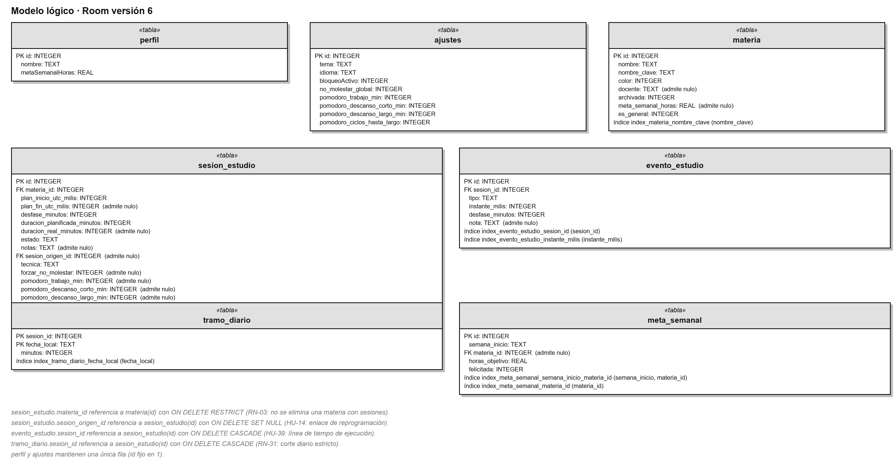
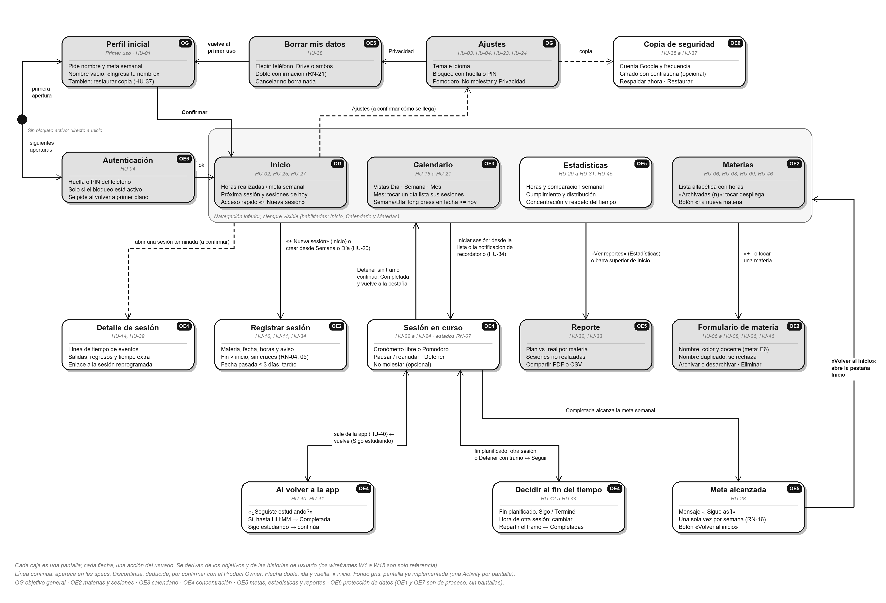
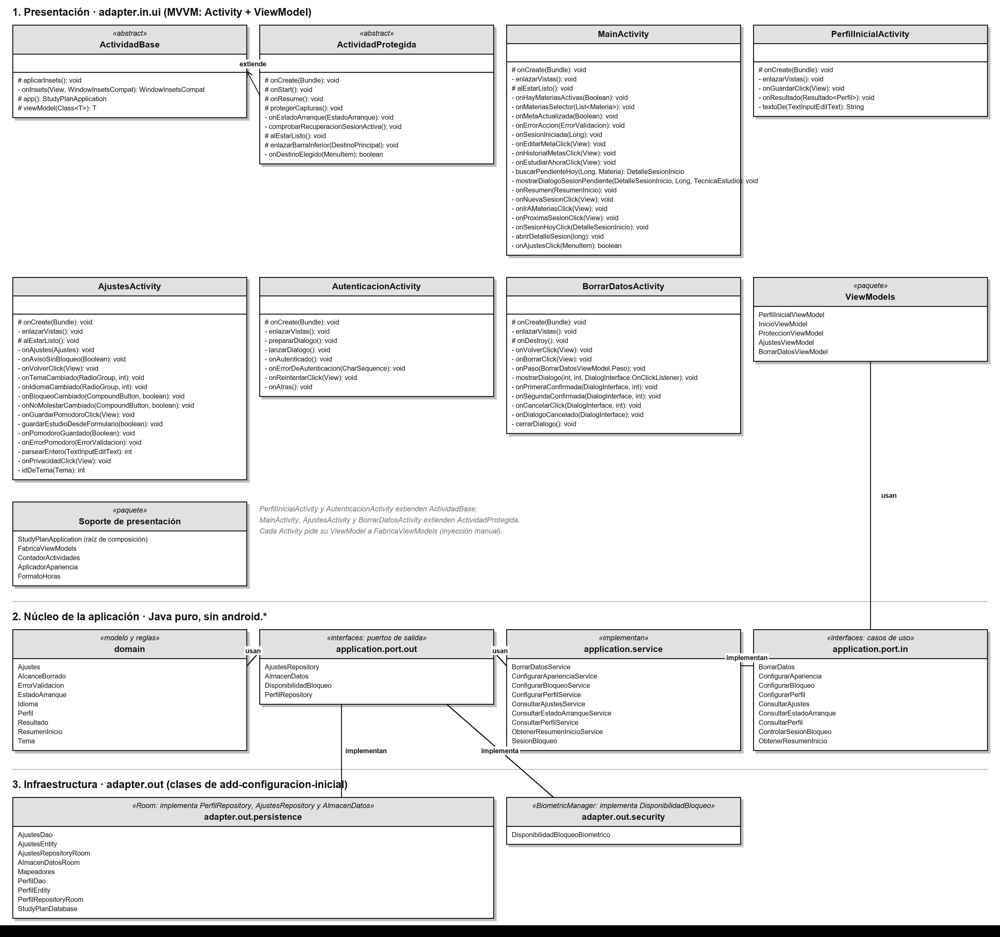
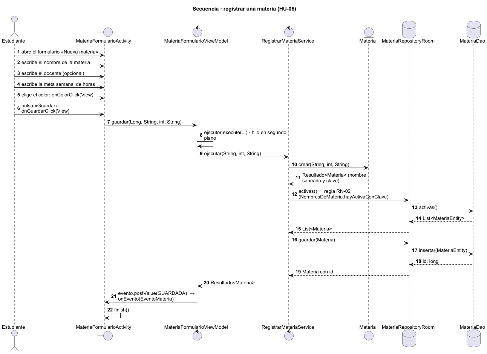
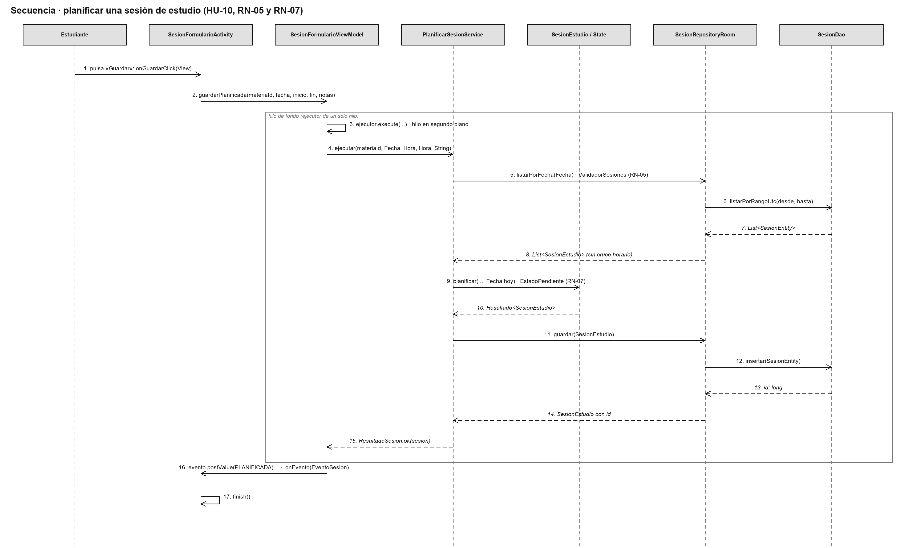
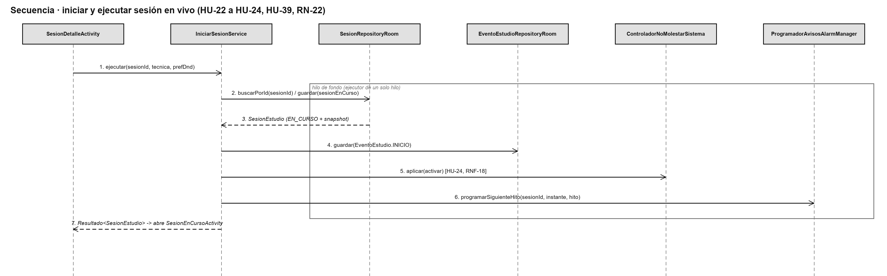
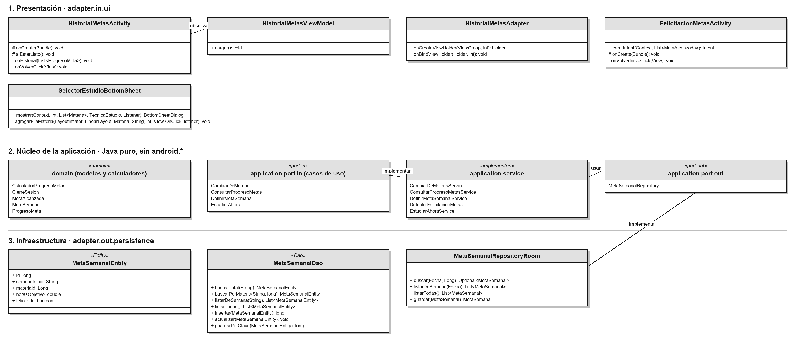

# Diseño del Software

## Arquitectura del Software

StudyPlan adopta una arquitectura hexagonal (de puertos y adaptadores) organizada en tres capas: presentación, núcleo de la aplicación e infraestructura (Cockburn, 2005). El núcleo, formado por los casos de uso y el dominio, no depende de Android ni de ninguna tecnología externa: se comunica con el exterior solo a través de puertos, que son interfaces Java. Los adaptadores de entrada conducen el núcleo (pantallas, widget y notificaciones) y los adaptadores de salida son llamados por él (Room, Google Drive, huella o PIN, alarmas); cada adaptador de salida implementa un puerto de salida, de modo que las dependencias siempre apuntan hacia el núcleo.

El patrón MVVM, fijado en el marco tecnológico, se conserva dentro de la capa de presentación: la Activity o el Fragment y su ViewModel forman el adaptador de entrada. La separación facilita los principios SOLID: responsabilidad única (un caso de uso por clase), inversión de dependencias (el núcleo depende de interfaces y no de Room ni de Android) y segregación de interfaces (puertos pequeños y específicos). Como el dominio no importa clases de Android, sus reglas, entre ellas la máquina de estados de la sesión, se prueban con JUnit sin emulador. La @figura:arq_hexagonal muestra las tres capas y la @tabla:capas resume su correspondencia con los paquetes del proyecto.

{#arq_hexagonal ancho=16.5}

Nota: Elaboración propia. Los nombres de puertos son ejemplos del dominio; los definitivos se fijan en el diseño de cada *change* de OpenSpec.

Tabla: Capas de la arquitectura de StudyPlan y su correspondencia con los paquetes {#capas anchos=3.2,5,8.3 tam=10}

| Capa | Paquetes | Responsabilidad |
|---|---|---|
| 1. Presentación (entrada) | adapter.in.ui | Activity o Fragment, ViewModel y layouts XML. Muestran datos y reciben los eventos del usuario (onCreate, onClick y demás listeners) y los delegan en los casos de uso. No contienen lógica de negocio. |
| 2. Núcleo de la aplicación | application.port.in, application.service, domain, application.port.out | Casos de uso, reglas de negocio (RN-xx), entidades y máquina de estados de la sesión. Java puro, sin android.*. |
| 3. Infraestructura (salida) | adapter.out.persistence, adapter.out.drive, adapter.out.security | Room, copia de seguridad en Google Drive con cifrado, disponibilidad del bloqueo del teléfono (huella o PIN), notificaciones y alarmas. Implementan los puertos de salida. |

Nota: Elaboración propia. Los paquetes cuelgan de io.github.jhoel0521.studyplan.

## Diseño de la Base de Datos

### Modelo Lógico

El esquema de Room está en la versión 6 y se exporta como JSON a `app/schemas/`; el diagrama y el diccionario de datos se generan desde ese archivo con `python docs/build/diagramas_clases.py`, de modo que no pueden desfasarse del esquema real. La @figura:modelo_logico muestra las tablas, sus claves y sus índices.

{#modelo_logico ancho=16.5}

Nota: Elaboración propia, generada desde el esquema de Room.

### Diccionario de Datos

Cada tabla se describe en una tabla del documento. La columna *Restricciones* sale del esquema de Room y la descripción, de las reglas de negocio (RN) y las historias de usuario (HU) que la originan.

Tabla: Diccionario de datos de la tabla perfil (Perfil del estudiante) {#diccionario_perfil anchos=3.4,2.2,3.6,6.8 tam=9}

| Campo | Tipo | Restricciones | Descripción |
|---|---|---|---|
| id | INTEGER | PK, NOT NULL | Identificador de la única fila del perfil (siempre 1, RN-01). |
| nombre | TEXT | NOT NULL | Nombre del estudiante, sin espacios en los extremos (HU-01). |
| metaSemanalHoras | REAL | NOT NULL | Meta semanal predeterminada en horas, mayor que 0 y hasta 168 (RN-14). |

Tabla: Diccionario de datos de la tabla ajustes (Ajustes de la aplicación) {#diccionario_ajustes anchos=3.4,2.2,3.6,6.8 tam=9}

| Campo | Tipo | Restricciones | Descripción |
|---|---|---|---|
| id | INTEGER | PK, NOT NULL | Identificador de la única fila de ajustes (siempre 1). |
| tema | TEXT | NOT NULL | Tema visual: SISTEMA, CLARO u OSCURO (HU-03). |
| idioma | TEXT | NOT NULL | Idioma de la aplicación: ES o EN (HU-03). |
| bloqueoActivo | INTEGER | NOT NULL | 1 si la app pide huella o PIN al abrirse y al volver a primer plano (HU-04). |
| no_molestar_global | INTEGER | NOT NULL | 1 si el modo No molestar se activa de forma predeterminada al estudiar (HU-24). |
| pomodoro_trabajo_min | INTEGER | NOT NULL | Duración en minutos de cada bloque de trabajo Pomodoro (HU-23, RN-22). |
| pomodoro_descanso_corto_min | INTEGER | NOT NULL | Duración en minutos del descanso corto Pomodoro (HU-23, RN-22). |
| pomodoro_descanso_largo_min | INTEGER | NOT NULL | Duración en minutos del descanso largo Pomodoro (HU-23, RN-22). |
| pomodoro_ciclos_hasta_largo | INTEGER | NOT NULL | Cantidad de ciclos de trabajo hasta un descanso largo Pomodoro (HU-23, RN-22). |

Tabla: Diccionario de datos de la tabla materia (Materias del estudiante) {#diccionario_materia anchos=3.4,2.2,3.6,6.8 tam=9}

| Campo | Tipo | Restricciones | Descripción |
|---|---|---|---|
| id | INTEGER | PK autoincremental, NOT NULL | Identificador autogenerado de la materia. |
| nombre | TEXT | NOT NULL | Nombre saneado de la materia, de 1 a 50 caracteres (RN-02). |
| nombre_clave | TEXT | NOT NULL | Nombre sin acentos y en mayúsculas: decide la unicidad entre las materias activas (RN-02). |
| color | INTEGER | NOT NULL | Color de la materia como entero ARGB (paleta provisional). |
| docente | TEXT | Admite nulo | Docente de la materia; vacío si no se indicó (texto libre opcional). |
| archivada | INTEGER | NOT NULL | 1 si la materia está archivada (HU-08); 0 si está activa. |
| meta_semanal_horas | REAL | Admite nulo | Meta semanal opcional propia de la materia en horas (> 0 y ≤ 168, RN-14, HU-26). |
| es_general | INTEGER | NOT NULL | 1 para la materia general protegida «Estudios varios» (RN-32); 0 para materias del estudiante. |

Tabla: Diccionario de datos de la tabla sesion_estudio (Sesiones de estudio) {#diccionario_sesion_estudio anchos=3.4,2.2,3.6,6.8 tam=9}

| Campo | Tipo | Restricciones | Descripción |
|---|---|---|---|
| id | INTEGER | PK autoincremental, NOT NULL | Identificador autogenerado de la sesión de estudio. |
| materia_id | INTEGER | NOT NULL | Identificador de la materia asociada; clave foránea a materia(id) con borrado restringido (RN-03). |
| plan_inicio_utc_milis | INTEGER | NOT NULL | Instante absoluto de inicio planificado o real de arranque en milisegundos UTC (RN-04, RN-05, HU-47). |
| plan_fin_utc_milis | INTEGER | Admite nulo | Instante absoluto de fin planificado en milisegundos UTC; nulo en sesiones sin plan iniciadas con «Estudiar ahora» (HU-47). |
| desfase_minutos | INTEGER | NOT NULL | Desfase horario local en minutos respecto a UTC vigente al planificar (para preservar el historial ante viajes). |
| duracion_planificada_minutos | INTEGER | NOT NULL | Duración planificada calculada en minutos entre hora_inicio y hora_fin. |
| duracion_real_minutos | INTEGER | Admite nulo | Duración real estudiada en minutos (entre 1 y 1440); nula mientras no se complete (HU-12, HU-13). |
| estado | TEXT | NOT NULL | Código de estado según el patrón State (RN-07): PENDIENTE, EN_CURSO, NO_REALIZADA, COMPLETADA, COMPLETADA_TARDIA o REPROGRAMADA. |
| notas | TEXT | Admite nulo | Notas u observaciones opcionales de la sesión (hasta 500 caracteres). |
| sesion_origen_id | INTEGER | Admite nulo | Identificador de la sesión original cuando procede de una reprogramación (HU-14); nulo si no aplica. |
| tecnica | TEXT | NOT NULL | Técnica elegida al iniciar: LIBRE o POMODORO; nula hasta que inicia (HU-22, HU-23). |
| forzar_no_molestar | INTEGER | Admite nulo | Preferencia de No molestar de la sesión: HEREDAR_GLOBAL, FORZAR_ACTIVAR o FORZAR_DESACTIVAR (HU-24). |
| pomodoro_trabajo_min | INTEGER | Admite nulo | Minutos de trabajo de la instantánea Pomodoro congelada al iniciar (RN-22); nula si no aplica. |
| pomodoro_descanso_corto_min | INTEGER | Admite nulo | Minutos de descanso corto de la instantánea Pomodoro congelada al iniciar (RN-22); nula si no aplica. |
| pomodoro_descanso_largo_min | INTEGER | Admite nulo | Minutos de descanso largo de la instantánea Pomodoro congelada al iniciar (RN-22); nula si no aplica. |
| pomodoro_ciclos_hasta_largo | INTEGER | Admite nulo | Ciclos hasta descanso largo de la instantánea Pomodoro congelada al iniciar (RN-22); nula si no aplica. |

Tabla: Diccionario de datos de la tabla evento_estudio (Eventos de ejecución de sesiones) {#diccionario_evento_estudio anchos=3.4,2.2,3.6,6.8 tam=9}

| Campo | Tipo | Restricciones | Descripción |
|---|---|---|---|
| id | INTEGER | PK autoincremental, NOT NULL | Identificador autogenerado del evento de ejecución. |
| sesion_id | INTEGER | NOT NULL | Identificador de la sesión asociada; clave foránea a sesion_estudio(id) con ON DELETE CASCADE (HU-39). |
| tipo | TEXT | NOT NULL | Tipo de evento cronológico: INICIO, PAUSA, REANUDACION, FIN, CAMBIO_FASE, SALIDA_APP o REGRESO_APP (HU-39, RN-23). |
| instante_milis | INTEGER | NOT NULL | Marca temporal exacta en milisegundos UTC desde epoch (RN-23). |
| desfase_minutos | INTEGER | NOT NULL | Desfase horario local en minutos respecto a UTC en el momento del evento (HU-39). |
| nota | TEXT | Admite nulo | Nota breve o detalle opcional del evento (por ejemplo, fase Pomodoro o resolución de regreso). |

Tabla: Diccionario de datos de la tabla tramo_diario (Minutos reales por día local (RN-31)) {#diccionario_tramo_diario anchos=3.4,2.2,3.6,6.8 tam=9}

| Campo | Tipo | Restricciones | Descripción |
|---|---|---|---|
| sesion_id | INTEGER | PK, NOT NULL | Identificador de la sesión asociada; parte de la clave primaria y FK a sesion_estudio(id) con ON DELETE CASCADE (RN-31). |
| fecha_local | TEXT | PK, NOT NULL | Fecha calendario local ISO AAAA-MM-DD en la que ocurrió el estudio (RN-31). |
| minutos | INTEGER | NOT NULL | Minutos reales contabilizables ocurridos en esa fecha local (RN-31). |

Tabla: Diccionario de datos de la tabla meta_semanal (Instantáneas de metas semanales (RN-33)) {#diccionario_meta_semanal anchos=3.4,2.2,3.6,6.8 tam=9}

| Campo | Tipo | Restricciones | Descripción |
|---|---|---|---|
| id | INTEGER | PK autoincremental, NOT NULL | Identificador autogenerado del snapshot semanal. |
| semana_inicio | TEXT | NOT NULL | Fecha ISO del lunes de la semana (RN-13, RN-33). |
| materia_id | INTEGER | Admite nulo | Nulo para la meta semanal total; FK a materia(id) con ON DELETE CASCADE para metas por materia (HU-25, HU-26). |
| horas_objetivo | REAL | NOT NULL | Objetivo semanal congelado en horas para esa semana (RN-14, RN-33). |
| felicitada | INTEGER | NOT NULL | 1 si la felicitación por esta meta ya se mostró en esa semana (RN-16); 0 en caso contrario. |

## Diseño de la Interfaz de Usuario (UI/UX)

El flujo de la aplicación se modela como un diagrama de estados en el que cada estado es una pantalla y cada transición es una acción del usuario. Parte de la primera apertura, en la que se crea el perfil, y cierra el ciclo en «Borrar mis datos», que devuelve a la pantalla de primer uso. Las pantallas se derivan de los objetivos del proyecto y de las historias de usuario; los wireframes sirven de referencia. La @figura:flujo_pantallas presenta el flujo y la @tabla:pantallas describe lo que se hace en cada pantalla. Las transiciones en línea discontinua se dedujeron de los wireframes y están por confirmar con el Product Owner.

{#flujo_pantallas ancho=16.5}

Nota: Elaboración propia. OG: objetivo general; OE2 a OE6: objetivos específicos del 2 al 6 del capítulo 1.

Tabla: Pantallas de StudyPlan, lo que se hace en cada una y su trazabilidad {#pantallas anchos=3.4,7.1,3.8,2.2 tam=9}

| Pantalla | Qué se hace | Historias | Objetivo |
|---|---|---|---|
| Perfil inicial | Pide nombre y meta semanal en el primer uso; el nombre es obligatorio. Permite restaurar una copia. | HU-01, HU-37 | OG |
| Autenticación | Pide huella o PIN al volver a primer plano, solo si el bloqueo está activo. | HU-04 | OE6 |
| Inicio | Muestra el saludo, las horas realizadas sobre la meta semanal (editable), el acceso al historial de metas, el botón «Estudiar ahora», la próxima sesión y las sesiones de hoy. | HU-02, HU-25, HU-27, HU-47 | OG |
| Historial de metas | Lista cronológica inversa de semanas con cumplimiento real, objetivo y marca de estimadas. | HU-27 | OE5 |
| Calendario | Ofrece las vistas Día, Semana y Mes con el estado de cada sesión; permite crear sesiones. | HU-16 a HU-21 | OE3 |
| Estadísticas | Muestra horas, comparación semanal, cumplimiento, distribución y concentración. | HU-29 a HU-31, HU-45 | OE5 |
| Materias | Lista las materias activas en orden alfabético con color, docente y horas reales acumuladas (`SesionesDeMateriaRoom`), la sección plegable de archivadas y el botón «+». | HU-06, HU-08, HU-09, HU-46 | OE2 |
| Formulario de materia | Registra o edita nombre, color y docente (la meta por materia llega con las metas, HU-26); archiva, desarchiva o elimina con confirmación. | HU-06 a HU-08, HU-26, HU-46 | OE2 |
| Registrar sesión | Planifica una sesión validando horario y cruces o registra sesiones pasadas (hasta 3 días) y reprograma desde `SesionFormularioActivity`. | HU-10, HU-11, HU-14, HU-34 | OE2 |
| Sesión en curso | Cronómetro libre o Pomodoro, pausar o reanudar, cambiar de materia y detener; modo No molestar. | HU-22 a HU-24, HU-48 | OE4 |
| Al volver a la app | Pregunta si el estudiante siguió estudiando tras salir de la app. | HU-40, HU-41 | OE4 |
| Decidir al fin del tiempo | Resuelve el tiempo extra, el cambio a otra sesión y el reparto de un tramo continuo. | HU-42 a HU-44 | OE4 |
| Meta alcanzada | Felicita una sola vez por semana y ofrece volver al inicio. | HU-28 | OE5 |
| Detalle de sesión | Muestra la ficha completa de una sesión (`SesionDetalleActivity`) y ejecuta transiciones (`completar`, registro tardío hasta 3 días, reprogramar o eliminar en `PENDIENTE`). | HU-12 a HU-15, HU-39 | OE2, OE4 |
| Reporte | Compara lo planificado con lo real por materia y lo comparte en PDF o CSV. | HU-32, HU-33 | OE5 |
| Ajustes | Configura tema, idioma, bloqueo, Pomodoro y No molestar; da acceso a Privacidad. | HU-03, HU-04, HU-23, HU-24 | OG |
| Copia de seguridad | Configura cuenta, frecuencia y cifrado; respalda y restaura. | HU-35 a HU-37 | OE6 |
| Borrar mis datos | Borra del teléfono, de Drive o de ambos con doble confirmación. | HU-38 | OE6 |

Nota: Elaboración propia a partir de las especificaciones de OpenSpec.

**Navegación entre pestañas.** Cada pestaña de la barra de navegación es una Activity y la pila de retroceso es siempre `[Inicio, pestaña]`: Atrás desde una pestaña vuelve a Inicio y Atrás desde Inicio sale de la aplicación. En teléfonos la barra va abajo y desde los 600 dp se sustituye por un riel lateral; cada pantalla principal tiene su envoltorio de teléfono y su variante `layout-w600dp`, que comparten el mismo contenido. Solo las pestañas implementadas están habilitadas.

### Wireframes y Mockups

[[pendiente: trasladar aquí los wireframes de baja fidelidad W1 a W15 (hoy en el Anexo A) y los mockups de las pantallas ya diseñadas]]

## Diseño de Componentes y Módulos

### Épica Configuración inicial

La primera épica implementada reúne el perfil inicial (HU-01), el Inicio parcial (HU-02), el tema y el idioma (HU-03), el bloqueo con huella o PIN (HU-04) y el borrado de datos del teléfono (HU-38). La @figura:clases_configuracion muestra sus 58 clases agrupadas por paquete. En la capa de presentación se detallan los métodos del ciclo de vida (onCreate, onStart) y de los listeners (onGuardarClick, onAjustesClick y los demás), que se escriben como métodos con nombre para que se vean en la revisión de código. Las Activities protegidas heredan de ActividadProtegida, que consulta al núcleo si falta el perfil o si hay que autenticar antes de mostrar datos; PerfilInicialActivity y AutenticacionActivity heredan de ActividadBase porque no muestran datos del estudiante.

{#clases_configuracion ancho=16.5}

Nota: Elaboración propia. Cada clase del diagrama existe en el código y cada clase de los paquetes aparece en el diagrama; el cotejo se repite con `python docs/build/cotejo_clases.py`.

### Épica Gestión de materias

La segunda épica implementada reúne el registro, la edición, el archivado y la eliminación de materias, la lista con sus horas y el desarchivado (HU-06 a HU-09 y HU-46). La @figura:clases_materias muestra sus clases: en la capa de presentación se detallan los métodos de las Activities y los ViewModel; en el núcleo, los campos y métodos de `Materia`; y en la infraestructura, la entidad, el DAO y el adaptador de Room. Las firmas salen del código fuente, no se escriben a mano.

{#clases_materias ancho=16.5}

Nota: Elaboración propia, generada desde el código; `python docs/build/cotejo_clases.py` comprueba que no se desfasa.

El nombre de la materia se sanea antes de guardarse (se recortan los espacios de los extremos y se colapsan los repetidos) y la unicidad entre las materias activas se decide con una clave sin acentos ni mayúsculas (RN-02, ampliada por el Product Owner). La @figura:secuencia_registrar_materia recorre las tres capas al registrar una materia: cada mensaje del diagrama corresponde a un método real y el script que lo dibuja falla si alguno deja de existir.

{#secuencia_registrar_materia ancho=16.5}

Nota: Elaboración propia. Los mensajes con línea discontinua son retornos.

### Épica Sesiones de estudio

La tercera épica implementada (`add-sesiones-estudio`) incorpora la planificación de sesiones, el registro de sesiones pasadas dentro de la ventana de tres días, la finalización el mismo día, el registro tardío desde `NO_REALIZADA`, la reprogramación con enlace al destino, la eliminación protegida de sesiones `PENDIENTE` y el cierre real de la pantalla Inicio y de las horas acumuladas por materia (HU-02, HU-08/RN-03, HU-09, HU-10 a HU-15 y RN-04 a RN-08). La @figura:clases_sesiones agrupa sus clases por paquete en las tres capas de la arquitectura hexagonal. En el dominio puro (sin `android.*` ni `java.time`), `Fecha`, `Hora` y `SesionEstudio` delegan cada transición válida del ciclo de vida (`RN-07`) en la jerarquía polimórfica del patrón *State* (`EstadoSesion` y sus seis estados concretos), devolviendo `Resultado` sin lanzar excepciones (`RNF-14`); en infraestructura, Room avanza a la versión 3 (`MIGRATION_2_3`) añadiendo `sesion_estudio` con clave foránea restringida hacia `materia` (`RN-03`), autoreferencia de reprogramación (`sesion_origen_id`) y el adaptador real `SesionesDeMateriaRoom`.

{#clases_sesiones ancho=16.5}

Nota: Elaboración propia, generada desde el código; `python docs/build/cotejo_clases.py` comprueba la correspondencia exacta con las clases Java.

Para evitar cruces horarios entre sesiones activas (`RN-05`), cada operación de planificación o reprogramación consulta `ValidadorSesiones` en el hilo de fondo antes de delegar en `SesionEstudio` y persistir mediante `SesionRepositoryRoom`. La @figura:secuencia_planificar_sesion recorre ese flujo desde `SesionFormularioActivity` hasta Room y el retorno al hilo principal; el script generador valida que todos los nombres de métodos correspondan al código fuente vigente.

{#secuencia_planificar_sesion ancho=16.5}

Nota: Elaboración propia. Los mensajes con línea discontinua son retornos.

### Épica Calendario de estudio

La cuarta épica implementada (`add-calendario-estudio`) habilita la pestaña **Calendario** (`DestinoPrincipal.CALENDARIO` → `CalendarioActivity`) con vistas nativas **Día**, **Semana** y **Mes** construidas íntegramente en Views XML y Java sin librerías externas de calendario ni permisos nuevos (HU-16 a HU-21, RN-08, RN-11, RN-13, RNF-06, RNF-19). En el dominio puro, `PeriodoCalendario` resuelve la navegación por día/semana/mes y la conservación de foco al alternar entre vistas, mientras `CalculadorRangoHorario` determina la ventana de desplazamiento inicial (`± 2 h` sobre la rejilla de 24 horas), distribuye columnas paralelas ante coincidencias visuales entre sesiones `REPROGRAMADA` y activas, y calcula el resumen `Plan / Real` del periodo visible. La @figura:clases_calendario presenta sus clases por capa y la @figura:secuencia_consultar_calendario muestra la consulta por rango (`listarPorRango`) sobre Room v3 sin migración de esquema.

{#clases_calendario ancho=16.5}

Nota: Elaboración propia, generada desde el código; `python docs/build/cotejo_clases.py` comprueba la correspondencia exacta con las clases Java.

{#secuencia_consultar_calendario ancho=16.5}

Nota: Elaboración propia. Los mensajes con línea discontinua son retornos.

### Épica Técnicas de estudio y ejecución en vivo

La quinta épica implementada (`add-tecnicas-estudio`) reemplaza la finalización directa desde `PENDIENTE` por el flujo obligatorio en vivo (`PENDIENTE → EN_CURSO → COMPLETADA`, `RN-07`), incorporando las técnicas **Libre** (`HU-22`) y **Pomodoro** (`HU-23`, con instantánea inmutable de parámetros al iniciar `RN-22`), la configuración opcional de **No molestar** sin bloqueo ante denegación (`HU-24`, `RNF-18`), la línea de tiempo cronológica de eventos persistidos en Room v4 (`evento_estudio`, `MIGRATION_3_4`, `HU-39`, `RN-23`), la recuperación tras salida de la app mediante el diálogo `W13` (`HU-40`, `HU-41`), los avisos de hitos con `AlarmManager` y el reparto interactivo de tramo continuo `W14` (`HU-42` a `HU-44`). La @figura:clases_tecnicas presenta sus clases agrupadas por capa, incluyendo el nuevo paquete `adapter.out.system`, y la @figura:secuencia_ejecucion_sesion ilustra el inicio de una sesión en vivo con persistencia del evento `INICIO`, aplicación opcional de No molestar y programación de avisos.

{#clases_tecnicas ancho=16.5}

Nota: Elaboración propia, generada desde el código; `python docs/build/cotejo_clases.py` comprueba la correspondencia exacta con las clases Java.

{#secuencia_ejecucion_sesion ancho=16.5}

Nota: Elaboración propia. Los mensajes con línea discontinua son retornos.

### Épica Metas semanales y estudio inmediato

La sexta épica implementada (`add-metas-semanales`, Room v6 con `MIGRATION_5_6`) incorpora las instantáneas semanales inmutables en `meta_semanal` (`RN-33`, `HU-25` a `HU-27`), la materia general protegida «Estudios varios» (`RN-32`), el inicio inmediato sin plan mediante `EstudiarAhora` (`Nueva → En curso`, `HU-47`, `RN-07`), el cambio continuo de materia en `CambiarDeMateria` (`HU-48`) y la felicitación única acumulada al cierre real de la sesión (`FelicitacionMetasActivity`, `HU-28`, `RN-16`). La @figura:clases_metas presenta sus clases agrupadas por capa.

{#clases_metas ancho=16.5}

Nota: Elaboración propia, generada desde el código; `python docs/build/cotejo_clases.py` comprueba la correspondencia exacta con las clases Java.

[[pendiente: diagramas de clases de las épicas siguientes (estadísticas y copia de seguridad), con los métodos del ciclo de vida y de los listeners, a medida que se implementen]]
