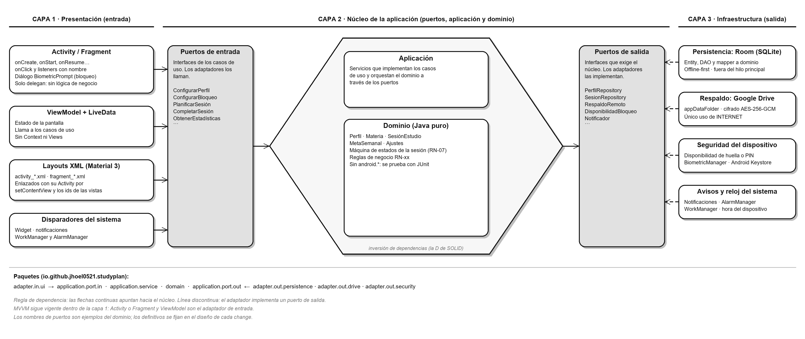

# Diseño del Software

## Arquitectura del Software

StudyPlan adopta una arquitectura hexagonal (de puertos y adaptadores) organizada en tres capas: presentación, núcleo de la aplicación e infraestructura [[pendiente: citar la fuente de la arquitectura hexagonal y verificarla]]. El núcleo, formado por los casos de uso y el dominio, no depende de Android ni de ninguna tecnología externa: se comunica con el exterior solo a través de puertos, que son interfaces Java. Los adaptadores de entrada conducen el núcleo (pantallas, widget y notificaciones) y los adaptadores de salida son llamados por él (Room, Google Drive, huella o PIN, alarmas); cada adaptador de salida implementa un puerto de salida, de modo que las dependencias siempre apuntan hacia el núcleo.

El patrón MVVM, fijado en el marco tecnológico, se conserva dentro de la capa de presentación: la Activity o el Fragment y su ViewModel forman el adaptador de entrada. La separación facilita los principios SOLID: responsabilidad única (un caso de uso por clase), inversión de dependencias (el núcleo depende de interfaces y no de Room ni de Android) y segregación de interfaces (puertos pequeños y específicos). Como el dominio no importa clases de Android, sus reglas, entre ellas la máquina de estados de la sesión, se prueban con JUnit sin emulador. La @figura:arq_hexagonal muestra las tres capas y la @tabla:capas resume su correspondencia con los paquetes del proyecto.

{#arq_hexagonal ancho=16.5}

Nota: Elaboración propia. Los nombres de puertos son ejemplos del dominio; los definitivos se fijan en el diseño de cada *change* de OpenSpec.

Tabla: Capas de la arquitectura de StudyPlan y su correspondencia con los paquetes {#capas anchos=3.2,5,8.3 tam=10}

| Capa | Paquetes | Responsabilidad |
|---|---|---|
| 1. Presentación (entrada) | adapter.in.ui | Activity o Fragment, ViewModel y layouts XML. Muestran datos y reciben los eventos del usuario (onCreate, onClick y demás listeners) y los delegan en los casos de uso. No contienen lógica de negocio. |
| 2. Núcleo de la aplicación | application.port.in, application.service, domain, application.port.out | Casos de uso, reglas de negocio (RN-xx), entidades y máquina de estados de la sesión. Java puro, sin android.*. |
| 3. Infraestructura (salida) | adapter.out.persistence, adapter.out.drive, adapter.out.security | Room, copia de seguridad en Google Drive con cifrado, disponibilidad del bloqueo del teléfono (huella o PIN), notificaciones y alarmas. Implementan los puertos de salida. |

Nota: Elaboración propia. Los paquetes cuelgan de io.github.jhoel0521.studyplan.

## Diseño de la Base de Datos

### Modelo Lógico

[[pendiente: modelo lógico (tablas, claves y relaciones) a partir del modelo de dominio del Anexo A, cuando se diseñe la capa de persistencia con Room]]

### Diccionario de Datos

[[pendiente: diccionario de datos de cada tabla (campo, tipo, restricciones y descripción)]]

## Diseño de la Interfaz de Usuario (UI/UX)

El flujo de la aplicación se modela como un diagrama de estados en el que cada estado es una pantalla y cada transición es una acción del usuario. Parte de la primera apertura, en la que se crea el perfil, y cierra el ciclo en «Borrar mis datos», que devuelve a la pantalla de primer uso. Las pantallas se derivan de los objetivos del proyecto y de las historias de usuario; los wireframes sirven de referencia. La @figura:flujo_pantallas presenta el flujo y la @tabla:pantallas describe lo que se hace en cada pantalla. Las transiciones en línea discontinua se dedujeron de los wireframes y están por confirmar con el Product Owner.

{#flujo_pantallas ancho=16.5}

Nota: Elaboración propia. OG: objetivo general; OE2 a OE6: objetivos específicos del 2 al 6 del capítulo 1.

Tabla: Pantallas de StudyPlan, lo que se hace en cada una y su trazabilidad {#pantallas anchos=3.4,7.1,3.8,2.2 tam=9}

| Pantalla | Qué se hace | Historias | Objetivo |
|---|---|---|---|
| Perfil inicial | Pide nombre y meta semanal en el primer uso; el nombre es obligatorio. Permite restaurar una copia. | HU-01, HU-37 | OG |
| Autenticación | Pide huella o PIN al volver a primer plano, solo si el bloqueo está activo. | HU-04 | OE6 |
| Inicio | Muestra el saludo, las horas realizadas sobre la meta semanal, la próxima sesión y las sesiones de hoy. | HU-02, HU-25, HU-27 | OG |
| Calendario | Ofrece las vistas Día, Semana y Mes con el estado de cada sesión; permite crear sesiones. | HU-16 a HU-21 | OE3 |
| Estadísticas | Muestra horas, comparación semanal, cumplimiento, distribución y concentración. | HU-29 a HU-31, HU-45 | OE5 |
| Materias | Lista las materias con sus horas y su meta semanal; da acceso al formulario. | HU-06, HU-09, HU-26 | OE2 |
| Formulario de materia | Registra o edita nombre, color, docente y meta; archiva o elimina. | HU-06 a HU-08, HU-26 | OE2 |
| Registrar sesión | Planifica una sesión validando horario y cruces; registra sesiones pasadas (hasta 3 días). | HU-10, HU-11, HU-34 | OE2 |
| Sesión en curso | Cronómetro libre o Pomodoro, pausar o reanudar y detener; modo No molestar. | HU-22 a HU-24 | OE4 |
| Al volver a la app | Pregunta si el estudiante siguió estudiando tras salir de la app. | HU-40, HU-41 | OE4 |
| Decidir al fin del tiempo | Resuelve el tiempo extra, el cambio a otra sesión y el reparto de un tramo continuo. | HU-42 a HU-44 | OE4 |
| Meta alcanzada | Felicita una sola vez por semana y ofrece volver al inicio. | HU-28 | OE5 |
| Detalle de sesión | Muestra la línea de tiempo de eventos de una sesión terminada. | HU-14, HU-39 | OE4 |
| Reporte | Compara lo planificado con lo real por materia y lo comparte en PDF o CSV. | HU-32, HU-33 | OE5 |
| Ajustes | Configura tema, idioma, bloqueo, Pomodoro y No molestar; da acceso a Privacidad. | HU-03, HU-04, HU-23, HU-24 | OG |
| Copia de seguridad | Configura cuenta, frecuencia y cifrado; respalda y restaura. | HU-35 a HU-37 | OE6 |
| Borrar mis datos | Borra del teléfono, de Drive o de ambos con doble confirmación. | HU-38 | OE6 |

Nota: Elaboración propia a partir de las especificaciones de OpenSpec.

### Wireframes y Mockups

[[pendiente: trasladar aquí los wireframes de baja fidelidad W1 a W15 (hoy en el Anexo A) y los mockups de las pantallas ya diseñadas]]

## Diseño de Componentes y Módulos

### Épica Configuración inicial

La primera épica implementada reúne el perfil inicial (HU-01), el Inicio parcial (HU-02), el tema y el idioma (HU-03), el bloqueo con huella o PIN (HU-04) y el borrado de datos del teléfono (HU-38). La @figura:clases_configuracion muestra sus 58 clases agrupadas por paquete. En la capa de presentación se detallan los métodos del ciclo de vida (onCreate, onStart) y de los listeners (onGuardarClick, onAjustesClick y los demás), que se escriben como métodos con nombre para que se vean en la revisión de código. Las Activities protegidas heredan de ActividadProtegida, que consulta al núcleo si falta el perfil o si hay que autenticar antes de mostrar datos; PerfilInicialActivity y AutenticacionActivity heredan de ActividadBase porque no muestran datos del estudiante.

{#clases_configuracion ancho=16.5}

Nota: Elaboración propia. Cada clase del diagrama existe en el código y cada clase de los paquetes aparece en el diagrama; el cotejo se repite con `python docs/build/cotejo_clases.py`.

[[pendiente: diagramas de clases de las épicas siguientes, con los métodos del ciclo de vida (onCreate) y de los listeners (onClick), a medida que se implementen]]
