# Diseño del Software

## Arquitectura del Software

StudyPlan adopta una arquitectura hexagonal (de puertos y adaptadores) organizada en tres capas: presentación, núcleo de la aplicación e infraestructura (Cockburn, 2005). El núcleo, formado por los casos de uso y el dominio, no depende de Android ni de ninguna tecnología externa: se comunica con el exterior solo a través de puertos, que son interfaces Java. Los adaptadores de entrada conducen el núcleo (pantallas, widget y notificaciones) y los adaptadores de salida son llamados por él (Room, Google Drive, huella o PIN, alarmas); cada adaptador de salida implementa un puerto de salida, de modo que las dependencias siempre apuntan hacia el núcleo.

El patrón MVVM, fijado en el marco tecnológico, se conserva dentro de la capa de presentación: la Activity o el Fragment y su ViewModel forman el adaptador de entrada. La separación facilita los principios SOLID: responsabilidad única (un caso de uso por clase), inversión de dependencias (el núcleo depende de interfaces y no de Room ni de Android) y segregación de interfaces (puertos pequeños y específicos). Como el dominio no importa clases de Android, sus reglas, entre ellas la máquina de estados de la sesión, se prueban con JUnit sin emulador. La @figura:arq_hexagonal muestra las tres capas y la @tabla:capas resume su correspondencia con los paquetes del proyecto.

{#arq_hexagonal ancho=16.5}

Nota: Elaboración propia. Los nombres de puertos son ejemplos del dominio; los definitivos se fijan en el diseño de cada *change* de OpenSpec.

Tabla: Capas de la arquitectura de StudyPlan y su correspondencia con los paquetes {#capas anchos=3.2,5,8.3 tam=10}

| Capa | Paquetes | Responsabilidad |
|---|---|---|
| 1. Presentación (entrada) | adapter.in.ui (una carpeta por épica y comun) | Activity o Fragment, ViewModel y layouts XML. Muestran datos y reciben los eventos del usuario (onCreate, onClick y demás listeners) y los delegan en los casos de uso. No contienen lógica de negocio. |
| 2. Núcleo de la aplicación | application.port.in, application.service (una carpeta por épica y comun), domain (por tipo de clase), application.port.out (persistence y system) | Casos de uso, reglas de negocio (RN-xx), entidades y máquina de estados de la sesión. Java puro, sin android.*. |
| 3. Infraestructura (salida) | adapter.out.persistence, adapter.out.security, adapter.out.system y adapter.out.drive | Room, disponibilidad del bloqueo del teléfono (huella o PIN), reloj, notificaciones y alarmas, y la copia de seguridad en Google Drive con cifrado opcional. Implementan los puertos de salida. |

Nota: Elaboración propia. Los paquetes cuelgan de io.github.jhoel0521.studyplan.

## Diseño de la Base de Datos

### Modelo Lógico

El esquema de Room está en la versión 8 y se exporta como JSON a `app/schemas/`; el diagrama y el diccionario de datos se generan desde ese archivo con `python docs/build/diagramas_clases.py`, de modo que no pueden desfasarse del esquema real. La @figura:modelo_logico muestra las tablas, sus claves y sus índices.

{#modelo_logico ancho=16.5}

Nota: Elaboración propia, generada desde el esquema de Room.

### Diccionario de Datos

Cada tabla se describe en una tabla del documento. La columna *Restricciones* sale del esquema de Room y la descripción, de las reglas de negocio (RN) y las historias de usuario (HU) que la originan.

Tabla: Diccionario de datos de la tabla perfil (Perfil del estudiante) {#diccionario_perfil anchos=3.4,2.2,3.6,6.8 tam=9}

| Campo | Tipo | Restricciones | Descripción |
|---|---|---|---|
| id | INTEGER | PK, NOT NULL | Identificador de la única fila del perfil (siempre 1, RN-01). |
| nombre | TEXT | NOT NULL | Nombre del estudiante, sin espacios en los extremos (HU-01). |
| metaSemanalHoras | REAL | NOT NULL | Meta semanal predeterminada en horas, mayor que 0 y hasta 168 (RN-14). |

Tabla: Diccionario de datos de la tabla ajustes (Ajustes de la aplicación) {#diccionario_ajustes anchos=3.4,2.2,3.6,6.8 tam=9}

| Campo | Tipo | Restricciones | Descripción |
|---|---|---|---|
| id | INTEGER | PK, NOT NULL | Identificador de la única fila de ajustes (siempre 1). |
| tema | TEXT | NOT NULL | Tema visual: SISTEMA, CLARO u OSCURO (HU-03). |
| idioma | TEXT | NOT NULL | Idioma de la aplicación: ES o EN (HU-03). |
| bloqueoActivo | INTEGER | NOT NULL | 1 si la app pide huella o PIN al abrirse y al volver a primer plano (HU-04). |
| no_molestar_global | INTEGER | NOT NULL | 1 si el modo No molestar se activa de forma predeterminada al estudiar (HU-24). |
| pomodoro_trabajo_min | INTEGER | NOT NULL | Duración en minutos de cada bloque de trabajo Pomodoro (HU-23, RN-22). |
| pomodoro_descanso_corto_min | INTEGER | NOT NULL | Duración en minutos del descanso corto Pomodoro (HU-23, RN-22). |
| pomodoro_descanso_largo_min | INTEGER | NOT NULL | Duración en minutos del descanso largo Pomodoro (HU-23, RN-22). |
| pomodoro_ciclos_hasta_largo | INTEGER | NOT NULL | Cantidad de ciclos de trabajo hasta un descanso largo Pomodoro (HU-23, RN-22). |
| recordatorio_minutos | INTEGER | NOT NULL | Antelación predeterminada en minutos para avisos previos al planificar (0 = sin recordatorio, 5, 15 o 30; valor inicial 15, HU-34). |

Tabla: Diccionario de datos de la tabla materia (Materias del estudiante) {#diccionario_materia anchos=3.4,2.2,3.6,6.8 tam=9}

| Campo | Tipo | Restricciones | Descripción |
|---|---|---|---|
| id | INTEGER | PK autoincremental, NOT NULL | Identificador autogenerado de la materia. |
| nombre | TEXT | NOT NULL | Nombre saneado de la materia, de 1 a 50 caracteres (RN-02). |
| nombre_clave | TEXT | NOT NULL | Nombre sin acentos y en mayúsculas: decide la unicidad entre las materias activas (RN-02). |
| color | INTEGER | NOT NULL | Color de la materia como entero ARGB (paleta provisional). |
| docente | TEXT | Admite nulo | Docente de la materia; vacío si no se indicó (texto libre opcional). |
| archivada | INTEGER | NOT NULL | 1 si la materia está archivada (HU-08); 0 si está activa. |
| meta_semanal_horas | REAL | Admite nulo | Meta semanal opcional propia de la materia en horas (> 0 y ≤ 168, RN-14, HU-26). |
| es_general | INTEGER | NOT NULL | 1 para la materia general protegida «Estudios varios» (RN-32); 0 para materias del estudiante. |

Tabla: Diccionario de datos de la tabla sesion_estudio (Sesiones de estudio) {#diccionario_sesion_estudio anchos=3.4,2.2,3.6,6.8 tam=9}

| Campo | Tipo | Restricciones | Descripción |
|---|---|---|---|
| id | INTEGER | PK autoincremental, NOT NULL | Identificador autogenerado de la sesión de estudio. |
| materia_id | INTEGER | NOT NULL | Identificador de la materia asociada; clave foránea a materia(id) con borrado restringido (RN-03). |
| plan_inicio_utc_milis | INTEGER | NOT NULL | Instante absoluto de inicio planificado o real de arranque en milisegundos UTC (RN-04, RN-05, HU-47). |
| plan_fin_utc_milis | INTEGER | Admite nulo | Instante absoluto de fin planificado en milisegundos UTC; nulo en sesiones sin plan iniciadas con «Estudiar ahora» (HU-47). |
| desfase_minutos | INTEGER | NOT NULL | Desfase horario local en minutos respecto a UTC vigente al planificar (para preservar el historial ante viajes). |
| duracion_planificada_minutos | INTEGER | NOT NULL | Duración planificada calculada en minutos entre hora_inicio y hora_fin. |
| duracion_real_minutos | INTEGER | Admite nulo | Duración real estudiada en minutos (entre 1 y 1440); nula mientras no se complete (HU-12, HU-13). |
| estado | TEXT | NOT NULL | Código de estado según el patrón State (RN-07): PENDIENTE, EN_CURSO, NO_REALIZADA, COMPLETADA, COMPLETADA_TARDIA o REPROGRAMADA. |
| notas | TEXT | Admite nulo | Notas u observaciones opcionales de la sesión (hasta 500 caracteres). |
| sesion_origen_id | INTEGER | Admite nulo | Identificador de la sesión original cuando procede de una reprogramación (HU-14); nulo si no aplica. |
| tecnica | TEXT | NOT NULL | Técnica elegida al iniciar: LIBRE o POMODORO; nula hasta que inicia (HU-22, HU-23). |
| forzar_no_molestar | INTEGER | Admite nulo | Preferencia de No molestar de la sesión: HEREDAR_GLOBAL, FORZAR_ACTIVAR o FORZAR_DESACTIVAR (HU-24). |
| pomodoro_trabajo_min | INTEGER | Admite nulo | Minutos de trabajo de la instantánea Pomodoro congelada al iniciar (RN-22); nula si no aplica. |
| pomodoro_descanso_corto_min | INTEGER | Admite nulo | Minutos de descanso corto de la instantánea Pomodoro congelada al iniciar (RN-22); nula si no aplica. |
| pomodoro_descanso_largo_min | INTEGER | Admite nulo | Minutos de descanso largo de la instantánea Pomodoro congelada al iniciar (RN-22); nula si no aplica. |
| pomodoro_ciclos_hasta_largo | INTEGER | Admite nulo | Ciclos hasta descanso largo de la instantánea Pomodoro congelada al iniciar (RN-22); nula si no aplica. |
| recordatorio_minutos | INTEGER | Admite nulo | Antelación del recordatorio previo en minutos (5, 15 o 30) o nula cuando está desactivado (HU-34). |

Tabla: Diccionario de datos de la tabla evento_estudio (Eventos de ejecución de sesiones) {#diccionario_evento_estudio anchos=3.4,2.2,3.6,6.8 tam=9}

| Campo | Tipo | Restricciones | Descripción |
|---|---|---|---|
| id | INTEGER | PK autoincremental, NOT NULL | Identificador autogenerado del evento de ejecución. |
| sesion_id | INTEGER | NOT NULL | Identificador de la sesión asociada; clave foránea a sesion_estudio(id) con ON DELETE CASCADE (HU-39). |
| tipo | TEXT | NOT NULL | Tipo de evento cronológico: INICIO, PAUSA, REANUDACION, FIN, CAMBIO_FASE, SALIDA_APP o REGRESO_APP (HU-39, RN-23). |
| instante_milis | INTEGER | NOT NULL | Marca temporal exacta en milisegundos UTC desde epoch (RN-23). |
| desfase_minutos | INTEGER | NOT NULL | Desfase horario local en minutos respecto a UTC en el momento del evento (HU-39). |
| nota | TEXT | Admite nulo | Nota breve o detalle opcional del evento (por ejemplo, fase Pomodoro o resolución de regreso). |
| topico | TEXT | Admite nulo | Clave canónica del tópico asociado a pausa, salida o estudio fuera de la app (HU-22, HU-39, HU-41, HU-45, RN-30); nula en registros previos a v7. |

Tabla: Diccionario de datos de la tabla tramo_diario (Minutos reales por día local (RN-31)) {#diccionario_tramo_diario anchos=3.4,2.2,3.6,6.8 tam=9}

| Campo | Tipo | Restricciones | Descripción |
|---|---|---|---|
| sesion_id | INTEGER | PK, NOT NULL | Identificador de la sesión asociada; parte de la clave primaria y FK a sesion_estudio(id) con ON DELETE CASCADE (RN-31). |
| fecha_local | TEXT | PK, NOT NULL | Fecha calendario local ISO AAAA-MM-DD en la que ocurrió el estudio (RN-31). |
| minutos | INTEGER | NOT NULL | Minutos reales contabilizables ocurridos en esa fecha local (RN-31). |

Tabla: Diccionario de datos de la tabla meta_semanal (Instantáneas de metas semanales (RN-33)) {#diccionario_meta_semanal anchos=3.4,2.2,3.6,6.8 tam=9}

| Campo | Tipo | Restricciones | Descripción |
|---|---|---|---|
| id | INTEGER | PK autoincremental, NOT NULL | Identificador autogenerado del snapshot semanal. |
| semana_inicio | TEXT | NOT NULL | Fecha ISO del lunes de la semana (RN-13, RN-33). |
| materia_id | INTEGER | Admite nulo | Nulo para la meta semanal total; FK a materia(id) con ON DELETE CASCADE para metas por materia (HU-25, HU-26). |
| horas_objetivo | REAL | NOT NULL | Objetivo semanal congelado en horas para esa semana (RN-14, RN-33). |
| felicitada | INTEGER | NOT NULL | 1 si la felicitación por esta meta ya se mostró en esa semana (RN-16); 0 en caso contrario. |

## Diseño de la Interfaz de Usuario (UI/UX)

El flujo de la aplicación se modela como un diagrama de estados en el que cada estado es una pantalla y cada transición es una acción del usuario. Parte de la primera apertura, en la que se crea el perfil, y cierra el ciclo en «Borrar mis datos», que devuelve a la pantalla de primer uso. Las pantallas se derivan de los objetivos del proyecto y de las historias de usuario; los wireframes sirven de referencia. La @figura:flujo_pantallas presenta el flujo y la @tabla:pantallas describe lo que se hace en cada pantalla. Las transiciones en línea discontinua se dedujeron de los wireframes y están por confirmar con el Product Owner.

{#flujo_pantallas ancho=16.5}

Nota: Elaboración propia. OG: objetivo general; OE2 a OE6: objetivos específicos del 2 al 6 del capítulo 1.

Tabla: Pantallas de StudyPlan, lo que se hace en cada una y su trazabilidad {#pantallas anchos=3.4,7.1,3.8,2.2 tam=9}

| Pantalla | Qué se hace | Historias | Objetivo |
|---|---|---|---|
| Perfil inicial | Pide nombre y meta semanal en el primer uso; el nombre es obligatorio. Permite restaurar una copia. | HU-01, HU-37 | OG |
| Autenticación | Pide huella o PIN al volver a primer plano, solo si el bloqueo está activo. | HU-04 | OE6 |
| Inicio | Muestra el saludo, el aviso de sesión en curso con «Volver a la sesión», las horas realizadas sobre la meta semanal (editable), el acceso al historial de metas, el botón «Estudiar ahora», la próxima sesión y las sesiones de hoy. | HU-02, HU-25, HU-27, HU-47 | OG |
| Historial de metas | Lista cronológica inversa de semanas con cumplimiento real, objetivo y marca de estimadas. | HU-27 | OE5 |
| Calendario | Ofrece las vistas Día, Semana y Mes con el estado de cada sesión; permite crear sesiones. | HU-16 a HU-21 | OE3 |
| Estadísticas | Muestra horas, comparación semanal, cumplimiento, distribución y concentración. | HU-29 a HU-31, HU-45 | OE5 |
| Materias | Lista las materias activas en orden alfabético con color, docente y horas reales acumuladas (`SesionesDeMateriaRoom`), la sección plegable de archivadas y el botón «+». | HU-06, HU-08, HU-09, HU-46 | OE2 |
| Formulario de materia | Registra o edita nombre, color y docente (la meta por materia llega con las metas, HU-26); archiva, desarchiva o elimina con confirmación. | HU-06 a HU-08, HU-26, HU-46 | OE2 |
| Registrar sesión | Planifica una sesión validando horario y cruces o registra sesiones pasadas (hasta 3 días) y reprograma desde `SesionFormularioActivity`. | HU-10, HU-11, HU-14, HU-34 | OE2 |
| Sesión en curso | Cronómetro libre o Pomodoro con un candado para bloquear la pantalla dentro del anillo; pausar o reanudar, cambiar de materia, detener y modo No molestar; aviso si las notificaciones están denegadas. | HU-22 a HU-24, HU-48, HU-49, HU-50 | OE4 |
| Al volver a la app | Pregunta si el estudiante siguió estudiando tras salir de la app. | HU-40, HU-41 | OE4 |
| Decidir al fin del tiempo | Resuelve el tiempo extra, el cambio a otra sesión y el reparto de un tramo continuo. | HU-42 a HU-44 | OE4 |
| Meta alcanzada | Felicita una sola vez por semana y ofrece volver al inicio. | HU-28 | OE5 |
| Detalle de sesión | Muestra la ficha completa de una sesión (`SesionDetalleActivity`) y ejecuta transiciones (`completar`, registro tardío hasta 3 días, reprogramar o eliminar en `PENDIENTE`). | HU-12 a HU-15, HU-39 | OE2, OE4 |
| Reporte | Compara lo planificado con lo real por materia y lo comparte en PDF o CSV. | HU-32, HU-33 | OE5 |
| Ajustes | Configura tema, idioma, bloqueo, Pomodoro y No molestar; da acceso a Privacidad. | HU-03, HU-04, HU-23, HU-24 | OG |
| Copia de seguridad | Configura cuenta, frecuencia y cifrado; respalda y restaura. | HU-35 a HU-37 | OE6 |
| Borrar mis datos | Borra del teléfono, de Drive o de ambos con doble confirmación. | HU-38 | OE6 |

Nota: Elaboración propia a partir de las especificaciones de OpenSpec.

**Navegación entre pestañas.** Cada pestaña de la barra de navegación es una Activity y la pila de retroceso es siempre `[Inicio, pestaña]`: Atrás desde una pestaña vuelve a Inicio y Atrás desde Inicio sale de la aplicación. En teléfonos la barra va abajo y desde los 600 dp se sustituye por un riel lateral; cada pantalla principal tiene su envoltorio de teléfono y su variante `layout-w600dp`, que comparten el mismo contenido. Solo las pestañas implementadas están habilitadas.

### Línea gráfica

La interfaz sigue la línea gráfica «Índigo Digital», definida por el Product Owner para toda la aplicación en teléfonos (change `aplicar-linea-grafica-indigo`, HU-03, RNF-06 y RNF-07). Sus valores viven en el estándar de diseño del proyecto (`.ux/standard/tokens.json`, versión 0.2.2) y llegan a las pantallas solo a través del tema de Material 3: los layouts nombran atributos del tema (`?attr/colorPrimary`, `?attr/textAppearanceTitleMedium`) y nunca un color o una medida sueltos. Cada rol se declara una vez en `res/values/colors.xml` y se redefine con el mismo nombre en `res/values-night/colors.xml`, de modo que el modo oscuro cambia solo los colores.

Tabla: Roles de color de la línea gráfica en tema claro y oscuro {#linea_grafica_colores anchos=4.2,2.4,2.4,6.5 tam=9}

| Rol (atributo del tema) | Claro | Oscuro | Uso |
|---|---|---|---|
| Acción principal (`colorPrimary`) | #4338CA | #818CF8 | Botón principal, anillo de estudio, pestaña activa |
| Contenedor de acción (`colorPrimaryContainer`) | #EEF2FF | #26294A | Botón tonal, píldora de la barra inferior, opción elegida |
| Descanso y completada (`colorSecondary`) | #0F766E | #2DD4BF | Descanso Pomodoro, sesión completada |
| Advertencia (`colorWarning`, propio) | #B45309 | #FBBF24 | Sesión en pausa |
| Error (`colorError`) | #B91C1C | #F87171 | Sesión no realizada, acciones destructivas |
| Fondo (`android:colorBackground`) | #F4F5F9 | #0F111A | Fondo de las pantallas |
| Superficie (`colorSurface`) | #FFFFFF | #1A1D2D | Tarjetas, diálogos y hojas inferiores |
| Texto (`colorOnSurface`) | #111827 | #F9FAFB | Títulos, cronómetro, nombres de materia |
| Texto secundario (`colorOnSurfaceVariant`) | #4B5563 | #9CA3AF | Fechas, etiquetas y subtítulos |
| Borde de tarjeta (`colorOutlineVariant`) | #E0E7FF | #2D324D | Borde de 1 dp de las tarjetas |

Nota: Elaboración propia. Los 42 pares de contraste del estándar (texto ≥ 4,5:1 y bordes ≥ 3:1) se comprueban con `ContrasteTemaTest` y con `node .ux/scripts/tokens.mjs`.

**Tipografía y forma.** Los títulos, los números y los botones usan Plus Jakarta Sans (licencia SIL OFL 1.1, archivos en `res/font/` y licencia en `docs/licencias/`); el texto corrido usa Roboto, que viene con Android. Como el proyecto admite Android 7.0 (minSdk 24), cada peso es un archivo de fuente propio en lugar de `android:textFontWeight`. La escala va de 12 sp (etiquetas) a 56 sp (cronómetro). Las tarjetas no tienen sombra y se separan del fondo por tono y por un borde de 1 dp; los radios son de 20 dp en tarjetas, 14 dp en botones y 8 dp en chips.

**Reglas de uso.** Todos los botones miden 48 dp de alto (un único valor, `@dimen/button_height`) y nunca cambian de altura: su etiqueta va en una sola línea y, si no cabe (por ejemplo con la fuente más grande del sistema), la letra se reduce de 16 a 8 sp; en el formulario de materia, Guardar, Archivar y Eliminar se muestran como iconos con su nombre accesible y un tooltip. Su importancia se marca solo por estilo: relleno para la acción principal, tonal, contorno o texto para las demás, y contorno rojo para lo destructivo. El color libre que el estudiante elige para cada materia aparece solo como acento (barra de 4 dp, punto de 10 dp o chip al 15 %) y nunca como fondo de tarjeta o botón; `ColorMateria` lo ajusta para que contraste al menos 3:1 con la superficie en ambos temas. En la sesión en curso, el anillo y la etiqueta de estado cambian de color con la fase (índigo al estudiar, ámbar en pausa y verde azulado en descanso), siempre acompañados de su etiqueta de texto (RNF-06).

**Revisión en el emulador.** El Product Owner revisó las pantallas en el emulador y pidió cuatro ajustes que se incorporaron al mismo change. El saludo de Inicio ocupa como máximo dos líneas y termina en «…», sin recortar el nombre guardado (HU-02). En «Estudiar ahora», tocar una materia solo la marca y la sesión empieza con el botón «▶ Comenzar» (HU-47). Si hay una sesión En curso, Inicio muestra un aviso con «Volver a la sesión» y el botón flotante abre esa sesión en lugar de pedir otra materia; esto además corrige un incumplimiento del escenario de HU-47 que ya exigía no crear una segunda sesión (HU-02, HU-47). La sesión En curso llega a Inicio por el caso de uso del resumen (`ObtenerResumenInicio`), a través del puerto `SesionRepository`, sin que la interfaz consulte la base de datos.

**Controles de la sesión y bloqueo de pantalla.** En una segunda revisión el Product Owner pidió controlar la sesión como un reproductor de música y bloquear el teléfono sin que cuente como distracción (HU-49, HU-50). La notificación de la sesión muestra la materia, el cronómetro del sistema o la cuenta atrás de la fase Pomodoro y los botones Pausar, Reanudar y Detener, y la sostiene un servicio en primer plano (`ServicioSesionEnCurso`) mientras la sesión esté En curso. Se refresca desde un decorador del puerto `ProgramadorAvisosSesion` (`ProgramadorAvisosConNotificacion`), de modo que los servicios existentes no cambian. Apagar la pantalla con una pantalla de StudyPlan en primer plano registra «bloqueo de pantalla» y no una salida (RN-23): `ContadorActividades` consulta si la pantalla está apagada al detenerse la última actividad. El candado usa un administrador del dispositivo limitado a `force-lock` y pide confirmación; Pausar y Reanudar forman un botón redondo de 64 dp, la única excepción a la altura común de los botones, y el resto de controles son iconos de 48 dp.

**Notificación normal y ventana de gracia.** Al probar en un teléfono Xiaomi con HyperOS, la notificación con estilo de reproductor le quitaba a YouTube Music el control de los botones y la tarjeta de bloqueo solo mostraba «Pausa». El Product Owner aclaró que StudyPlan no compite con la reproducción multimedia: es una notificación con botones, como la de un mensaje. Se retiró la sesión multimedia, el estilo de reproductor y la dependencia `androidx.media`; la notificación usa la categoría de estado, el cronómetro del sistema y tres botones con texto (HU-49). Los avisos salen en silencio cuando suena música y se eliminó el sonido directo que duplicaba el del canal. Además, salir de la app tiene una ventana de gracia de 1 minuto (HU-40, RN-23): `SalidaConGracia`, lógica pura sin tipos de Android, decide entre bloqueo, salida breve y salida confirmada, apoyada en `ProgramadorRetardado` y en el reloj real, porque el temporizador no avanza con el teléfono dormido. La salida confirmada se registra con la hora en que ocurrió (`RegistrarSalidaApp.ejecutar(instanteSalidaMs)`), no con la del vencimiento.

**Logo.** El logo de la app (anillo blanco con un arco verde azulado y un libro abierto sobre el índigo `#4338CA`) se aplica al icono adaptativo, al icono temático de Android 13, a las notificaciones (solo blanco), a la pantalla de inicio de Android 12 o posterior y a los recursos de Google Play (icono de 512 × 512 y gráfico de función de 1024 × 500), generados desde `logo-app.jpg`. No cambia ninguna historia de usuario.

### Wireframes y Mockups

Los wireframes de baja fidelidad W1 a W15 se dibujaron antes de implementar las pantallas y representan las historias de usuario de cada una; debajo de cada pantalla se indican las historias que cubre. Se agrupan en cinco láminas (@figura:figura4 a @figura:figura8).

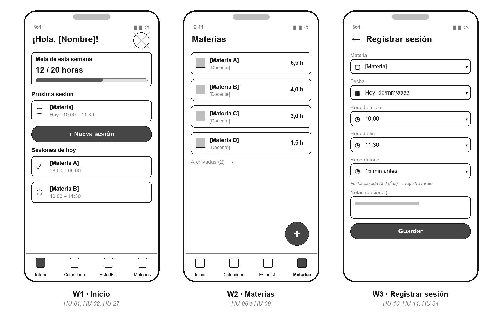{#figura4}

Nota: Debajo de cada pantalla se indican las historias de usuario que representa. Elaboración propia a partir del mockup de referencia del proyecto.

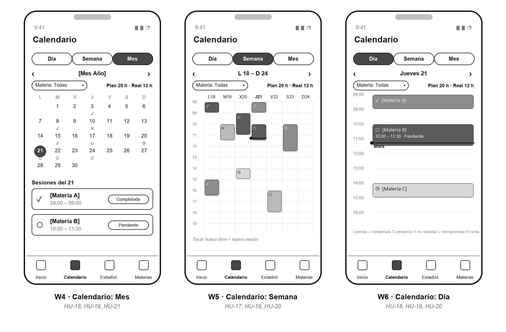{#figura5}

Nota: Íconos de estado: visto (completada), círculo vacío (pendiente), equis (no realizada), flecha circular (reprogramada) y reloj (registro tardío). Elaboración propia.

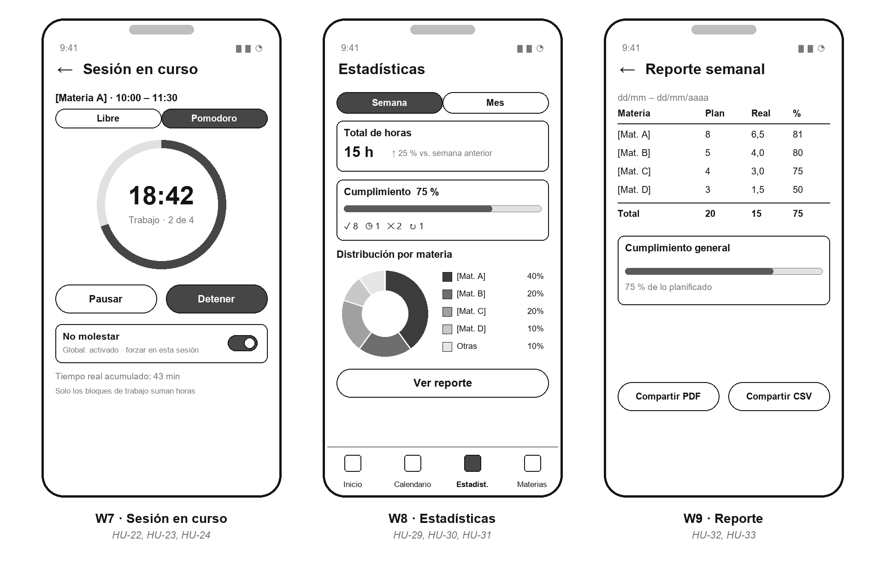{#figura6}

Nota: Elaboración propia.

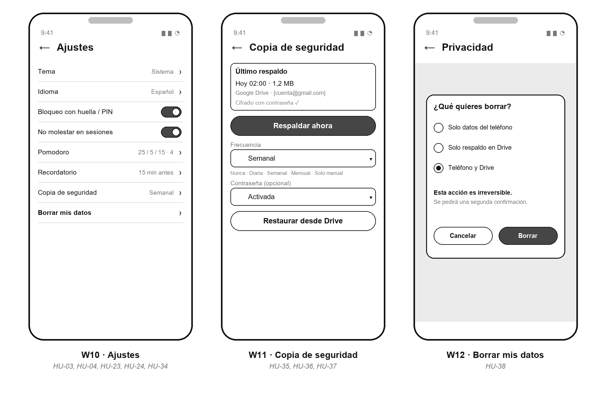{#figura7}

Nota: Elaboración propia.

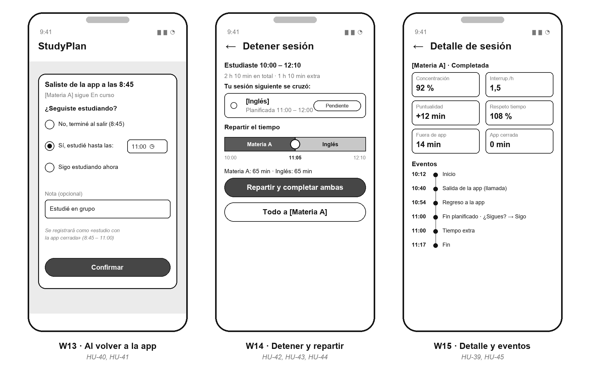{#figura8}

Nota: W13 implementa la declaración de estudio con la app cerrada; W15 muestra la línea de tiempo de eventos y las métricas de concentración. Elaboración propia.

Para contrastar los prototipos con lo construido se capturaron cinco pantallas de la aplicación instalada en un teléfono Android: Inicio con la meta semanal (@figura:app_inicio), Calendario en vista de día (@figura:app_calendario), Estadísticas con la distribución por materia (@figura:app_estadisticas), Materias (@figura:app_materias) y Copia de seguridad (@figura:app_respaldo). A las capturas se les recortó la barra de estado y se ocultaron el nombre del estudiante y el correo de la cuenta vinculada.

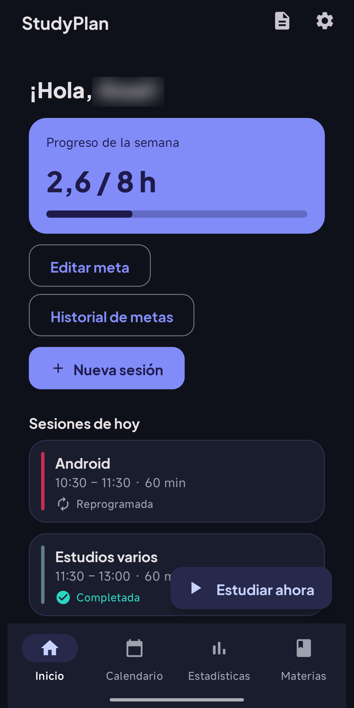{#app_inicio ancho=5.5}

Nota: Elaboración propia. Captura de la aplicación en un teléfono Android.

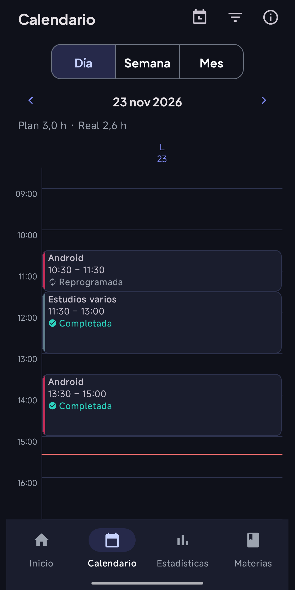{#app_calendario ancho=5.5}

Nota: Elaboración propia. Captura de la aplicación en un teléfono Android.

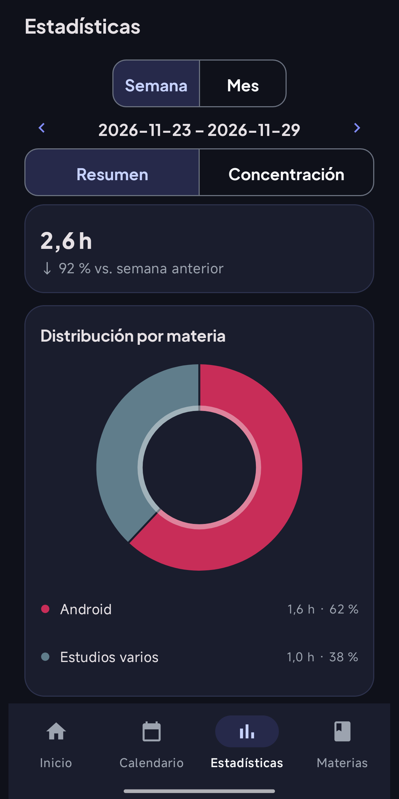{#app_estadisticas ancho=5.5}

Nota: Elaboración propia. Captura de la aplicación en un teléfono Android.

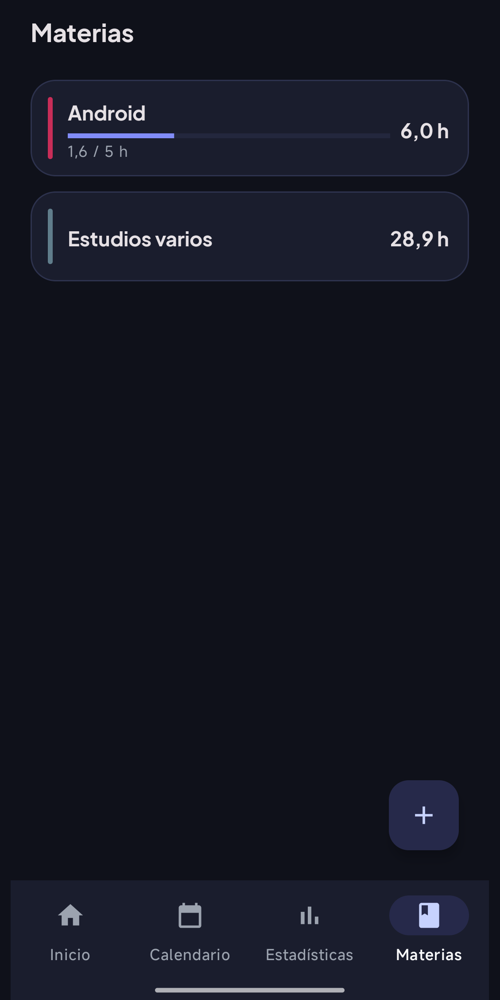{#app_materias ancho=5.5}

Nota: Elaboración propia. Captura de la aplicación en un teléfono Android.

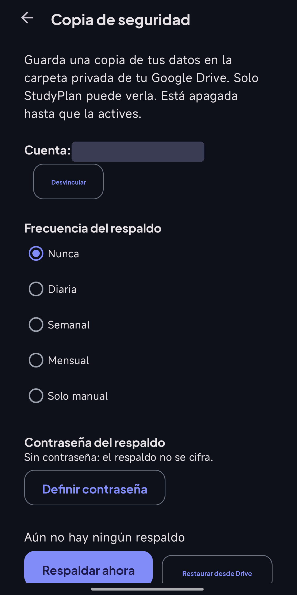{#app_respaldo ancho=5.5}

Nota: Elaboración propia. Captura de la aplicación en un teléfono Android. El correo de la cuenta se ocultó.

## Diseño de Componentes y Módulos

### Estructura de paquetes y tipos de clase

El código está dividido en tres capas (presentación, núcleo e infraestructura) y, dentro de cada capa, en carpetas que dicen qué es cada clase. Antes todas las clases de una capa vivían sueltas en una sola carpeta (el dominio tenía 71 archivos juntos), de modo que no se podía distinguir una entidad de un value object, un enum o una clase de lectura. La reorganización se hace por etapas, capa por capa, sin cambiar el comportamiento de la aplicación: cada etapa compila, mantiene las mismas pruebas y actualiza esta sección. Esta sección documenta las tres capas: el dominio, la aplicación y los adaptadores.

El dominio (`domain`) se divide por tipo de clase. Una clase se asigna a su carpeta con estas preguntas, en este orden, y la primera que se cumple decide:

1. ¿Es un enum, una lista cerrada de valores? Va a `enumeration`.
2. ¿Forma parte de la máquina de estados de la sesión? Va a `state`.
3. ¿Tiene identidad y cambia en el tiempo? Va a `entity`.
4. ¿Es una regla o un cálculo sin estado? Va a `service`.
5. ¿Es un dato que se arma para devolverlo a la pantalla? Va a `readmodel`.
6. Si no, es inmutable y se define por su valor: va a `valueobject`.

Dos enums quedan fuera de `enumeration` por pertenecer a un grupo mayor: `ErrorValidacion` está en `result`, junto a `Resultado`, y `CodigoEstadoSesion` está en `state`, junto a los estados de la sesión.

```text
domain/
  entity/        Materia, SesionEstudio, EventoEstudio, Perfil, MetaSemanal, Ajustes
  valueobject/   Fecha, Hora, Instante, ConfiguracionPomodoro, IntervaloEfectivo,
                 FiltroCalendario, PeriodoCalendario, PeriodoEstadisticas
  enumeration/   TecnicaEstudio, FasePomodoro, TipoEventoEstudio, Tema, Idioma, ... (12 enums)
  state/         EstadoSesion (contrato), EstadoPendiente, EstadoEnCurso, EstadoCompletada, ...
  service/       CalculadorPomodoro, CalculadorTiempoReal, RepartidorPorDia, ... (8 reglas)
  result/        Resultado, ErrorValidacion
  readmodel/     ResumenInicio, DetalleSesion, DatosCalendario, ... (los datos que ve la pantalla)
```

Nota: Elaboración propia. Cada carpeta existe en el código; la prueba `EstructuraPaquetesTest` falla si se deja una clase suelta en la raíz de `domain` o en una carpeta que no sea un tipo.

La capa de aplicación (`application`) se divide por épica, es decir, por grupo de casos de uso: `configuracion`, `materias`, `sesiones`, `calendario`, `tecnicas`, `metas`, `estadisticas`, `reportes` y `recordatorios`, más `comun` para lo que sirve a varias épicas. Cada caso de uso tiene su contrato de entrada en `port/in/<épica>` y su servicio en `service/<épica>`, en la misma épica; `EstructuraPaquetesTest` comprueba que cada servicio esté junto a su contrato. Los contratos de salida, lo que el núcleo exige a Room, al reloj o a las notificaciones, se dividen en `port/out/persistence` (repositorios) y `port/out/system` (el resto). Cuatro clases ayudantes que usan servicios de varias épicas (`NombresDeMateria`, `ValidadorSesiones`, `EjecucionHitos` y `DetectorFelicitacionMetas`) están en `service/comun` y son públicas; es el único cambio de código de esta reorganización, pensado para que la carpeta no oculte una dependencia.

```text
application/
  port/in/<épica>/      RegistrarMateria, IniciarSesion, ConsultarCalendario, ...  (un contrato por caso de uso)
  port/out/persistence/ MateriaRepository, SesionRepository, AlmacenDatos, ...
  port/out/system/      Reloj, MarcadorSalidaApp, ControladorNoMolestar, ProgramadorAvisosSesion, ...
  service/<épica>/      RegistrarMateriaService, IniciarSesionService, ...
  service/comun/        NombresDeMateria, ValidadorSesiones, EjecucionHitos, DetectorFelicitacionMetas
```

Nota: Elaboración propia. `<épica>` es una de las nueve carpetas de épica o `comun`.

Los adaptadores se dividen según su dirección. Los de entrada, la interfaz de usuario (`adapter/in/ui`), se agrupan por épica igual que la aplicación: cada carpeta reúne las Activities, los ViewModels, los adaptadores de lista y los diálogos de esa épica, y `comun` guarda lo compartido (las clases base `ActividadBase` y `ActividadProtegida`, los formatos y el aplicador de apariencia). Los de salida se dividen por tecnología: `adapter/out/persistence` tiene `entity` (las tablas de Room), `dao` (las consultas) y `repository` (las clases que implementan los contratos de salida de persistencia), y `adapter/out/system` y `adapter/out/security` quedan planos porque tienen pocos archivos.

Algunas clases no se movieron a propósito. `StudyPlanDatabase` y `Migraciones` se quedan en la raíz de `adapter/out/persistence` porque Room guarda el esquema exportado en una carpeta con el nombre completo de la base de datos. `StudyPlanApplication`, `FabricaViewModels`, `ReceptorAvisosSesion` y `ServicioSesionEnCurso` se quedan en la raíz de `adapter/in/ui` porque el manifiesto las nombra y el sistema operativo las recuerda por su nombre de clase, y `ReceptorAdministradorBloqueo` se queda en `adapter/out/system` por la misma razón. Ocho clases de la interfaz que antes solo se veían dentro de su carpeta (por ejemplo `FormatoHoras` o `MensajesDeError`) pasaron a ser públicas porque ahora las usan varias épicas, igual que los métodos de acceso de `StudyPlanApplication` y de `NotificadorSesion` que usan las pruebas.

```text
adapter/
  in/ui/<épica>/        Activity, ViewModel, adaptador de lista y diálogo de la épica
  in/ui/comun/          ActividadBase, ActividadProtegida, AplicadorApariencia, FormatoHoras, ...
  in/ui/                StudyPlanApplication, FabricaViewModels, ReceptorAvisosSesion, ServicioSesionEnCurso
  out/persistence/      entity/ (tablas Room), dao/, repository/ (con Mapeadores); StudyPlanDatabase, Migraciones
  out/system/           BloqueoPantallaSistema, RelojSistema, ProgramadorAvisosAlarmManager, ...
  out/security/         DisponibilidadBloqueoBiometrico
```

Nota: Elaboración propia. Dos nombres se repiten a propósito en capas distintas y no se confunden por el paquete: `domain/entity` es el modelo del negocio y `adapter/out/persistence/entity` son las tablas de Room; `domain/service` son reglas sin estado y `application/service` son los casos de uso.

La @tabla:tipos_de_clase define cada tipo de clase del proyecto, con un ejemplo real. Los contratos (puertos) y los servicios de aplicación viven en la capa de aplicación, y los adaptadores en la de infraestructura y presentación; se incluyen aquí para tener todas las definiciones juntas.

Tabla: Tipos de clase del proyecto y un ejemplo de cada uno {#tipos_de_clase anchos=3,6.2,4.6 tam=10}

| Tipo | Qué es | Ejemplo en StudyPlan |
|---|---|---|
| Enum | Una lista cerrada de valores posibles. | `TecnicaEstudio` (Libre, Pomodoro) |
| Entidad | Un objeto con identidad propia que cambia en el tiempo. | `SesionEstudio` |
| Value object | Un valor inmutable que se define por lo que contiene, sin identidad. | `Fecha`, `Hora` |
| Estado | Una clase que representa un estado de la sesión y qué transiciones admite (patrón State). | `EstadoEnCurso` |
| Servicio de dominio | Una regla o un cálculo sin estado que no pertenece a una sola entidad. | `CalculadorPomodoro` |
| Resultado | Lo que devuelve una validación: un valor correcto o un error. | `Resultado`, `ErrorValidacion` |
| Clase de lectura | Datos armados para mostrarlos en una pantalla; no es una entidad. | `ResumenInicio` |
| Contrato (puerto) | Una interfaz que el núcleo expone (de entrada, un caso de uso) o exige (de salida, lo que necesita de afuera). | `RegistrarMateria` (entrada), `MateriaRepository` (salida) |
| Servicio de aplicación | La clase que implementa un contrato de entrada y orquesta un caso de uso. | `RegistrarMateriaService` |
| Adaptador | Una clase de infraestructura o de presentación que conecta el núcleo con Android, Room u otro sistema. | `MateriaRepositoryRoom`, `MateriasActivity` |

Nota: Elaboración propia. Los ejemplos son clases reales del código.

Los diagramas de clases siguen la notación UML. Cada contrato (puerto de entrada o de salida) se dibuja como una interfaz (`«interface»`) y cada servicio o adaptador como una clase aparte que la realiza, con trazo discontinuo y triángulo hueco; la herencia usa línea continua con triángulo hueco, y la asociación, una flecha simple. Las clases se agrupan en un paquete UML por capa (`adapter.in.ui`, `application.port.in`, `application.service`, `application.port.out`, `domain` y los paquetes de `adapter.out`). Cada caja muestra solo los métodos públicos, hasta un máximo, y el resto se resume con «(+n)». Las relaciones y las firmas se leen de los fuentes Java, y los diagramas de secuencia parten de un actor, el Estudiante, que abre la pantalla, completa los campos y pulsa el botón; donde otro actor dispara el flujo, como Android con las alarmas, aparece también como actor. Los archivos fuente de los diagramas están en `docs/build/uml/` y se regeneran con `python docs/build/diagramas_uml.py`.

### Épica Configuración inicial

La primera épica implementada reúne el perfil inicial (HU-01), el Inicio parcial (HU-02), el tema y el idioma (HU-03), el bloqueo con huella o PIN (HU-04) y el borrado de datos del teléfono (HU-38). La @figura:clases_configuracion muestra sus 58 clases agrupadas por paquete. En la capa de presentación se detallan los métodos del ciclo de vida (onCreate, onStart) y de los listeners (onGuardarClick, onMenuBarraSuperiorClick y los demás), que se escriben como métodos con nombre para que se vean en la revisión de código. Las Activities protegidas heredan de ActividadProtegida, que consulta al núcleo si falta el perfil o si hay que autenticar antes de mostrar datos; PerfilInicialActivity y AutenticacionActivity heredan de ActividadBase porque no muestran datos del estudiante.

{#clases_configuracion ancho=16.5}

Nota: Elaboración propia. Cada clase del diagrama existe en el código y cada clase de los paquetes aparece en el diagrama; el cotejo se repite con `python docs/build/cotejo_clases.py`.

### Épica Gestión de materias

La segunda épica implementada reúne el registro, la edición, el archivado y la eliminación de materias, la lista con sus horas y el desarchivado (HU-06 a HU-09 y HU-46). La @figura:clases_materias muestra sus clases: en la capa de presentación se detallan los métodos de las Activities y los ViewModel; en el núcleo, los campos y métodos de `Materia`; y en la infraestructura, la entidad, el DAO y el adaptador de Room. Las firmas salen del código fuente, no se escriben a mano.

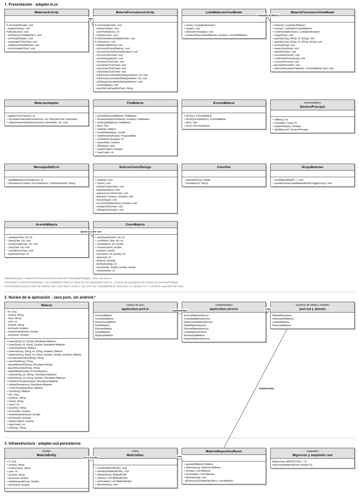{#clases_materias ancho=16.5}

Nota: Elaboración propia, generada desde el código; `python docs/build/cotejo_clases.py` comprueba que no se desfasa.

El nombre de la materia se sanea antes de guardarse (se recortan los espacios de los extremos y se colapsan los repetidos) y la unicidad entre las materias activas se decide con una clave sin acentos ni mayúsculas (RN-02, ampliada por el Product Owner). La @figura:secuencia_registrar_materia recorre las tres capas al registrar una materia, desde que el Estudiante abre el formulario, escribe el nombre, el docente y la meta, elige el color y pulsa «Guardar»: cada mensaje que corresponde a un método del código se verifica y el script que lo dibuja falla si alguno deja de existir.

{#secuencia_registrar_materia ancho=16.5}

Nota: Elaboración propia. Los mensajes con línea discontinua son retornos.

### Épica Sesiones de estudio

La tercera épica implementada (`add-sesiones-estudio`) incorpora la planificación de sesiones, el registro de sesiones pasadas dentro de la ventana de tres días, la finalización el mismo día, el registro tardío desde `NO_REALIZADA`, la reprogramación con enlace al destino, la eliminación protegida de sesiones `PENDIENTE` y el cierre real de la pantalla Inicio y de las horas acumuladas por materia (HU-02, HU-08/RN-03, HU-09, HU-10 a HU-15 y RN-04 a RN-08). La @figura:clases_sesiones agrupa sus clases por paquete en las tres capas de la arquitectura hexagonal. En el dominio puro (sin `android.*` ni `java.time`), `Fecha`, `Hora` y `SesionEstudio` delegan cada transición válida del ciclo de vida (`RN-07`) en la jerarquía polimórfica del patrón *State* (`EstadoSesion` y sus seis estados concretos), devolviendo `Resultado` sin lanzar excepciones (`RNF-14`); en infraestructura, Room avanza a la versión 3 (`MIGRATION_2_3`) añadiendo `sesion_estudio` con clave foránea restringida hacia `materia` (`RN-03`), autoreferencia de reprogramación (`sesion_origen_id`) y el adaptador real `SesionesDeMateriaRoom`.

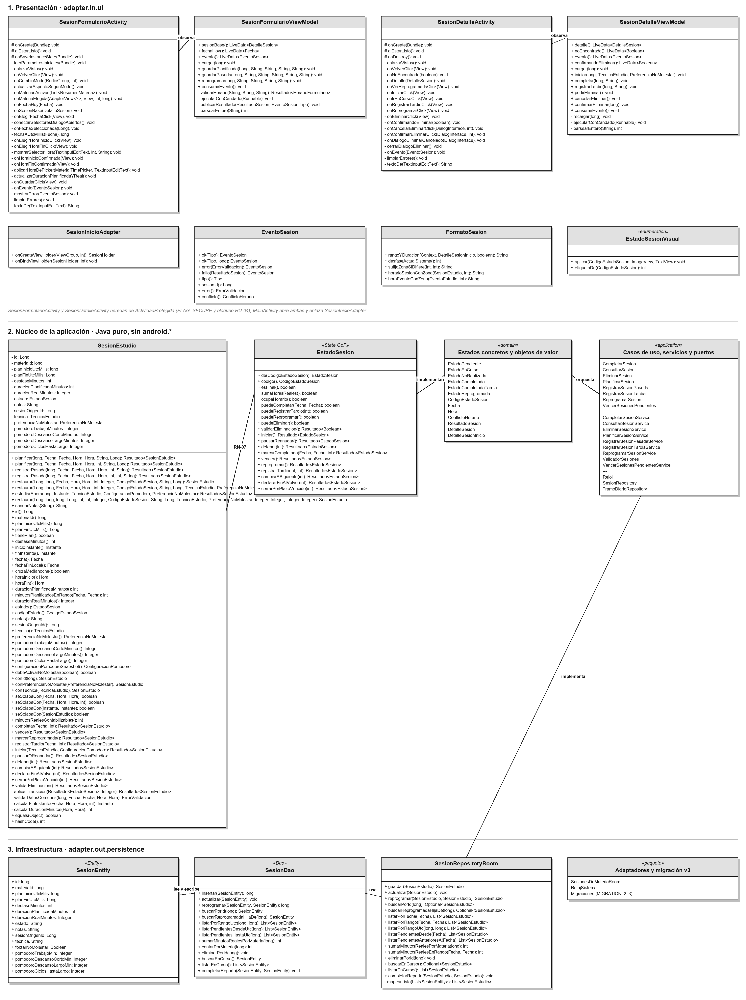{#clases_sesiones ancho=16.5}

Nota: Elaboración propia, generada desde el código; `python docs/build/cotejo_clases.py` comprueba la correspondencia exacta con las clases Java.

Para evitar cruces horarios entre sesiones activas (`RN-05`), cada operación de planificación o reprogramación consulta `ValidadorSesiones` en el hilo de fondo antes de delegar en `SesionEstudio` y persistir mediante `SesionRepositoryRoom`. La @figura:secuencia_planificar_sesion recorre ese flujo desde que el Estudiante abre el formulario y elige materia, fecha y horas hasta Room y el retorno al hilo principal; el script generador valida que todos los nombres de métodos correspondan al código fuente vigente.

{#secuencia_planificar_sesion ancho=16.5}

Nota: Elaboración propia. Los mensajes con línea discontinua son retornos.

### Épica Calendario de estudio

La cuarta épica implementada (`add-calendario-estudio`) habilita la pestaña **Calendario** (`DestinoPrincipal.CALENDARIO`, que abre `CalendarioActivity`) con vistas nativas **Día**, **Semana** y **Mes** construidas íntegramente en Views XML y Java sin librerías externas de calendario ni permisos nuevos (HU-16 a HU-21, RN-08, RN-11, RN-13, RNF-06, RNF-19). En el dominio puro, `PeriodoCalendario` resuelve la navegación por día/semana/mes y la conservación de foco al alternar entre vistas, mientras `CalculadorRangoHorario` determina la ventana de desplazamiento inicial (`± 2 h` sobre la rejilla de 24 horas), distribuye columnas paralelas ante coincidencias visuales entre sesiones `REPROGRAMADA` y activas, y calcula el resumen `Plan / Real` del periodo visible. La @figura:clases_calendario presenta sus clases por capa y la @figura:secuencia_consultar_calendario muestra la consulta por rango (`listarPorRango`) sobre Room v3 sin migración de esquema.

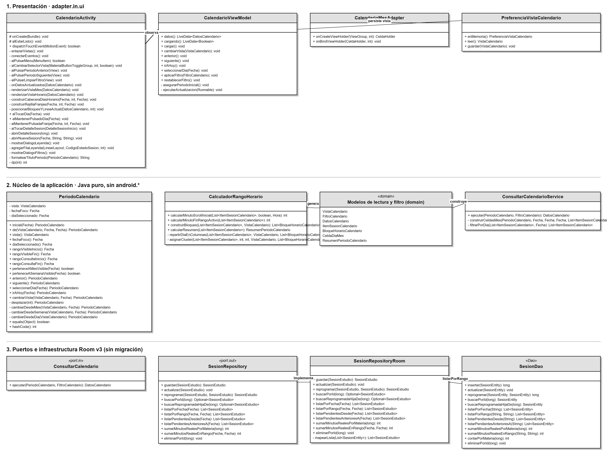{#clases_calendario ancho=16.5}

Nota: Elaboración propia, generada desde el código; `python docs/build/cotejo_clases.py` comprueba la correspondencia exacta con las clases Java.

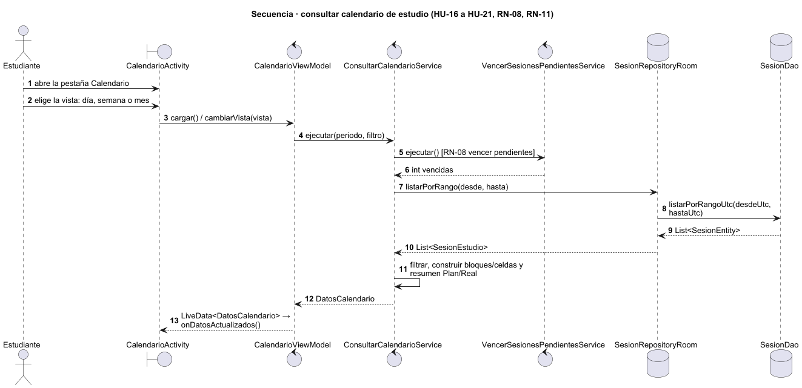{#secuencia_consultar_calendario ancho=16.5}

Nota: Elaboración propia. Los mensajes con línea discontinua son retornos.

### Épica Técnicas de estudio y ejecución en vivo

La quinta épica implementada (`add-tecnicas-estudio`) reemplaza la finalización directa desde `PENDIENTE` por el flujo obligatorio en vivo (de `PENDIENTE` a `EN_CURSO` y luego a `COMPLETADA`, `RN-07`), incorporando las técnicas **Libre** (`HU-22`) y **Pomodoro** (`HU-23`, con instantánea inmutable de parámetros al iniciar `RN-22`), la configuración opcional de **No molestar** sin bloqueo ante denegación (`HU-24`, `RNF-18`), la línea de tiempo cronológica de eventos persistidos en Room v4 (`evento_estudio`, `MIGRATION_3_4`, `HU-39`, `RN-23`), la recuperación tras salida de la app mediante el diálogo `W13` (`HU-40`, `HU-41`), los avisos de hitos con `AlarmManager` y el reparto interactivo de tramo continuo `W14` (`HU-42` a `HU-44`). La @figura:clases_tecnicas presenta sus clases agrupadas por capa, incluyendo el nuevo paquete `adapter.out.system`, y la @figura:secuencia_ejecucion_sesion ilustra el inicio de una sesión en vivo con persistencia del evento `INICIO`, aplicación opcional de No molestar y programación de avisos.

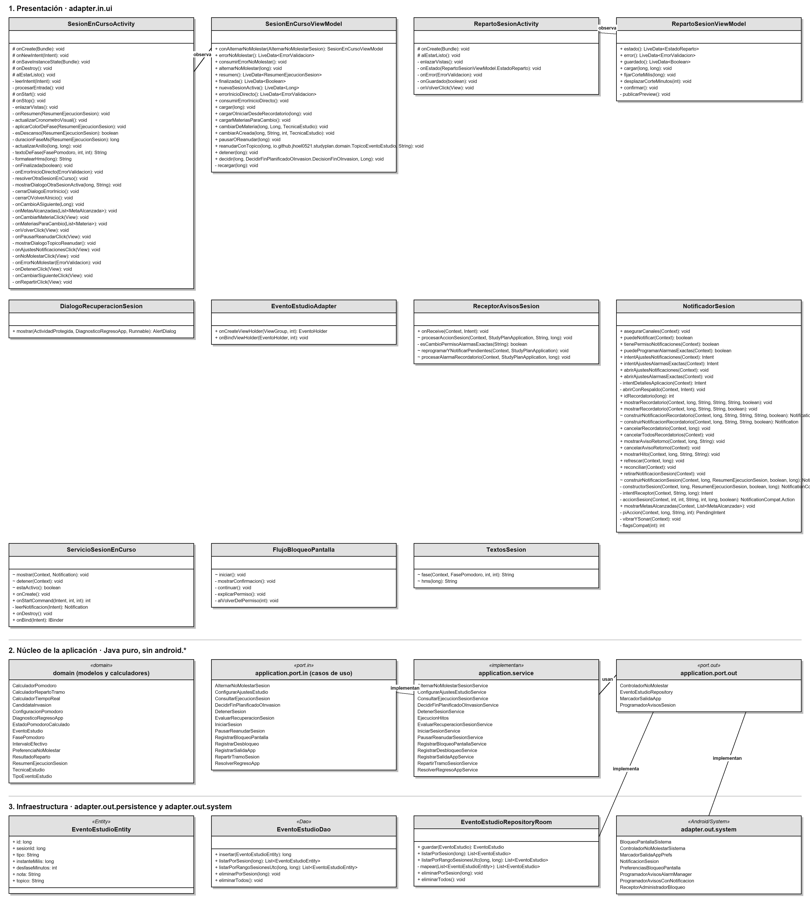{#clases_tecnicas ancho=16.5}

Nota: Elaboración propia, generada desde el código; `python docs/build/cotejo_clases.py` comprueba la correspondencia exacta con las clases Java.

{#secuencia_ejecucion_sesion ancho=16.5}

Nota: Elaboración propia. Los mensajes con línea discontinua son retornos.

### Épica Metas semanales y estudio inmediato

La sexta épica implementada (`add-metas-semanales`, Room v6 con `MIGRATION_5_6`) incorpora las instantáneas semanales inmutables en `meta_semanal` (`RN-33`, `HU-25` a `HU-27`), la materia general protegida «Estudios varios» (`RN-32`), el inicio inmediato sin plan mediante `EstudiarAhora` (de `Nueva` a `En curso`, `HU-47`, `RN-07`), el cambio continuo de materia en `CambiarDeMateria` (`HU-48`) y la felicitación única acumulada al cierre real de la sesión (`FelicitacionMetasActivity`, `HU-28`, `RN-16`). La @figura:clases_metas presenta sus clases agrupadas por capa.

{#clases_metas ancho=16.5}

Nota: Elaboración propia, generada desde el código; `python docs/build/cotejo_clases.py` comprueba la correspondencia exacta con las clases Java.

### Épica Estadísticas y blindaje de ejecución

La séptima épica implementada (`add-estadisticas`, Room v7 con `MIGRATION_6_7` que incorpora `topico` en `evento_estudio`) habilita la pestaña **Estadísticas** (`DestinoPrincipal.ESTADISTICAS`, que abre `EstadisticasActivity`), calcula el total de horas reales con variación semanal o mensual (`HU-29`, `RN-31`), presenta la distribución por materia mediante `MPAndroidChart` (`HU-30`), evalúa la tasa de cumplimiento excluyendo sesiones aún vigentes (`HU-31`), mide concentración, puntualidad, respeto del tiempo y tópicos agrupados de pausas o salidas (`HU-45`, `RN-30`), y blinda la detección de regresos y descansos Pomodoro (`HU-39`, `HU-41`). La @figura:clases_estadisticas presenta sus clases agrupadas por capa y `DesgloseMateriaPeriodo` como base compartida para reportes.

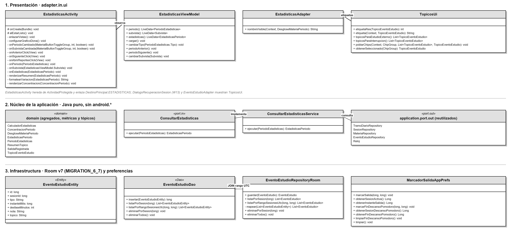{#clases_estadisticas ancho=16.5}

Nota: Elaboración propia, generada desde el código; `python docs/build/cotejo_clases.py` comprueba la correspondencia exacta con las clases Java.

### Épica Reportes y exportación

La octava épica implementada (`add-reportes`, sin cambios de esquema sobre Room v7) reutiliza `DesgloseMateriaPeriodo` y `CalculadorEstadisticas` (`calcularReporte`) junto con el corte diario unificado `SesionEstudio.minutosPlanificadosEnRango` (`RN-31`) para presentar reportes semanales o mensuales con horas planificadas, horas reales, cumplimiento y sesiones no realizadas (`HU-32`), accesibles desde Estadísticas conservando el periodo activo o desde la barra superior de Inicio sin alterar las cuatro pestañas fijas (`W8`). En `HU-33`, `GeneradorCsvReporte` emite UTF-8 con prefijo BOM, delimitador `,`, fin de línea `CRLF`, decimales con punto (`Locale.ROOT`) y mitigación `CWE-1236` para apertura en Google Sheets e importación en Excel Windows, mientras `ExportadorReporteSistema` genera PDF A4 multipágina (`PdfDocument`) independiente de densidad y tema, los expone vía `FileProvider` con retención acotada en caché y los limpia desde `BorrarDatosService` (`HU-38`). La @figura:clases_reportes muestra sus clases por capa.

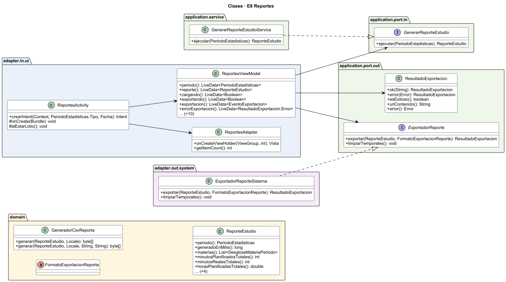{#clases_reportes ancho=16.5}

Nota: Elaboración propia, generada desde el código; `python docs/build/cotejo_clases.py` comprueba la correspondencia exacta con las clases Java.

### Épica Recordatorios de sesiones

La novena épica implementada (`add-recordatorios`, Room v8 con `MIGRATION_7_8`) incorpora los recordatorios locales previos al inicio planificado sin tablas adicionales, conservando la antelación como `AntelacionRecordatorio` (`0`, `5`, `15` o `30` min) en `ajustes.recordatorio_minutos` (predeterminado en 15 min) y `sesion_estudio.recordatorio_minutos` (nulo cuando está desactivado, `HU-34`). Desde el núcleo puro, `PlanificarSesionService`, `ReprogramarSesionService` y los casos de uso que mutan sesiones `PENDIENTE` (`EliminarSesionService`, `IniciarSesionService`, `DecidirFinPlanificadoOInvasionService`, `RepartirTramoSesionService` y `BorrarDatosService`) sincronizan alarmas y notificaciones mediante `ProgramadorRecordatorios`, mientras `ReprogramarRecordatoriosPendientesService` restablece avisos futuros tras reinicio (`BOOT_COMPLETED`), actualización (`MY_PACKAGE_REPLACED`) o concesión de `SCHEDULE_EXACT_ALARM` y notifica de inmediato los avisos cuya ventana venció antes del inicio. En las capas de sistema e interfaz (`ProgramadorAvisosAlarmManager` mediante `setExactAndAllowWhileIdle` o respaldo `setAndAllowWhileIdle`, `NotificadorSesion` con `VISIBILITY_PRIVATE` bajo bloqueo activo, acción directa «Iniciar» sin `CLEAR_TASK` y flujos no bloqueantes de permisos `RNF-18`), la @figura:clases_recordatorios presenta las clases introducidas.

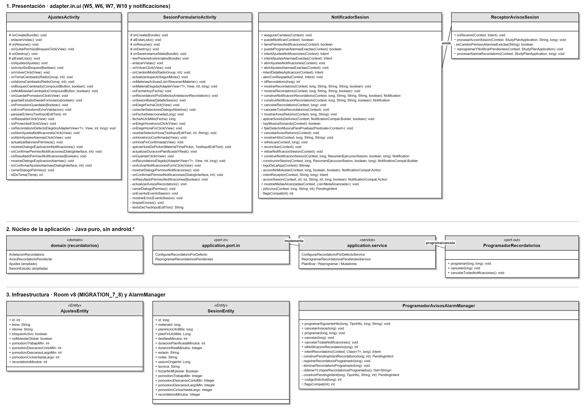{#clases_recordatorios ancho=16.5}

Nota: Elaboración propia, generada desde el código; `python docs/build/cotejo_clases.py` comprueba la correspondencia exacta con las clases Java.

### Widget de progreso semanal

El change `add-widget-progreso` implementa HU-05. El widget es de un solo tamaño, 1×4 celdas (RNF-19), y muestra de izquierda a derecha el logo de la aplicación, la meta semanal (un anillo con el porcentaje y «horas / meta») y las dos próximas materias, cada una con su color, día y hora. Es un adaptador de entrada en `adapter.in.ui.configuracion` que reutiliza el caso de uso `ObtenerResumenInicio` de la pantalla de Inicio, de modo que el cálculo de las horas, la meta y la próxima sesión no se duplica. Para las dos próximas materias se amplió el modelo de lectura `ResumenInicio` con `proximasSesiones()`, calculada con el mismo recorrido que ya elegía la próxima; Inicio sigue usando `proximaSesion()` sin cambios.

El widget se compone de cuatro clases: `WidgetProgresoProvider` (el `AppWidgetProvider` que arma las vistas y abre Inicio al tocarlo), `ModeloWidgetProgreso` (decide el estado y el porcentaje; es Java puro y se prueba en la JVM), `DibujanteAnilloProgreso` (dibuja el anillo en un mapa de bits, porque `RemoteViews` no admite vistas propias) y `ObservadorProgresoWidget` (pide el refresco cuando cambian los datos).

Dos decisiones explican el diseño. Primera, el refresco usa el rastreador de invalidación de Room sobre `sesion_estudio`, `meta_semanal`, `perfil` y `materia`: así el widget se actualiza al completar una sesión sin modificar ninguno de los servicios de sesión, y los avisos seguidos se agrupan en un solo redibujado. Segunda, la lectura de los datos ocurre en el hilo de fondo de la aplicación (`goAsync`), nunca en el principal. Además de los cambios de datos, el sistema lo redibuja cada 30 minutos, el mínimo permitido, para el cambio de día y de semana; por eso, tras la medianoche puede mostrar el dato anterior hasta un máximo de 30 minutos.

Si no hay perfil, meta semanal o sesiones próximas, el widget lo dice con texto («Abre StudyPlan para empezar», «Define tu meta semanal», «Sin sesiones próximas») y, como en el resto de la aplicación, ningún estado depende solo del color (RNF-06). Tocar el widget abre Inicio, donde se aplica el bloqueo con huella o PIN (HU-04) si está activo. Una versión previa con dos tamaños (2×2 y 4×2) se descartó por decisión del Product Owner. Quedan fuera, por no estar en HU-05, mostrar la sesión en curso, ocultar los datos con el bloqueo activo y un botón «Estudiar ahora».

### Épica Respaldo y privacidad

El change `add-respaldo-drive` implementa HU-35 a HU-38 (RN-19 a RN-21). El respaldo nace apagado: sin cuenta vinculada y con frecuencia `NUNCA`; lo activa el estudiante. El núcleo es Java puro: `InstantaneaRespaldo` guarda cada tabla de Room como filas (mapas de columna a valor), de modo que el formato no duplica las entidades y tolera columnas nuevas; `SerializadorRespaldo` lo convierte a JSON sin depender de `org.json`; `NormalizadorRespaldo` deja por defecto los ajustes ligados al teléfono (bloqueo con huella o PIN y No molestar) y devuelve a «Pendiente» las sesiones «En curso» antes de restaurar. Tres casos de uso (`ConfigurarRespaldo`, `RespaldarAhora`, `RestaurarRespaldo`) y la ampliación de `BorrarDatos` con los alcances `DRIVE` y `AMBOS` devuelven un `ResultadoRespaldo` en vez de lanzar excepciones; si Drive falla al borrar, no se toca nada del teléfono. `RestaurarRespaldoService` abre y valida todo (cabecera, contraseña, versión de formato) antes de modificar datos y después reprograma los recordatorios.

En infraestructura, `CifradorRespaldoAesGcm` cifra con AES-256-GCM y una clave derivada con PBKDF2-HMAC-SHA256 (120 000 iteraciones, sal de 16 bytes, IV de 12 bytes); el PBKDF2 se calcula con HMAC-SHA256 porque `SecretKeyFactory("PBKDF2WithHmacSHA256")` solo existe desde Android 8 y la app admite Android 7. `AlmacenCredencialRespaldoKeystore` guarda la contraseña cifrada con una clave del Android KeyStore para poder respaldar de forma automática sin pedirla; si la clave se pierde, el respaldo vuelve a pedirla. `ClienteGoogleDriveRest` usa `HttpURLConnection` contra la API REST de Drive v3 sobre `appDataFolder` con un único archivo, y `AutenticadorGoogleDrive` obtiene el token con la API de autorización de Google Identity Services y el alcance `drive.appdata`; `WorkerRespaldoDrive` y `ProgramadorRespaldoWorkManager` programan la tarea periódica con red conectada y reintento solo ante fallos de red. `AlmacenDatosRoom.restaurarTodo` reemplaza todas las tablas en una transacción y comprueba las claves foráneas antes de confirmar. En la interfaz, `RespaldoActivity` y `RespaldoViewModel` (Ajustes > Copia de seguridad), el flujo de borrado con alcance y el botón «Restaurar desde Google Drive» de `PerfilInicialActivity`.

La @figura:clases_respaldo muestra las clases de la épica de respaldo, con los métodos del ciclo de vida y de los listeners de la pantalla, y la @figura:clases_widget las del widget de progreso semanal. Los métodos se toman del código con `python docs/build/diagramas_clases.py`, y `python docs/build/cotejo_clases.py` comprueba que ningún diagrama quede desfasado respecto de las clases reales.

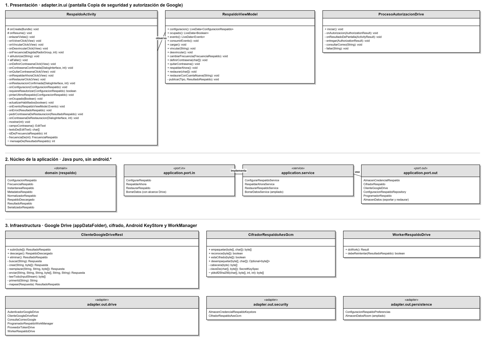{#clases_respaldo ancho=16.5}

Nota: Elaboración propia a partir del código.

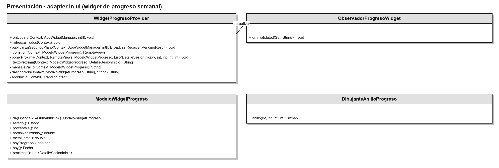{#clases_widget ancho=16.5}

Nota: Elaboración propia a partir del código.
