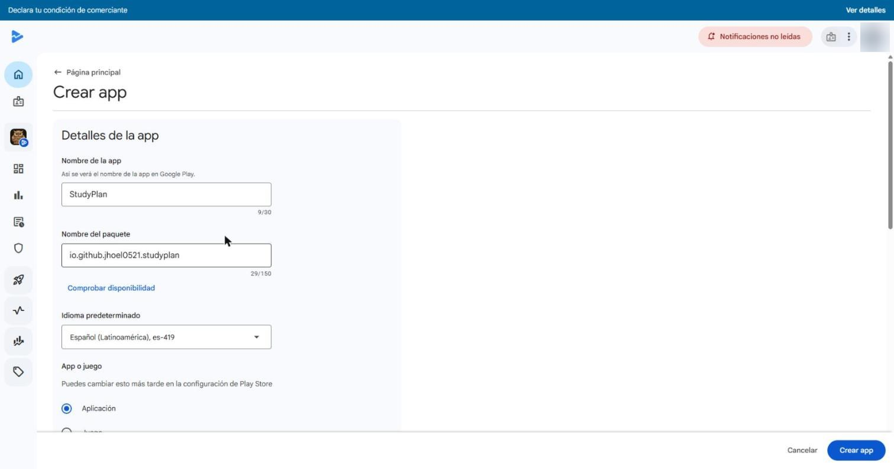
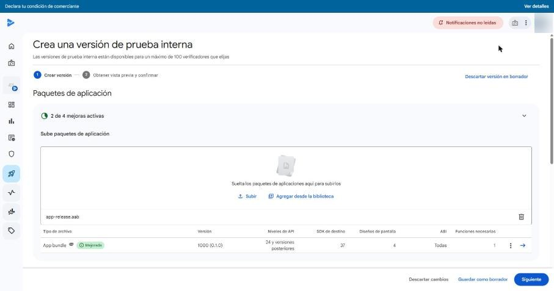
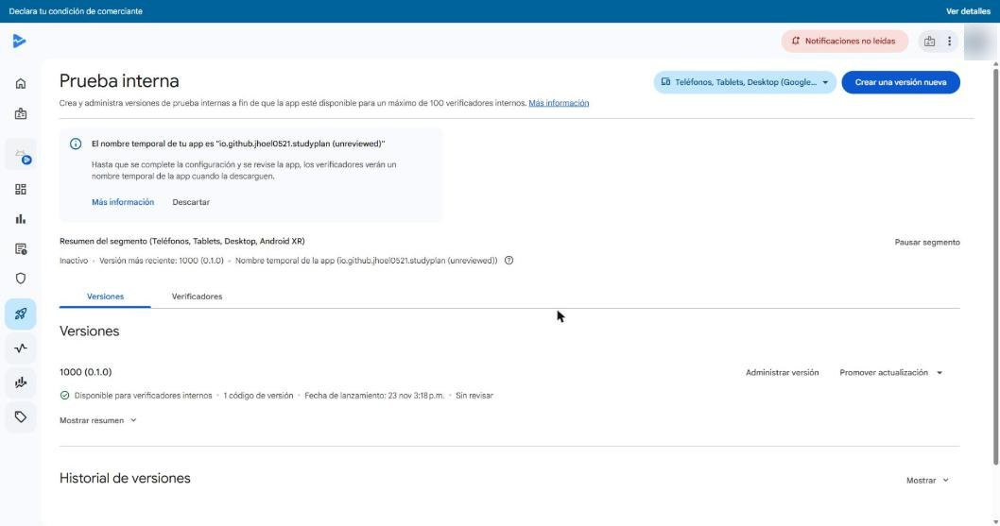
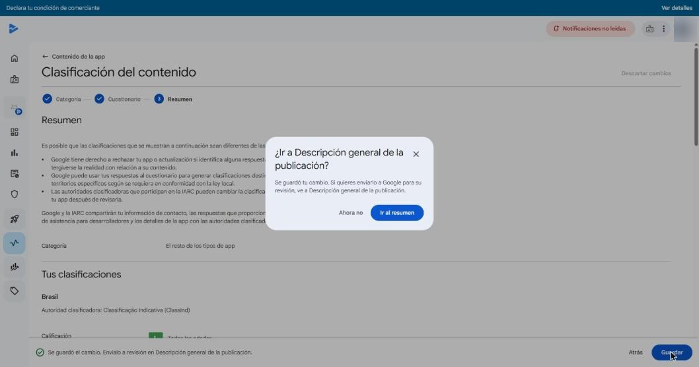
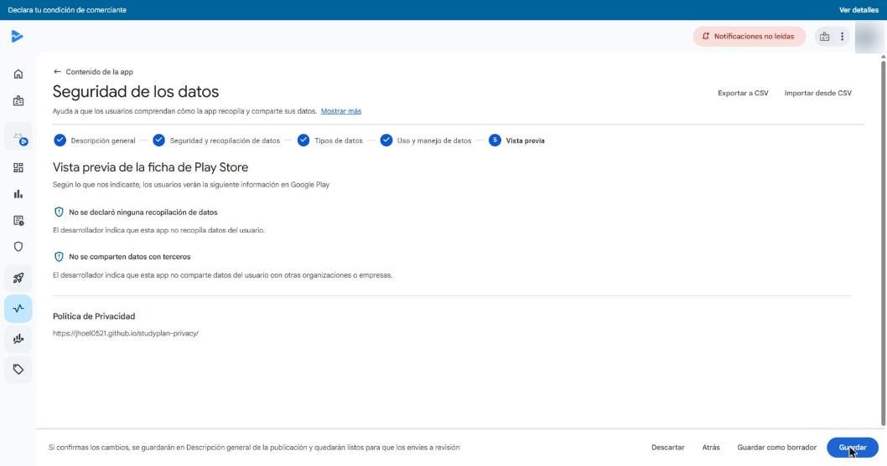
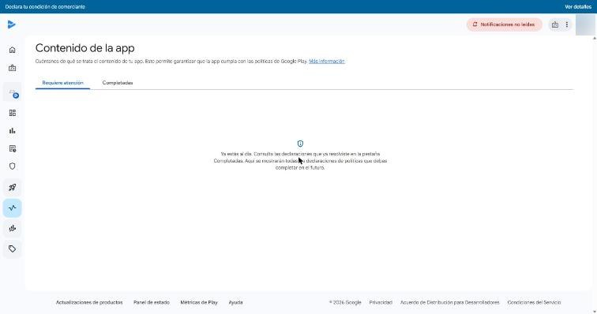
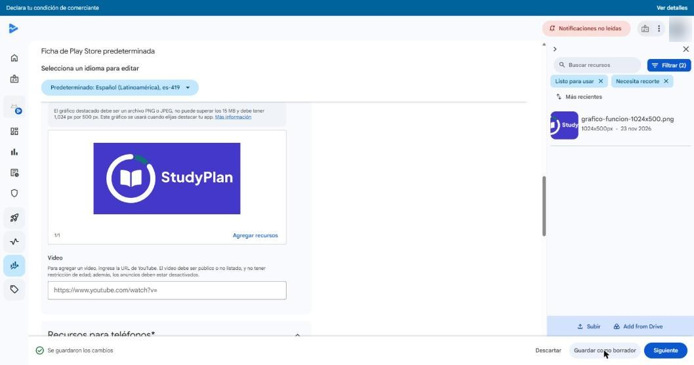
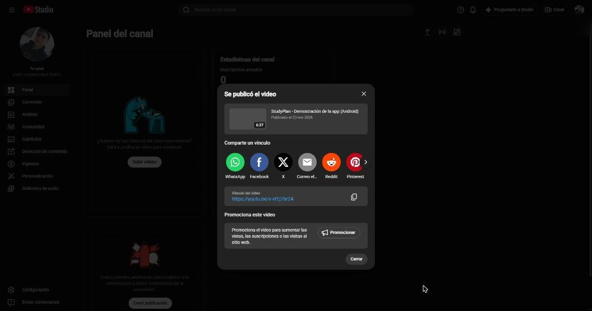

# Publicación en Google Play {#publicacion}

Este capítulo documenta cómo se llevó StudyPlan desde un binario firmado en integración continua hasta una versión en prueba interna de Google Play Console, el 23 de noviembre de 2026. Es un registro de lo realizado y de las decisiones que tomó el Product Owner. No describe una aplicación ya disponible para el público: a la fecha de redacción la versión está en prueba interna, sin verificadores asignados, y el envío de la ficha a revisión de Google no se ha realizado. Cada captura se tomó durante el proceso; en las de la aplicación se ocultaron el nombre y el correo del Product Owner, y en las de la consola se difuminó su foto de perfil.

## Alcance y estado {#pub_estado}

La publicación se organizó en dos pistas con dependencias entre sí. La primera es de código y de automatización (firma, integración continua y empaquetado), y la segunda son los formularios y las consolas de Google, que solo puede completar el titular de la cuenta con la ayuda de la IA y su confirmación en cada paso sensible. La @tabla:estado_publicacion resume el estado de cada paso al cierre de este capítulo.

Tabla: Estado de los pasos de publicación al 23 de noviembre de 2026 {#estado_publicacion anchos=6.5,3,6.5 tam=10}

| Paso | Estado | Evidencia |
|---|---|---|
| Clave de subida y secretos en GitHub | Hecho por el Product Owner | Cuatro secretos presentes en el repositorio (solo se consultaron sus nombres) |
| Release firmado por etiqueta `v0.1.0` | Hecho | Ejecución del flujo `release.yml` con verificación `apksigner` |
| App creada en Play Console | Hecho | @figura:play_crear_app |
| Versión 1000 (0.1.0) en prueba interna | Hecho, sin verificadores | @figura:play_prueba_interna |
| Declaraciones de Contenido de la app | Hecho (11 de 11) | @figura:play_declaraciones_al_dia |
| Ficha de la tienda en español | Guardada | @figura:play_ficha |
| Categoría y contacto de la ficha | Ingresados; falta comprobar que quedaron guardados | Pendiente de verificación en la consola |
| Cliente OAuth de Drive para la firma de Play | Pendiente | Ver @sec:pub_pendientes |
| Envío a revisión y pruebas cerradas | Pendiente | Ver @sec:pub_pendientes |

Nota: Elaboración propia a partir del registro de la sesión de trabajo.

## Firma y artefacto {#pub_firma}

Google Play exige que cada versión se suba firmada con una clave de subida que controla el desarrollador. La clave de StudyPlan la creó el Product Owner en su otra computadora, con `keytool`, y cargó en GitHub los cuatro secretos que usa el flujo de release: el almacén de claves codificado, su contraseña, el alias y la contraseña de la clave. La IA no creó, leyó ni imprimió claves o contraseñas, en cumplimiento de la regla del proyecto que reserva esas credenciales al humano; solo comprobó, con la herramienta de línea de comandos de GitHub, que los cuatro secretos existían.

El primer release, generado el 22 de noviembre sobre un commit anterior a la épica de respaldo, se borró por orden del Product Owner junto con su etiqueta, porque no contenía el respaldo en Google Drive. Se creó de nuevo la etiqueta `v0.1.0` sobre el commit `7477f7e`, que ya incluía la épica. El flujo terminó con éxito en 5 min 17 s, ejecutó las pruebas y el análisis estático, compiló el paquete y el APK firmados, y verificó la firma del APK con `apksigner`. El resultado fue un borrador de GitHub Release con dos archivos: `app-release.aab` (4 960 777 bytes) y `app-release.apk` (4 494 448 bytes). Se descargó el paquete y su suma SHA-256, `22444da95b698d9708c1e2c64ba40e40cab4b930abbc65314726ce344a54d521`, coincidió con la que GitHub registra para el archivo. El código de versión se deriva de la etiqueta: `v0.1.0` produce `versionName` 0.1.0 y `versionCode` 1000.

## Creación de la app en Play Console {#pub_crear}

La cuenta de desarrollador del Product Owner es personal y ya existía. Se creó la app con el nombre StudyPlan, el idioma predeterminado español (Latinoamérica), el tipo «Aplicación» y precio «Gratis», y con el nombre de paquete `io.github.jhoel0521.studyplan`, que no puede cambiarse después. Para crearla fue necesario aceptar dos declaraciones del formulario: el cumplimiento de las políticas del programa para desarrolladores y las leyes de exportación de Estados Unidos. Esta última es una declaración legal y la aplicación usa cifrado AES-256, de modo que el Product Owner la aceptó con conocimiento de ese dato; su contenido exacto conviene revisarlo con la ayuda de Play. La @figura:play_crear_app muestra el formulario completo antes de enviarse.

{#play_crear_app ancho=15}

Nota: Elaboración propia. Captura de pantalla de Google Play Console, tomada por el autor.

## Subida de la versión y prueba interna {#pub_subida}

El paquete firmado se subió a la pista de prueba interna arrastrándolo a la consola. Play lo aceptó sin errores de firma y lo mostró como versión 1000 (0.1.0), para Android 7.0 (nivel de API 24) o superior, con versión de destino 37 y marcado como «Mejorada» (@figura:play_aab_aceptado). Al publicar la versión por primera vez, Play registró la clave de subida del Product Owner. La versión quedó «Disponible para verificadores internos» (@figura:play_prueba_interna), pero la consola advirtió que, al no haber verificadores, nadie puede instalarla todavía.

{#play_aab_aceptado ancho=15}

Nota: Elaboración propia. Captura de pantalla de Google Play Console, tomada por el autor.

{#play_prueba_interna ancho=15}

Nota: Elaboración propia. Captura de pantalla de Google Play Console, tomada por el autor.

## Declaraciones de contenido {#pub_declaraciones}

Antes de poder enviar la ficha a revisión, Play exige completar las declaraciones de la sección Contenido de la app. Se completaron las once que la consola pidió. La @tabla:declaraciones resume cada respuesta y el motivo. Las respuestas las propuso la IA con base en las especificaciones y el código del proyecto, y el Product Owner decidió en las que cambian las políticas aplicables o comprometen una afirmación pública.

Tabla: Declaraciones de Contenido de la app, respuesta y fundamento {#declaraciones anchos=4,3.5,8.5 tam=9}

| Declaración | Respuesta | Fundamento |
|---|---|---|
| Política de privacidad | URL de la página en GitHub Pages | Es la política publicada para el proyecto; falta actualizarla (ver @sec:pub_pendientes) |
| Anuncios | No contiene | El proyecto no incluye redes publicitarias ni SDK de analítica |
| Detalles de acceso | Ninguna parte restringida | El bloqueo con huella o PIN es opcional y viene apagado; la cuenta de Google solo sirve para el respaldo opcional |
| Clasificación del contenido | Todas las edades | Cuestionario IARC: se respondió «No» a contenido descargado, intercambio entre usuarios, contenido en línea, productos con restricción de edad, ubicación, compras, recompensas, navegador y producto de noticias o educativo |
| Público objetivo | Solo mayores de 18 años | Decisión del Product Owner; evita la política de familias |
| Seguridad de los datos | No recopila ni comparte datos | Ver el criterio de la @sec:pub_riesgos |
| ID de publicidad | No lo usa | No hay anuncios ni SDK que lo requieran |
| Apps gubernamentales | No | La app no se desarrolló por encargo de un gobierno |
| Funciones financieras | Ninguna | La app es gratuita y no ofrece servicios financieros |
| Apps de salud | Ninguna función de salud | La app organiza el estudio y no ofrece funciones de salud |
| Servicio en primer plano | Uso «Otro», con descripción y video | Ver @sec:pub_video |

Nota: Elaboración propia a partir de la consola de Google Play.

La declaración de detalles de acceso mereció una explicación aparte porque su lista de casos que obligan a responder «Sí» menciona la autenticación biométrica y los PIN. Se respondió «No» porque quien instala la app, incluido el revisor de Google, llega a todas las pantallas sin ninguna clave, y el bloqueo solo existe si el propio usuario lo activa en Ajustes. Es una interpretación de la pregunta y no una confirmación de Google; si la revisión pidiera credenciales, la respuesta pasaría a «Sí» con una explicación de que el bloqueo es opcional.

{#play_clasificacion ancho=15}

Nota: Elaboración propia. Captura de pantalla de Google Play Console, tomada por el autor.

{#play_seguridad_datos ancho=15}

Nota: Elaboración propia. Captura de pantalla de Google Play Console, tomada por el autor.

{#play_declaraciones_al_dia ancho=15}

Nota: Elaboración propia. Captura de pantalla de Google Play Console, tomada por el autor.

## Ficha de la tienda {#pub_ficha}

La ficha en español contiene el nombre StudyPlan, una descripción breve de 78 caracteres, una descripción larga, el ícono de 512 × 512 píxeles, el gráfico de funciones de 1024 × 500 y cinco capturas de teléfono. El ícono y el gráfico se obtuvieron del logo original del proyecto, redimensionado y compuesto con un script. Play pide declarar si los recursos se crearon o editaron con IA; esa declaración quedó en manos del Product Owner, que guardó la ficha sin etiquetar ningún recurso. Las capturas son de la aplicación real, instalada en un teléfono Android con los datos de estudio del propio Product Owner; para la ficha se les recortó la barra de estado, se les ocultó el nombre y el correo y se ajustó su proporción a 2:1, que es el máximo que Play admite. Se muestran como @figura:app_inicio, @figura:app_calendario, @figura:app_estadisticas, @figura:app_materias y @figura:app_respaldo en el capítulo de diseño.

{#play_ficha ancho=15}

Nota: Elaboración propia. Captura de pantalla de Google Play Console, tomada por el autor.

Cuando la ficha se completó y se guardó, el logo de StudyPlan reemplazó en la consola al ícono genérico de Android. Durante el proceso la IA afirmó, sin comprobarlo, que el logo solo aparecería tras la aprobación de Google. El Product Owner la corrigió al señalar que otra aplicación de su cuenta mostraba su logo antes de enviarse a revisión. El hecho observado fue que el logo aparece al completar y guardar la ficha, y no al aprobarse.

## Video del servicio en primer plano {#pub_video}

La app declara el permiso de servicio en primer plano de uso especial para sostener la notificación de la sesión de estudio en curso (HU-49). Play exige, para ese permiso, una descripción y un video que muestre su uso. Se grabó en un emulador de Android un recorrido de 6 min 36 s con los datos de estudio del Product Owner (con el nombre del perfil cambiado en la copia del emulador): calendario en vistas de día, semana y mes, estadísticas, materias, la creación de una sesión, el inicio de una sesión Pomodoro, el panel de notificaciones con los botones Pausar, Detener y No molestar, la pantalla de bloqueo, el widget de progreso, los reportes, los ajustes, la copia de seguridad y la sección de privacidad. El Product Owner decidió publicarlo en YouTube con visibilidad pública (https://youtu.be/v-vtEj7br2A) y pegó ese enlace junto con la descripción en la declaración de Play.

{#youtube_video ancho=14}

Nota: Elaboración propia. Captura de pantalla de YouTube Studio, tomada por el autor.

En la pantalla de bloqueo, Android muestra la notificación como un icono compacto y no como tarjeta completa cuando hay otras notificaciones; la tarjeta con los botones se ve en el panel de notificaciones desplegado.

## Decisiones, criterios y riesgos {#pub_riesgos}

La @tabla:decisiones reúne las decisiones de la publicación que no eran obvias, quién las tomó y el riesgo que quedó abierto. La que más puede discutirse es la de Seguridad de los datos. La ayuda de Play indica que, si el usuario sube sus datos a su propia cuenta de almacenamiento en la nube, como Google Drive, la carga se rige por las condiciones de ese proveedor y la aplicación nunca recopila esos datos ni accede a ellos, no es necesario declararlos como recopilación (Ayuda de Play Console, s.f.). StudyPlan guarda la copia en la carpeta de datos de la aplicación del Drive del propio usuario (Google for Developers, s.f.), de modo que el desarrollador nunca ve esos datos. La IA presentó las dos opciones y el Product Owner eligió declarar que no se recopilan ni comparten datos. Google puede discrepar de esa interpretación.

Tabla: Decisiones de publicación, responsable y riesgo abierto {#decisiones anchos=5,3,7.5 tam=9}

| Decisión | La tomó | Riesgo abierto |
|---|---|---|
| Usar la clave de subida creada en la otra computadora | Product Owner | Si pierde el archivo de la clave, Play exige un trámite para restablecerla |
| Detalles de acceso: «No» | IA propuso, Product Owner aceptó | Google puede pedir credenciales de prueba |
| Público objetivo: solo mayores de 18 años | Product Owner | Excluye a estudiantes de colegio |
| Seguridad de los datos: no recopila ni comparte | Product Owner | Google puede considerar que la copia en Drive sí es recopilación |
| Mantener `allowBackup` activo en el manifiesto | Product Owner | El respaldo automático de Android también puede copiar datos al Drive del usuario; debe reflejarse en la política de privacidad |
| Publicar el video en YouTube como público | Product Owner | El video muestra datos de estudio de ejemplo y es visible para cualquiera |
| Aceptar la declaración de leyes de exportación | Product Owner | La app usa cifrado AES-256; la declaración es legal y debe revisarse |

Nota: Elaboración propia.

## Pendientes de publicación {#pub_pendientes}

Quedan pasos que dependen de decisiones o de verificaciones del Product Owner, y que la IA no puede resolver sola. La @tabla:pendientes_publicacion los enumera.

Tabla: Pasos pendientes para publicar la aplicación {#pendientes_publicacion anchos=7,8.5 tam=10}

| Paso | Qué falta |
|---|---|
| Categoría y contacto | Comprobar en la consola que la categoría Productividad y el correo de contacto quedaron guardados, porque el navegador dejó de responder durante la verificación |
| Clientes OAuth de Drive | Crear los clientes de Android de la clave de subida y del certificado de firma de Play App Signing; sin ellos, la app instalada desde Play no podría vincular la cuenta de Google |
| Usuarios de prueba | Mientras el proyecto de Google Cloud esté en estado «Prueba», solo los usuarios declarados pueden vincular su cuenta |
| Política de privacidad | Quitar el aviso «en desarrollo» y mencionar la copia opcional en Drive y el respaldo automático de Android |
| Verificadores | Asignarlos en la prueba interna para que alguien pueda instalar la versión |
| Prueba cerrada | Play suele exigirla a las cuentas personales nuevas antes de producción; hay que comprobar el requisito vigente |
| Condición de comerciante | Declararla en la cuenta de desarrollador antes de febrero de 2027 |
| Ficha en inglés | Traducir la ficha (opcional) |
| Envío a revisión | Enviar los cambios de la ficha cuando la consola habilite el botón |

Nota: Elaboración propia.
