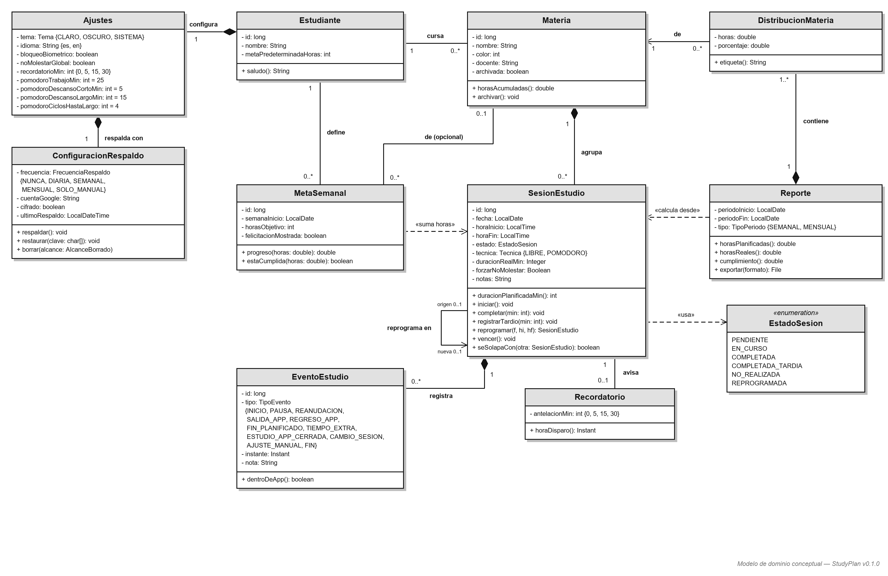

# Anexos {.sin-numero}

## Anexo A: Modelo de Dominio

Este anexo adelanta el modelo de dominio (diagrama de clases conceptual), un producto de la consigna *Modelado de requerimientos*. Su análisis detallado corresponde a la sección 3.3.3 de la siguiente entrega. El prototipo de baja fidelidad, que antes estaba aquí, está en la sección «Wireframes y Mockups» del capítulo 4.

{#figura3}

Nota: Reporte y DistribucionMateria son conceptos calculados a partir de las sesiones y no se almacenan. Una MetaSemanal sin materia es la meta total. Elaboración propia.

Las clases principales son: **Estudiante**, el único usuario local, con sus **Ajustes** (tema, idioma, bloqueo, No molestar y Pomodoro) y su **ConfiguracionRespaldo**; **Materia**, que agrupa por composición las **SesionEstudio**, cada una con fecha, horario, técnica, un **EstadoSesion** gobernado por la máquina de estados (@figura:figura2) y un **Recordatorio** opcional. La autoasociación *reprograma en* enlaza una sesión reprogramada con la nueva. **MetaSemanal** representa la meta total (sin materia) o una meta por materia, y su progreso se calcula sumando las horas de las sesiones completadas. **Reporte** contiene una **DistribucionMateria** por cada materia del periodo.

## Anexo B: Matriz de Trazabilidad

Tabla: Trazabilidad entre historias de usuario, especificaciones, prototipo y criterios de calidad {#tabla27}

| HU | Spec (capacidad) | Esc. | Wireframe | Reglas | RNF de la épica |
|---|---|---|---|---|---|
| HU-01 | perfil-ajustes | 2 | W1 | No aplica | RNF-01, RNF-07, RNF-08, RNF-12 |
| HU-02 | perfil-ajustes | 2 | W1 | No aplica | RNF-01, RNF-07, RNF-08, RNF-12 |
| HU-03 | perfil-ajustes | 2 | W10 | No aplica | RNF-01, RNF-07, RNF-08, RNF-12 |
| HU-04 | perfil-ajustes | 2 | W10 | No aplica | RNF-01, RNF-07, RNF-08, RNF-12 |
| HU-05 | perfil-ajustes | 2 | No aplica | No aplica | RNF-01, RNF-07, RNF-08, RNF-12 |
| HU-06 | gestion-materias | 2 | W2 | RN-02 | RNF-06, RNF-14 |
| HU-07 | gestion-materias | 1 | W2 | No aplica | RNF-06, RNF-14 |
| HU-08 | gestion-materias | 3 | W2 | RN-03 | RNF-06, RNF-14 |
| HU-09 | gestion-materias | 2 | W2 | No aplica | RNF-06, RNF-14 |
| HU-46 | gestion-materias | 2 | W2 | RN-02 | RNF-06, RNF-14 |
| HU-10 | sesiones-estudio | 3 | W3 | RN-04, RN-05 | RNF-02, RNF-04, RNF-14, RNF-15 |
| HU-11 | sesiones-estudio | 2 | W3 | RN-06 | RNF-02, RNF-04, RNF-14, RNF-15 |
| HU-12 | sesiones-estudio | 2 | W4 a W6 | RN-07 | RNF-02, RNF-04, RNF-14, RNF-15 |
| HU-13 | sesiones-estudio | 3 | W4 a W6 | RN-08, RN-10 | RNF-02, RNF-04, RNF-14, RNF-15 |
| HU-14 | sesiones-estudio | 3 | W4 a W6 | RN-05, RN-09 | RNF-02, RNF-04, RNF-14, RNF-15 |
| HU-15 | sesiones-estudio | 2 | W4 a W6 | RN-12 | RNF-02, RNF-04, RNF-14, RNF-15 |
| HU-16 | calendario-estudio | 3 | W4 | No aplica | RNF-02, RNF-04, RNF-06, RNF-19 |
| HU-17 | calendario-estudio | 2 | W5 | No aplica | RNF-02, RNF-04, RNF-06, RNF-19 |
| HU-18 | calendario-estudio | 1 | W6 | No aplica | RNF-02, RNF-04, RNF-06, RNF-19 |
| HU-19 | calendario-estudio | 2 | W4 a W6 | No aplica | RNF-02, RNF-04, RNF-06, RNF-19 |
| HU-20 | calendario-estudio | 2 | W5, W6 | No aplica | RNF-02, RNF-04, RNF-06, RNF-19 |
| HU-21 | calendario-estudio | 2 | W4 a W6 | No aplica | RNF-02, RNF-04, RNF-06, RNF-19 |
| HU-22 | tecnicas-estudio | 3 | W7 | RN-22, RN-26 | RNF-03, RNF-10, RNF-18 |
| HU-23 | tecnicas-estudio | 4 | W7, W10 | RN-11, RN-17, RN-25 | RNF-03, RNF-10, RNF-18 |
| HU-24 | tecnicas-estudio | 3 | W7, W10 | RN-18 | RNF-03, RNF-10, RNF-18 |
| HU-39 | tecnicas-estudio | 2 | W15 | RN-22 | RNF-03, RNF-10, RNF-18 |
| HU-40 | tecnicas-estudio | 2 | W13 | RN-23 | RNF-03, RNF-10, RNF-18 |
| HU-41 | tecnicas-estudio | 4 | W13 | RN-24, RN-29 | RNF-03, RNF-10, RNF-18 |
| HU-42 | tecnicas-estudio | 2 | W14 | RN-25 | RNF-03, RNF-10, RNF-18 |
| HU-43 | tecnicas-estudio | 2 | W14 | RN-27 | RNF-03, RNF-10, RNF-18 |
| HU-44 | tecnicas-estudio | 2 | W14 | RN-28 | RNF-03, RNF-10, RNF-18 |
| HU-25 | metas-semanales | 3 | W1 | RN-14, RN-15 | RNF-05, RNF-15 |
| HU-26 | metas-semanales | 2 | W2 | RN-14 | RNF-05, RNF-15 |
| HU-27 | metas-semanales | 2 | W1, W8 | RN-11 | RNF-05, RNF-15 |
| HU-28 | metas-semanales | 2 | No aplica | RN-16 | RNF-05, RNF-15 |
| HU-29 | estadisticas | 2 | W8 | No aplica | RNF-02, RNF-06 |
| HU-30 | estadisticas | 2 | W8 | No aplica | RNF-02, RNF-06 |
| HU-31 | estadisticas | 1 | W8 | No aplica | RNF-02, RNF-06 |
| HU-45 | estadisticas | 2 | W15 | RN-30 | RNF-02, RNF-06 |
| HU-32 | reportes | 2 | W9 | No aplica | RNF-11, RNF-15 |
| HU-33 | reportes | 2 | W9 | No aplica | RNF-11, RNF-15 |
| HU-34 | recordatorios | 3 | W3, W10 | No aplica | RNF-03, RNF-18 |
| HU-35 | respaldo-privacidad | 3 | W11 | RN-19 | RNF-10, RNF-11, RNF-12, RNF-13 |
| HU-36 | respaldo-privacidad | 2 | W11 | RN-20 | RNF-10, RNF-11, RNF-12, RNF-13 |
| HU-37 | respaldo-privacidad | 2 | W11 | No aplica | RNF-10, RNF-11, RNF-12, RNF-13 |
| HU-38 | respaldo-privacidad | 2 | W12 | RN-21 | RNF-10, RNF-11, RNF-12, RNF-13 |

Nota: Total: 46 historias y 103 escenarios, más 13 escenarios de la máquina de estados (RN-07). Las columnas de código y prueba se agregarán en cada sprint de implementación.

## Anexo C: Glosario de Términos

Tabla: Glosario de términos {#tabla28}

| Término | Definición |
|---|---|
| Change (OpenSpec) | Propuesta de cambio con proposal, specs delta, design y tasks, que se aprueba antes de implementarse. |
| Criterio de aceptación | Condición verificable, escrita como Dado / Cuando / Entonces, que una historia debe cumplir para considerarse terminada. |
| DAO | Data Access Object: interfaz de Room que define las consultas a la base de datos. |
| Definition of Done | Lista acordada de condiciones que todo incremento debe cumplir para considerarse terminado. |
| Épica | Agrupación de historias de usuario relacionadas con un mismo objetivo funcional. |
| Estudio con la app cerrada | Tramo de estudio que el estudiante declara al volver a la app, después de haber salido de ella con una sesión en curso. |
| Evento de estudio | Registro con marca de tiempo de algo que ocurre en una sesión: inicio, pausa, salida o regreso a la app, fin planificado, tiempo extra, cambio de sesión o fin. |
| Historia de usuario | Descripción breve de una funcionalidad desde la perspectiva del usuario: «Como… quiero… para…». |
| Máquina de estados | Modelo que define los estados de un objeto y los eventos que provocan transiciones entre ellos. |
| MoSCoW | Técnica de priorización: Must (debe), Should (debería), Could (podría), Won't (no se hará ahora). |
| MVVM | Modelo-Vista-Modelo de Vista: patrón que separa la interfaz de la lógica de presentación y de los datos. |
| Offline-first | Diseño en el que la aplicación funciona por completo sin conexión y solo usa la red para funciones opcionales. |
| Patrón State | Patrón de diseño en el que cada estado es una clase que conoce sus acciones y su estado siguiente. |
| Pomodoro | Técnica de estudio en bloques de concentración (25 min) separados por descansos cortos y largos. |
| Registro tardío | Registro de una sesión ya estudiada, hasta 3 días después de su fecha, en estado «Completada (registro tardío)». |
| Regla de negocio | Restricción del dominio que el sistema debe cumplir en todas sus funciones (RN-xx). |
| Room | Biblioteca de Android Jetpack que abstrae SQLite y valida las consultas en compilación. |
| SDD | Spec-Driven Development: desarrollo en el que la especificación aprobada precede y guía al código. |
| Tiempo extra | Tiempo estudiado después de la hora de fin planificada de una sesión. |
| Spec | Especificación de comportamiento de una capacidad del sistema, con Requirements y Scenarios. |
| Sprint | Iteración de duración fija (una semana en este proyecto) que produce un incremento usable. |
| Wireframe | Prototipo de baja fidelidad que muestra la estructura de una pantalla sin diseño visual final. |
